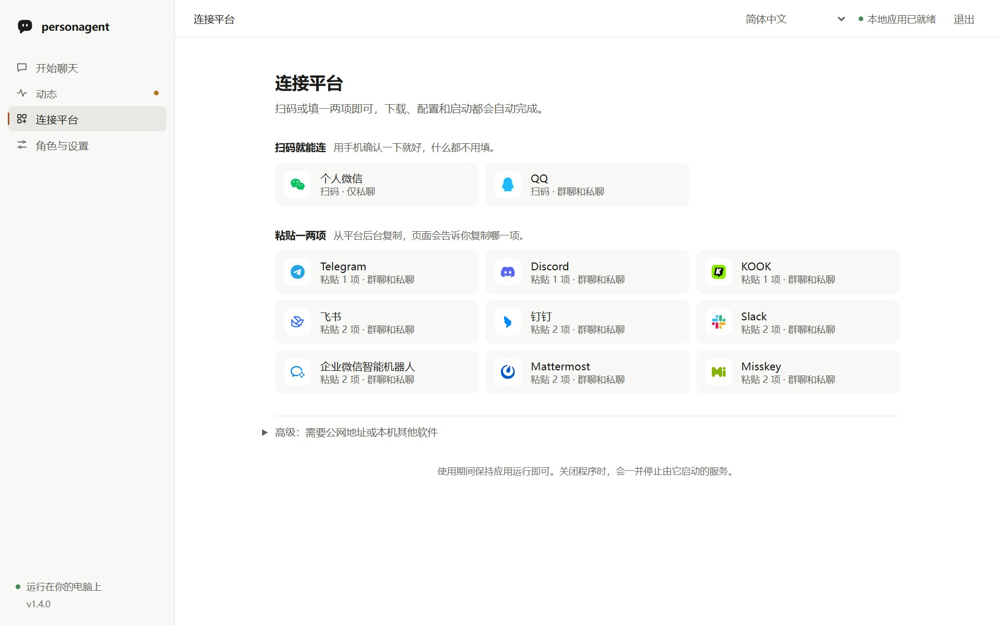

<p align="center">
  
</p>

<h3 align="center">一个知道什么时候该安静、能从别人的纠正里学习的群聊角色。</h3>

<p align="center">
  <a href="https://pypi.org/project/personagent/"></a>
  <a href="https://github.com/wangkant/personagent/actions/workflows/ci.yml"></a>
  <a href="https://www.python.org/downloads/"></a>
  <a href="https://github.com/wangkant/personagent/blob/main/LICENSE"></a>
</p>

<p align="center"><a href="https://github.com/wangkant/personagent/blob/main/README.md">English</a> · <strong>简体中文</strong> · <a href="https://github.com/wangkant/personagent/blob/main/docs/readme/README.zh-TW.md">繁體中文</a> · <a href="https://github.com/wangkant/personagent/blob/main/docs/readme/README.ja.md">日本語</a> · <a href="https://github.com/wangkant/personagent/blob/main/docs/readme/README.ko.md">한국어</a> · <a href="https://github.com/wangkant/personagent/blob/main/docs/readme/README.es.md">Español</a> · <a href="https://github.com/wangkant/personagent/blob/main/docs/readme/README.fr.md">Français</a> · <a href="https://github.com/wangkant/personagent/blob/main/docs/readme/README.de.md">Deutsch</a> · <a href="https://github.com/wangkant/personagent/blob/main/docs/readme/README.pt-BR.md">Português</a> · <a href="https://github.com/wangkant/personagent/blob/main/docs/readme/README.ru.md">Русский</a></p>

personagent 是放进群聊里的一个角色：选一个现成的或自己写一个，接上任意 OpenAI 兼容的模型就能用。先在自己电脑上和它聊，再从同一个本地页面把它带进 QQ、微信、Telegram、Discord 和另外十几个平台。

<p align="center">
  
</p>

<p align="center"><em>「连接平台」和设置、角色聊天在同一个本地页面里。</em></p>

## 为什么用它

<table>
<tr>
<td width="220" valign="top"><strong>知道什么时候该安静</strong></td>
<td valign="top">
叫它就回。没人叫时，由一个模型判断真人这时会不会接话。<br>
有人连着刷屏，它只回一条。
</td>
</tr>
<tr>
<td width="220" valign="top"><strong>只从站得住的纠正里学</strong></td>
<td valign="top">
纠正教会的事（比如群里管健身房叫什么）会带进这个聊天之后的每一句回复。<br>
捣乱的人、旁观者都教不坏它。<br>
每一处改动都有记录，哪一处都能撤回。
</td>
</tr>
<tr>
<td width="220" valign="top"><strong>上手快，你的群在哪它就去哪</strong></td>
<td valign="top">
一条命令就在电脑上打开它，页面有中文、英文和另外八种语言。<br>
填一个模型 Key 就能聊，再用手机扫一次码或粘贴一两项，就能接入一个平台。
</td>
</tr>
<tr>
<td width="220" valign="top"><strong>现成角色可以挑，也能自己写</strong></td>
<td valign="top">
七个现成性格。其中三个是社区里早就有人画的角色：DeepSeek 鲸鱼娘、GPT 娘（白龙）和 Claude 娘，立绘会眨眼、会想、会开口说话。<br>
人设随时可以改写，角色学到的东西会留着。
</td>
</tr>
</table>

每个聊天有自己的记忆，让它忘它就忘：`小夏，记住 阿杰不吃辣`、`小夏 忘掉 不吃辣`（[记忆命令](https://github.com/wangkant/personagent/blob/main/docs/guide.zh-CN.md#教它)）。

## 从这里开始

```sh
python -m pip install personagent
personagent
```

装了 [uv](https://docs.astral.sh/uv/) 的话，`uvx personagent` 不用单独安装就能运行。Windows 也可以下载源码 ZIP，双击 `start.bat`。

在 Windows 上它会开一个独立的窗口，在 macOS 和 Linux 上在浏览器里打开。填入模型 API Key，点「验证并开始聊天」。还没有 Key？默认选中的是 OpenRouter 的免费模型，它的 Key 不花钱。`personagent demo` 不用 Key，会播放三段写好的场景。[简明入门](https://github.com/wangkant/personagent/blob/main/docs/start.zh-CN.md)把页面一屏一屏讲了一遍。

personagent 本身免费。钱付给你选的模型服务，按它自己的价格算。OpenRouter 的免费模型每天可以请求 50 次，有些免费服务商会保留收到的内容；Ollama 在你自己的电脑上跑模型，不需要 Key。

## 接进你的群

在本地页面打开「连接平台」：

| 页面分组 | 平台 | 要准备什么 |
|---|---|---|
| 扫码就能连 | QQ、个人微信 | 手机。微信机器人只能一对一聊天 |
| 粘贴一两项 | Telegram、Discord、KOOK、飞书、钉钉、Slack、企业微信智能机器人、Mattermost、Misskey | 从平台后台复制，页面会说复制哪一项 |
| 高级 | 企业微信应用、微信公众号、QQ（Webhook）、OneBot v11（NapCat）、Satori | 公网地址，或本机的其他软件 |

连好的平台以后每次启动 personagent 都会自动连上。扫码连接的平台、Telegram 和 Discord 由 personagent 自己连接；其余平台经它在后台下载并运行的 [AstrBot](https://github.com/AstrBotDevs/AstrBot) 接入。在服务器上，`personagent up` 不开浏览器就能全部启动。各平台的设置方法见[使用手册](https://github.com/wangkant/personagent/blob/main/docs/guide.zh-CN.md#接进聊天平台)；从零接 QQ 见[部署教程](https://github.com/wangkant/personagent/blob/main/docs/deploy.zh-CN.md)。

已经在跑 AstrBot、Koishi 或 Matrix？personagent 可以接在它后面，只当那个角色：见[你自己运行的桥接](https://github.com/wangkant/personagent/blob/main/docs/guide.zh-CN.md#你自己运行的桥接)、[Satori 连接器](https://github.com/wangkant/personagent/blob/main/integrations/satori/README.zh-CN.md)和 [Matrix 连接器](https://github.com/wangkant/personagent/blob/main/integrations/matrix/README.zh-CN.md)。

## 编程助手

**让编程助手帮你装。** 把下面这句话发给能在你电脑上运行命令的 AI 编程助手。模型 Key 由你自己填进本地页面，不经过助手。

```text
读 https://raw.githubusercontent.com/wangkant/personagent/main/docs/setup-for-agents.md ，然后帮我把 personagent 装好并设置好
```

**写代码时和角色说话。** Claude Code、Codex 和 DeepSeek Harness（`dsh`）都能找到你的角色，聊天和记忆与本地页面是同一份：

```bash
personagent connect claude-code
personagent connect codex
personagent connect dsh
```

`--remove` 会把它撤掉。权限，以及让角色在一轮结束时说一句话的 `--react`，见[手册](https://github.com/wangkant/personagent/blob/main/docs/guide.zh-CN.md#编程助手)。

## 更新和卸载

PyPI 上有新版本时，页面会显示一条提示和对应的更新命令。用 pip 装的话是 `python -m pip install -U personagent`。设置、角色、它学到的东西和连好的平台都会保留。要卸载，照[卸载步骤](https://github.com/wangkant/personagent/blob/main/docs/setup-for-agents.md#undoing-it)（英文）做。

## 隐私

personagent 存的一切都在你自己机器上的一个主目录里。你选的模型服务商会看到它回复的对话；personagent 每天向 pypi.org 查一次有没有新版本（`UPDATE_CHECK_ENABLED=false` 可以关掉）。接入真人之前，请告诉他们这是机器人，并征得他们同意；哪些内容会发到哪里，[手册](https://github.com/wangkant/personagent/blob/main/docs/guide.zh-CN.md#隐私与知情同意)里都列着。

## 文档

- [使用手册](https://github.com/wangkant/personagent/blob/main/docs/guide.zh-CN.md)：设置、连接器、教它、「动态」页、排错。
- [部署指南](https://github.com/wangkant/personagent/blob/main/docs/deploy.zh-CN.md)：真正跑起来要知道的事、费用，以及机器人不说话时查什么。
- [连接器协议](https://github.com/wangkant/personagent/blob/main/docs/connectors.zh-CN.md)：给自己写连接器的人看。
- [工具脚本](https://github.com/wangkant/personagent/blob/main/docs/tools.zh-CN.md)：`tools/` 里的脚本，从克隆的源码运行时用。
- [更新日志](https://github.com/wangkant/personagent/blob/main/CHANGELOG.md)（英文） · [贡献指南](https://github.com/wangkant/personagent/blob/main/.github/CONTRIBUTING.md)（英文） · [安全策略](https://github.com/wangkant/personagent/blob/main/.github/SECURITY.md)（英文） · [免责声明](https://github.com/wangkant/personagent/blob/main/docs/DISCLAIMER.zh-CN.md)

## 许可证

personagent 以 [PolyForm Noncommercial License 1.0.0](https://github.com/wangkant/personagent/blob/main/LICENSE) 发布，© 2026 Qiankang (Kant) Wang：可免费用于非商业目的的使用、修改和分享，不得用于商业目的。`integrations/` 下的连接器仍采用 MIT 许可，1.4.0 及更早的版本亦然。三张角色立绘采用 CC BY-NC-SA 4.0 许可，署名见 [persona_agent/static/characters/LICENSE.md](https://github.com/wangkant/personagent/blob/main/persona_agent/static/characters/LICENSE.md)。

## 致谢

- 其他聊天平台的接入靠 [AstrBot](https://github.com/AstrBotDevs/AstrBot)、[NapCat](https://github.com/NapNeko/NapCatQQ)、[Koishi](https://koishi.chat) 与 [satori-python](https://github.com/RF-Tar-Railt/satori-python)、[matrix-nio](https://github.com/matrix-nio/matrix-nio) 与 [mautrix 桥接](https://docs.mau.fi/bridges/)；微信连接依据腾讯的 [openclaw-weixin 协议说明](https://github.com/Tencent/openclaw-weixin/blob/main/docs/protocol.md)。
- 从反应中学习借鉴了 [Self-Feeding Chatbot](https://arxiv.org/abs/1901.05415)、[Alexa self-learning](https://arxiv.org/abs/1911.02557) 和 [BlenderBot 3x](https://arxiv.org/abs/2306.04707)；世界书参考了 [SillyTavern](https://github.com/SillyTavern/SillyTavern) 的 World Info。
