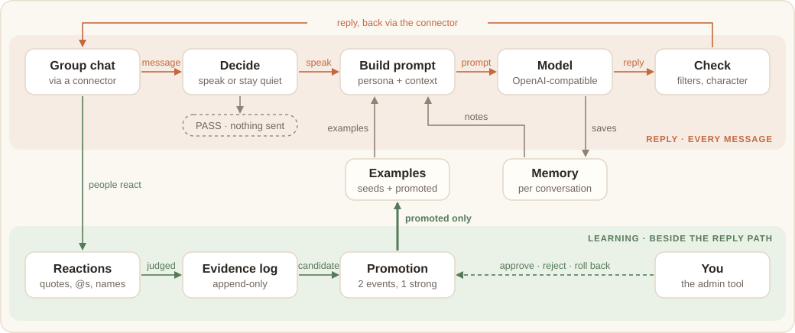

# personagent ユーザーガイド

[English](guide.md) · [简体中文](guide.zh-CN.md) · [繁體中文](guide.zh-TW.md) · 日本語 · [한국어](guide.ko.md) · [Español](guide.es.md) · [Français](guide.fr.md) · [Deutsch](guide.de.md) · [Português (Brasil)](guide.pt-BR.md) · [Русский](guide.ru.md)

このガイドでは、personagent のセットアップ、チャットへの参加、教え方、日々の管理を説明します。[README](readme/README.ja.md) は短い紹介で、[はじめに](start.ja.md) はローカルページを画面ごとに案内します。

1. [インストールと personagent フォルダー](#インストールと-personagent-フォルダー)
2. [ローカルページ](#ローカルページ)：[詳細設定](#詳細設定) · [アプリビュー](#アプリビュー)
3. [まず見てみる：デモ](#まず見てみるデモ)
4. [ターミナルコマンド](#ターミナルコマンド)：[セットアップ](#ターミナルでセットアップする) · [プラットフォームとの連携](#ターミナルでプラットフォームと連携する) · [チャット](#ターミナルでチャットする) · [サービスの実行](#サービスを実行する)
5. [自分のキャラクターにする](#自分のキャラクターにする)
6. [チャットに入れる](#チャットに入れる)：[新しいチャットの承認](#返信する相手新しいチャットの承認) · [personagent が直接連携するプラットフォーム](#personagent-が直接連携するプラットフォーム) · [その他のプラットフォーム](#その他のプラットフォーム管理下の-astrbot-経由) · [自分で動かすブリッジ](#自分で動かすブリッジ) · [自分から話しかける](#自分から話しかける)
7. [ツール](#ツール)
8. [コーディングアシスタント](#コーディングアシスタント)
9. [その他のソフトウェア](#その他のソフトウェア)
10. [教える](#教える)
11. [記憶](#記憶)
12. [アクティビティ](#アクティビティ)
13. [測定する](#測定する)
14. [仕組み](#仕組み)
15. [プライバシーと同意](#プライバシーと同意)
16. [トラブルシューティング](#トラブルシューティング)
17. [0.x からのアップグレード](#0x-からのアップグレード)
18. [現状とその他の文書](#現状とその他の文書)

## インストールと personagent フォルダー

```sh
python -m pip install personagent
personagent
```

`personagent` は[ローカルページ](#ローカルページ)を開きます。次の方法でもインストールや実行ができます。

| 方法 | コマンド |
|---|---|
| インストールせずに実行 | `uvx personagent`（[uv](https://docs.astral.sh/uv/) の機能で、Python も自動的に取得します） |
| 常設の `personagent` コマンド | `uv tool install personagent` または `pipx install personagent` |
| Windows、ソース ZIP から | 展開して `start.bat` をダブルクリック |
| クローンから | `git clone https://github.com/wangkant/personagent.git`、`cd personagent`、`python -m venv .venv`、続けて `.venv/bin/python -m pip install -e .` と `.venv/bin/python -m persona_agent`（Windows では `.venv\Scripts\python.exe`） |

personagent は Python 3.10–3.14 で動きます。`start.bat` は `.venv` を作り、依存パッケージをインストールして同じページを開きます。初回は、デスクトップとスタートメニューに personagent のアイコンも置きます。`pyproject.toml` の依存リストが変わると、そのたびに再インストールします。

**personagent フォルダー**には、設定（`.env`）、キャラクター（`persona.txt`）、学習内容（`runtime/`）、チャットプラットフォーム（`platforms/`）が入ります。`platforms/` には管理下の AstrBot と、personagent が直接連携するプラットフォームの認証情報を保存する `direct.json` があります。personagent は次のうち最初に当てはまるフォルダーを使います。

1. `--home DIR` または `AGENT_HOME` で指定したフォルダー。`--home` は `personagent chat --home D:\bot` のように、コマンドの前後どちらにも置けます。
2. クローンから実行している場合はそのクローン。
3. `.env` と `persona.txt` の両方があれば現在のフォルダー。
4. 初回セットアップで作られる `~/personagent`。

1 つのインストールで複数のキャラクターを動かすには、それぞれに別のホームを与えてください。

このガイドではコマンドを `personagent ...` と書きます。インストールしていない場合は前に `uvx` を付けてください。クローンでは `.venv/bin/python -m persona_agent ...` が同じ働きをします（Windows では `.venv\Scripts\python.exe -m persona_agent ...`）。

## ローカルページ

`personagent`（または `personagent start`）は、このコンピューターからだけ開けるページを提供します。Windows では専用のウィンドウで開きます。macOS と Linux ではブラウザーで開きますが、`pip install "personagent[app]"` で [pywebview](https://pywebview.flowrl.com/) を入れればウィンドウでも開けます（Linux では Qt も一緒に入ります）。ページには 6 つのビューがあり、サイドバーに次の順で並びます。

- **チャット** はページ上でキャラクターと 1 対 1 で話すチャットです。チャットプラットフォームに応答しているのと同じエージェントが答えます。このチャットでは、あなたが管理者です。キャラクターが送ったスタンプや画像はチャットに表示され、保存されなくなった画像の位置には短い説明が表示されます。キャラクターが返信の後に送るメッセージ（返信中に送った記憶コマンドへの回答、キャラクターが自分から話しかけるメッセージなど）は、チャットビューを開いている間、数秒以内に表示されます。どちらもチャットの履歴に残ります。モデルが応答しない場合は、返信の代わりにその旨がページに表示され、**再送信** を選択できます。入力欄の下の **記憶コマンド** は[記憶コマンド](#記憶コマンド)を一覧にし、選んだコマンドを入力欄に挿入します。**このページのチャットの記憶を削除** は、キャラクターがこのチャットと、このページの以前のチャットについて記憶しているすべての内容を削除し、新しいチャットを始めます。連携したアプリのチャットについての記憶は保持され、この削除は元に戻せません。この機能には[アクティビティ](#アクティビティ)の裏にあるデータが必要です。**新しいチャット** は、キャラクターの記憶を保ったまま新しいチャットを始めます。
- **アクティビティ** はキャラクターがいるチャット、最近の発言、記憶している内容、学んだことを表示します。[アクティビティ](#アクティビティ)を参照してください。
- **プラットフォーム連携** はキャラクターを QQ、WeChat、Telegram、Discord などのプラットフォームに入れます。[チャットに入れる](#チャットに入れる)を参照してください。最下部の **コーディングアシスタント** では、キャラクターをこのコンピューター上の[コーディングアシスタント](#コーディングアシスタント)と連携できます。
- **キャラクターと設定** では、モデルサービス（OpenRouter、DeepSeek、SiliconFlow、Alibaba Bailian、Zhipu GLM、Moonshot、Volcengine Ark、OpenAI、Google Gemini、Ollama、その他の OpenAI 互換サービス）を選び、API キーを貼り付け、名前と既成のキャラクターを選びます。**確認してチャットを開始** は小さなリクエスト 1 回でキーを試し、成功した場合だけ保存します。OpenRouter を選んでいる場合は、代わりに **OpenRouter でサインイン** でキーを取得できます。ブラウザーに OpenRouter の承認画面が表示され、OpenRouter はブラウザーをこのコンピューター上のページ自身のアドレス（`http://localhost:<port>/signin/openrouter`）に戻します。personagent は一度限りのコードをキーと交換し、同じ方法で試して、フォームの他の内容と一緒に保存します。キーがページ自体を通ることはありません。キーが使えるようになると、モデル名の欄にはそのサービスが提供するモデルが表示されます（保存済みのキーで `<API アドレス>/models` から読み込み、5 分間保持します）。一覧を提供しないサービスでは、欄はそのままです。セットアップ後は **ペルソナ** 欄に `persona.txt` が表示されます。**ペルソナを保存** は新しい文章でエージェントを再起動し、学んだことは保ちます。**その他の機能** では Tavily によるウェブ検索（無料の既定は DuckDuckGo）、画像の理解、選んだプラットフォームで自分から発言する機能をオンにできます。その下の **ツール** では [MCP サーバーのツール](#ツール)を追加できます。その下に[詳細設定](#詳細設定)が続きます。
- **練習** は台本どおりのデモを再生し、練習用のグループチャットを実行します。[まず見てみる：デモ](#まず見てみるデモ)を参照してください。
- **アプリ** はキャラクターが依存するサービスを確認し、ログ、バックグラウンド実行、更新、データを扱います。[アプリビュー](#アプリビュー)を参照してください。

**練習** と **アプリ** は、モデルを設定する前でも開けます。プラットフォームを連携するまで、チャットビューには短い **はじめに** バーが表示されます。

`personagent` をもう一度実行すると、すでに開いているページが前面に戻ります。`--browser` はウィンドウの代わりにブラウザーでページを開き、`--no-browser` はリンクを出力するだけで何も開きません。Windows では、`personagent shortcut` がデスクトップとスタートメニューにアイコンを置きます。そのアイコンからはターミナルなしでウィンドウが開きます。`personagent shortcut --remove` でアイコンを削除できます。アプリビューからも同じ操作ができます。

PyPI に新しい personagent があると、チャットビューに、pip、uvx、uv tool、pipx、Git クローンのどれで入れたかに応じた更新コマンドの通知が表示されます。展開したソース ZIP の場合、通知はリリースページへのリンクになります。ターミナルにも同じコマンドが出力されます。通知を閉じるとそのバージョンでは非表示になり、バージョン番号の下の **N が利用可能** で再表示できます。`personagent up` と `personagent doctor` も新しいバージョンを報告します。ページと `up` は多くても 1 日 1 回、バックグラウンドで pypi.org に尋ねます。`doctor` は前回の回答から 1 日を超えていればすぐに尋ねます。確認をオフにするには `UPDATE_CHECK_ENABLED=false` を設定してください。アプリビューから更新をインストールすることもできます。[バージョンと更新](#バージョンと更新)を参照してください。

ページはエージェントと連携中のプラットフォームをバックグラウンドで起動するので、使っている間はウィンドウを開いたままにしてください。**終了** をクリックしても、Ctrl+C を押しても、ウィンドウを閉じても、起動したものはすべて一緒に止まります。プラットフォームを連携している間は、ウィンドウを閉じる前に確認が表示されます。Windows では、ウィンドウを閉じても personagent が動き続けるように設定することもできます。[バックグラウンドで実行](#バックグラウンドで実行)を参照してください。以前の実行がクラッシュしてプロセスが残っていれば、次の起動時に先に止めます。

### 詳細設定

モデルを設定すると、**キャラクターと設定** の末尾に **詳細設定** が表示されます。これまで `.env` でしか変更できなかった設定を、6 つのセクションにまとめています。どの設定も任意で既定値があり、空欄の場合は既定値が使われます。

| セクション | 設定 |
|---|---|
| **返信、管理者とアクセス** | **メッセージに返信**（`AGENT_ENABLED`）、**返信を停止するグループ**（`ACCESS_PAUSED_GROUPS`）、キャラクターがあなたを呼ぶ名前と、あなたとキャラクターの関係（`ADMIN_NAME`、`ADMIN_RELATIONSHIP`）、**あなたのアカウント**（`ADMIN_IDS`）、**返信するグループを限定**（`ACCESS_GROUPS`）、**DM を許可する他のユーザー**（`ACCESS_DM_USERS`）、**新しいチャットに承認が必要なプラットフォーム**（`ACCESS_APPROVAL_PLATFORMS`）。**最近のチャットから選択** はアクティビティに表示される人とグループを一覧にするので、ID を入力せずに追加できます。 |
| **発言と返信のスタイル** | **タイムゾーン**（`PERSONA_TZ_OFFSET_HOURS`）、**グループでは呼びかけられたときのみ返信**（`CHAT_ONLY_WHEN_CALLED`）、**会話に加わるまでのメッセージ数**（`CHAT_TRIGGER_COUNT`）、7 つの `PROACTIVE_*` のタイミングをまとめて設定する **自分から話しかける頻度**、**返信のスタイル**（絵文字、3 組の記号、返信の最大長。`persona.card.json` に書き込まれます）。 |
| **モデル** | 専用のサービスアドレスとキーを持つ予備モデル（`LLM_FALLBACK_MODEL`、`LLM_FALLBACK_BASE_URL`、`LLM_FALLBACK_API_KEY`）、短い判断に使うモデル（`LLM_JUDGE_MODEL`）、DM 用のモデル（`LLM_DM_MODEL`）。予備モデルは保存前にテストされます。 |
| **学習** | `REACT_LEARN_ENABLED`、`REACT_LEARN_ADMIN_ONLY`、`REACT_ELICIT_ENABLED`、`PROMOTE_AUTO_ENABLED`、`PROMOTE_MIN_SPEAKERS`（1 または 2）、`PROMOTE_JUDGE_ENABLED`（反応では決まらない項目をキャラクター自身が判断します）、`PROMOTE_OBSERVE_MAX_DAYS`（観察中の項目が、新しい反応のないまま除外されるまでの日数）。**学習をやり直す** は新しい `PERSONA_VERSION` を書き込み、それまでに学習した内容が使われないようにします。削除されるものはありません。 |
| **記憶** | `MEMORY_CALLS_PER_DAY`、`MEMORY_TIDY_EVERY`、`CHAT_CONTEXT_MESSAGES`、`MEMORY_PROMPT_CHARS`、`MEMORY_EPISODES_MAX`、`MEMORY_KEEP_RECENT`、`MEMORY_LOG_DAYS`。[記憶](#記憶)を参照してください。 |
| **その他の設定** | `DASHBOARD_ENABLED`、`UPDATE_CHECK_ENABLED`、7 つの `PROACTIVE_*` のタイミング、`CHAT_FOLLOWUP_WINDOW_S`、`REACT_*` と `PROMOTE_*` の上限、`REACT_MODEL`、キャラクター自身の判断に使うモデル、間隔、1 回あたりの件数（`PROMOTE_JUDGE_MODEL`、`PROMOTE_JUDGE_INTERVAL_S`、`PROMOTE_JUDGE_BATCH`）、`PERSONA_VERSION`。 |

**詳細設定を保存** は変更された設定だけを書き込み、`.env` のほかの部分はそのまま残します。その後キャラクターを再起動します。ただし、変更が `UPDATE_CHECK_ENABLED` だけの場合は再起動しません。返信をオフにする（`AGENT_ENABLED`）場合は、事前に確認があります。**キャラクター名** でキャラクターの名前を変更する場合も同様です。新しい名前は新しいキャラクターとして扱われるためです。**あなたのアカウント**、**返信するグループを限定**、**返信を停止するグループ**、**DM を許可する他のユーザー** に、どのアカウントも指さない項目があると、**詳細設定を保存** はそれを受け付けません。接頭辞のない項目は QQ 番号でなければならず、コロンの前はプラットフォーム名でなければなりません（例：`telegram:-1001234567890`）。

### アプリビュー

**アプリ** には、対応が必要な事項があると赤い点が表示されます。対象は、サービスの起動失敗、旧名称の設定や誤りのある設定、プラットフォーム接続の失敗、直前のチェックの失敗です。

**動作チェック。** **チェックを実行** は、キャラクターが依存するすべてのサービスをテストします。対象は、グループと DM の返信に使うチャットモデル、ウェブ検索の判断、反応の判定、学習の判断、自身の返信の見直し、画像の理解、自己評価モデル、記憶の検索、ウェブ検索、QQ ブリッジ（NapCat）、学習記録です。ページでは、DM への返信とグループチャットへの返信がそれぞれ 1 行で示され、ロアブック、会話例、禁止語フィルターのファイルにも専用の行（**ロアブック、会話例、禁止語フィルター**）があります。未設定のサービスは **未設定のサービス N 件を表示** の下にまとめられます。モデルの各行は、その処理を担当するモデルをテストします。**ウェブ検索の判断** は判断用モデル（`LLM_JUDGE_MODEL`、未設定なら予備モデル、それもなければメインモデル）をテストし、そのモデルが検索ツールを呼び出さない場合は失敗とします。その場合、ウェブ検索が実行されることはないためです。**反応の判定** は `REACT_MODEL`（未設定なら判断用モデル）をテストし、`REACT_LEARN_ENABLED` がオフの間は省略されます。**学習の判断** は、反応だけでは決まらない項目をキャラクターが判断するためのモデル（`PROMOTE_JUDGE_MODEL`、未設定なら反応の判定に使うモデル）をテストし、`PROMOTE_JUDGE_ENABLED` または `PROMOTE_AUTO_ENABLED` がオフの間は省略されます。**自身の返信の見直し** は `EVOLVE_MODEL`（未設定なら `EVAL_MODEL`、次に予備モデル、それもなければメインモデル）をテストし、`EVOLVE_AUTO_ENABLED` がオフの間は省略されます。この 2 行がテストするモデルを前の行がすでにテストしている場合、そのモデルには再度問い合わせず、その行の結果をそのまま表示します。**自己評価モデル** は、`EVAL_ENABLED` がオフの間は省略されます。サービスごとに 1 行が表示され、**正常**、**異常**、**未設定** のいずれかが付きます。行の上の判定には、修正すべき箇所が示されます。キャラクターが動いている場合、チェックはキャラクターを通して行われます。動いていない場合は、別のテスト実行が `personagent doctor` と同じチェックを行います。チェックは短いリクエストを数回送信するため、モデルサービスの利用枠をわずかに消費します。1 分以内の結果は、設定が変わっていない限り再利用されます。ビューの同じ部分には、次の項目も表示されます。

- キャラクター、AstrBot、プラットフォーム接続が起動に失敗した理由。該当するログ行、**ログを表示**、**再起動** が添えられます。
- **旧名称の設定**：1.0 で名前が変わった設定です。**設定名を変更** は `personagent doctor --fix` と同じ処理を行います。事前に確認があり、変更前のファイルを `.env.bak` として残し、キャラクターが起動を拒否していた場合は再び起動します。
- **プラットフォーム接続**：personagent が直接連携する各プラットフォームの状態と、接続に失敗した場合はその理由です。
- **確認が必要な設定**：`.env` で見つかった問題です。モデルキーの欠落、personagent が読み取らない設定、空の値、バイトオーダーマークなどが該当します。
- **ログ**：`runtime/desktop/` にある各ログの末尾の行です（キャラクター、AstrBot、プラットフォーム接続、ダウンロードとインストール、アプリ、練習、直前の更新）。判別できるキーやトークンは伏せられますが、チャットの内容は表示される場合があります。**さらに表示** は最大 200 行まで表示し、**ログフォルダーを開く** はそのフォルダーを開きます。

**モデルの使用量。** personagent は、自身が行うすべてのモデルへのリクエストを、モデルサービスが報告する使用量をもとに、モデルごと、日ごとに集計します。対象はリクエスト数、トークン数、および OpenRouter のようにサービスが報告する場合の費用です。アプリビューには本日と過去 7 日間の値が表示され、本日のリクエストは返信、学習、記憶の整理、起動時のモデル確認などの用途別にも示されます。`personagent doctor` は合計を出力し、`doctor --json` はそれを `model_use` として加えます。集計は `runtime/model_usage.json` に 8 日間保持されます。集計によって返信が遅れることのないよう、personagent はこのファイルをバックグラウンドで書き込みます。書き込みは多くても 1 分に 1 回で、停止時にもう 1 回行います。リクエストはモデルサービスへの 1 回の呼び出しで、1 件のメッセージから通常は複数発生します。返信そのもののほか、ウェブ検索をするかどうかの判断、グループでは発言するかどうかの判断が行われることがあり、その後、返信への反応の判定も行われます。キャラクターが起動するたびに（保存後の再起動を含む）モデルの確認が 1 回加わります。ファイルの書き込みは多くても 1 分に 1 回のため、強制終了すると最後の 1 分間の集計が失われることがあります。

#### バックグラウンドで実行

この部分は Windows のアプリウィンドウで利用できます。**ウィンドウを閉じた後も実行を継続** にチェックを入れると、ウィンドウを閉じたときに personagent は画面右下の通知領域のアイコンに移り、キャラクターは応答を続けます。アイコンのメニューから personagent を再び開くか終了でき、アイコンをダブルクリックしても開きます。**今すぐバックグラウンドに移動** はウィンドウをすぐに隠します。このオプションにチェックが入っていれば、`personagent start --background` はウィンドウを表示せずに、アイコンの状態で personagent を起動します。

#### バージョンと更新

この部分には、実行中のバージョンと直前の確認の日時が表示されます。**更新を確認** は、毎日の確認がオフになっていても、すぐに pypi.org に問い合わせます。新しいバージョンがある場合、**更新して再起動** は事前に確認したうえで personagent を閉じ、このインストールに合った更新コマンドを実行して、personagent を再び開きます。所要時間は 1 分ほどで、その間キャラクターは応答しません。クローンは `git pull --ff-only` に続けて `pip install -e` で更新されます。更新に失敗した場合は以前のバージョンが再び開き、**ログを表示** で経過を確認できます。次の 4 つの場合、アプリは自身を更新できないため、代わりにコマンドまたはリリースページを表示します。

- ソース ZIP を展開したコピー。新しいソースに手動で置き換えてください。
- uvx で実行しているコピー。次回 `uvx personagent@latest` で起動したときに新しいバージョンが取得されます。
- 使用しているツール（`git`、`uv`、`pipx`）が見つからないインストール。
- ローカルに変更があるクローン。

#### このコンピューターとデータ

- **デスクトップとスタートメニューのアイコン**（Windows）：**アイコンを追加** と **アイコンを削除** は `personagent shortcut` と同じ処理を行います。uvx で実行しているコピーは一時フォルダーから動くため、アイコンを作成できません。
- **Windows へのサインイン後に personagent を起動** は、スタートアップフォルダーにショートカットを追加します。personagent がバックグラウンドで実行するように設定されている場合は、ウィンドウを開かずにアイコンの状態で起動します。
- **データ** からは、personagent のフォルダー、ペルソナファイル、ログ、記憶と学習内容、スタンプのフォルダー、独自のロアブック、例、出力フィルターを置く `data/` フォルダーを開けます。
- **今すぐバックアップ** は、デスクトップ、ドキュメント、または personagent フォルダーの `backups` フォルダーに zip ファイルを 1 つ保存します。このファイルには、API キーを含む設定、ペルソナ、記憶と学習内容、ロアブックのファイル、スタンプ、プラットフォームのログイン情報が含まれます。ログとダウンロードしたコンポーネントは含まれません。ファイルは非公開で保管してください。記憶には、直近 72 時間の最近のメッセージ（`runtime/recent.json`）と反応を待っている返信が含まれ、どちらにもチャットの本文があります。チャットの記録（`runtime/log/`）とこのページ自身のチャットは含まれません。
- **バックアップから復元** は、上記 3 か所にあるバックアップを一覧にします。**復元** は事前に確認したうえでキャラクターを一時停止し、現在のデータをバックアップとして保存してから、バックアップのデータで置き換え、このページのチャットを消去します。バックアップにはチャットの記録が含まれないため、ディスク上の記録はそのまま残ります。
- **削除とリセット** は、先に `backups` フォルダーにバックアップを保存し、キャラクターを一時停止します。**記憶を削除** は、人物についてのキャラクターのメモ、学習した返信とその履歴、練習のデータ、このページのチャットを削除します。設定、ペルソナ、連携中のプラットフォーム、スタンプは残ります。**すべてリセット** は personagent を初回起動時の状態に戻します。設定と API キー、ペルソナ、記憶と学習内容を削除し、すべてのプラットフォームとの連携を解除します。スタンプ、`data/` フォルダー、ダウンロード済みの AstrBot は残ります。

## まず見てみる：デモ

`personagent demo` は台本どおりに答えるモデルで 3 つの場面を再生するので、キーは要りません。どのグループメッセージをなぜ見送るか、訂正からどう学ぶか、見知らぬ人が指示を仕込もうとしてどう失敗するかを見せます。1 つの場面だけを再生するには名前を指定します（`quiet`、`teach`、`troll`）。別の言語にするには `--lang` と言語コードを付けます（`--lang ja` など）。

以下は `personagent demo teach --lang ja` の実行を短くしたものです。モデルのせりふはスクリプトですが、学習記録と昇格ルールは本物のコードです。

```text
  アレックス：ノヴァ、デプロイまた失敗した
  ノヴァ：ログは見た？まずロールバックして、それから設定を比べて
  アレックス：ノヴァ、ちょっと愚痴っただけだよ
      判定：否定、採用：「アレックスは愚痴を言っていただけで、解決策を求めていなかった」
      学習記録：否定のみ（返信がずれていたとは言うが、どう言うべきかは言っていない）
      ノヴァの次のアレックスへの返信は 2 回目の返信として扱われます
  ノヴァ：だよね、今日の終わりにそれはきつい
  アレックス：はは、ほんとそれ。ありがとうノヴァ
      判定：肯定、採用：「アレックスは 2 回目の返信に同意してノヴァに感謝した」
      学習記録：弱（笑いや感謝だけでは何も変わらない）
      学習記録：アレックスが 2 回目の返信を受け入れた：強（アレックスは返信の相手本人）

  修正：「ログは見た？まずロールバックして、それから設定を比べて」->「だよね、今日の終わりにそれはきつい」
    [x] 一致した反応 2/2 件
    [x] 強 1/1 件
    [x] 同じチャット
    [x] 異なる人 1/1 人（PROMOTE_MIN_SPEAKERS）
    [x] 反対意見なし、競合する修正案なし
    使用中：一致した反応 2 件、うち強 1 件、同じチャット
```

この場面では、誰かのノートパソコンがデモの途中で壊れたという同じメッセージを、教える前後で送ります。訂正の前は、ノヴァは解決策を出します。訂正の後は、同情します。デモはキーが設定されていてもスクリプトのままなので、毎回同じで費用もかかりません。`personagent demo --online` は代わりに自分のモデルで再生します。トークンを消費し、実行ごとに変わります。

ローカルページの **練習** ビューでも、同じ 3 つの場面を再生できます。**デモ** で場面を選び、**再生** を選択します。各ステップには、人々の発言、キャラクターの発言、黙った理由または加わった理由、反応の判定方法、学習のチェックリストが表示されます。

同じビューの **練習用グループ** は、[`personagent chat`](#ターミナルでチャットする) のページ版で、モデルが必要です。**発言者** では、次のメッセージを誰が送るかを選びます。管理者としてのあなたか、架空の 3 人のメンバーのいずれかです。行の **理由を表示** は、キャラクターが返信した理由または黙った理由、学習した内容、使用した過去の学習内容を示します。**返信** はキャラクターの発言の 1 つを引用し、次のメッセージをその発言への反応として扱わせます。**学習内容を表示** は、このグループで学習した内容を一覧にします。練習用グループは状態を `personagent chat` と同じ `runtime/trial/` フォルダーに保存し、実際のチャットには影響しません。**練習用グループをリセット** はその状態を削除します。

## ターミナルコマンド

ページでできることはすべてターミナルからもできるので、サーバーやスクリプトに向いています。

| コマンド | 働き |
|---|---|
| `personagent start` | ローカルページを開きます（`--terminal` を付けるとターミナルのメニューになります） |
| `personagent init` | ホームをセットアップします。`--terminal` はターミナルで質問し、`--no-input` は値をフラグで受け取ります |
| `personagent chat` | ターミナルで模擬グループチャットを行います |
| `personagent demo` | 上で説明した台本どおりのデモを再生します |
| `personagent run` | サービスだけを起動します。自分で動かすコネクター向けです |
| `personagent up` | サービス、personagent が直接連携するプラットフォーム、管理下の AstrBot をまとめて起動します（`--page` でページも提供します） |
| `personagent page password` | 他のデバイスがページにサインインするためのパスワードを設定します（`--random` で新しいパスワードを一度だけ表示します） |
| `personagent service install` | 再起動後も `personagent up` を動かし続けます（`restart`、`remove`、`status`。`--dry-run` で実行内容を表示します） |
| `personagent connect <platform>` | [personagent が直接連携するプラットフォーム](#ターミナルでプラットフォームと連携する)の 1 つと連携します（`--remove` で連携を解除します）。プラットフォームを指定しない場合は、それらを一覧にします |
| `personagent connect astrbot` | AstrBot と連携します（`--install` で管理下の AstrBot をダウンロードし、`--start` で起動します） |
| `personagent connect claude-code`、`personagent connect codex`、`personagent connect dsh` | キャラクターを[コーディングアシスタント](#コーディングアシスタント)と連携します（最初の 2 つは `--react` でターン終了時のコメントを追加し、`--remove` で元に戻します） |
| `personagent tools` | [MCP サーバーのツール](#ツール)：`list`、`add`、`remove`、`check`、`call`、`set` |
| `personagent mcp` | コーディングアシスタントが起動する MCP サーバー。自分で実行するものではありません |
| `personagent doctor` | セットアップと、依存するすべてのサービスを確認します |
| `personagent learned` | 学習した内容とまだ観察中の内容を表示し、必要に応じて介入できます |
| `personagent memory` | 記憶している内容を一覧にし、項目を削除または復元します |
| `personagent access` | [承認待ちの新しいチャット](#返信する相手新しいチャットの承認)を一覧にし、コードで承認または拒否します（`approve`、`admin`、`decline`、`undo`、`policy <platform> approve\|open`） |
| `personagent eval` | 発言、ペルソナ、学習、記憶を測定します |
| `personagent character` | [キャラクターカードを取り込む](#キャラクターカードと下書き)（`import FILE`）、キャラクターをカードとして保存する（`export FILE.png` または `.json`）、説明から作成したペルソナの下書きを表示する（`draft "..."`） |

すべてのコマンドは `--help` を受け付けます。

### ターミナルでセットアップする

`personagent init --terminal` はページと同じ質問を、最初に選んだ言語で尋ね、各用語を 1 行で説明します。

- **AI サービス。** プリセットはページと同じです。既定は OpenRouter の `openrouter/free` で、各リクエストを無料モデルのどれかに渡します。キーは無料です。**OpenRouter でサインイン**（またはターミナルでのコードによるサインイン）で取得したキーは、`personagent` というラベルの付いた通常の OpenRouter キーです。貼り付けたキーと同じように `.env` に保存され、[openrouter.ai/keys](https://openrouter.ai/keys) で削除するまで、そのアカウントのクレジットを使用できます。ただし、無料モデルにクレジットは不要です。上限は 1 分あたり 20 リクエストと 1 日 50 リクエストで、10 クレジット以上購入すると 1 日 1000 になります。返信だけでなくすべてのモデル呼び出しが数えられ、日付は UTC の午前 0 時に切り替わります。上限に達するとキャラクターは今は答えられないと言い、`runtime/desktop/agent.log` に OpenRouter の理由が残ります。リクエストごとにモデルが変わるので、1 つのモデルを選んだときよりキャラクターの声はぶれやすく、無料プロバイダーの中には受け取った内容を保存するものもあります。キャラクターを安定させるには、同じキーで有料モデルを使ってください。OpenRouter につながりにくい地域では、Zhipu の `glm-4.7-flash` も無料です。Ollama では、すでに取得済みのモデルを指定してください。Ollama にキーは要りません。
- **キー。** 入力は既定で隠されます。表示を選ぶこともでき、その場合は再設定時に保存済みのキーも見えます。ウィザードは小さなリクエスト 1 回でキーを試します。失敗すると、呼び出したアドレス、HTTP ステータス、考えられる対処を表示します。
- **キャラクター。** 名前と、7 つの既成キャラクター（辛口の友人、温かな聞き手、ゲーム仲間、読書家、そしてコミュニティですでに描かれている 3 人：クジラの少女 DeepSeekちゃん、ドラゴンの少女 GPTちゃん、お嬢様の Claudeちゃん）のいずれか、または後で自分で作成するための基本的なキャラクターを選びます。コミュニティの 3 人のいずれかを選んで名前を決めなければ、キャラクターは擬人化された名前（GPTちゃん、DeepSeekちゃん、Claudeちゃん）になります。ローカルページにはその動く立ち絵が表示されます。ペルソナを自分で書いた後は、「キャラクターと設定」で立ち絵をクリックしても画像だけが変わります。同じ場所の「自分の画像を使う」では 2 MB までの PNG、JPEG、WebP ファイルを選べます。画像は personagent フォルダーの `avatar.png`（または `.jpg`、`.webp`）に保存され、ローカルページにのみ表示されます。
- **チャットプラットフォーム。** 任意で、初回はこの手順を飛ばせます。セットアップでは personagent が直接連携する 10 個のプラットフォームが示されます。これらはセットアップの後で [`personagent connect <platform>`](#ターミナルでプラットフォームと連携する) を使って接続します。その他のプラットフォームについては、この手順で AstrBot を接続でき、AstrBot がなければ先にダウンロードしてインストールします。[自分で動かすブリッジ](#自分で動かすブリッジ)を参照してください。

スクリプトなどで質問なしにセットアップするには、`personagent init --no-input` を `--provider`、`--model`、`--key-env VAR`、`--name`、`--lang`、`--persona` と一緒に実行します。新しいホームでは、`--key-env` やシェルの `LLM_API_KEY` のキーがどこのものかを示すために `--provider` か `--base-url` が必要です。`--provider other` には `--base-url` も必要です。`personagent init --help` がすべてのフラグを一覧にします。`personagent init` をターミナルなしで、これらのフラグも付けずに実行すると、質問を飛ばしてその旨を伝え、コード 2 で終了します。

### ターミナルでプラットフォームと連携する

`personagent connect <platform>` は、ページを使わずに [personagent が直接連携するプラットフォーム](#personagent-が直接連携するプラットフォーム)の 1 つと連携します。プラットフォームには `qq`、`wechat`、`telegram`、`discord`、`matrix`、`twitch`、`irc`、`zulip`、`vk`、`stoat` のいずれかを指定します。このコマンドは **プラットフォーム連携** と同じ手順を表示し、各値を尋ね、その値をプラットフォームに確認したうえで、ページと同じ形式で保存します。保存後は、ページにもそのプラットフォームが連携済みとして表示されます。プラットフォームが値を拒否した場合、コマンドは理由を伝え、何も保存しません。プラットフォームを指定せずに `personagent connect` を実行すると、10 個のプラットフォームと、それぞれが接続済みかどうかが一覧表示されます。

- QQ と WeChat はターミナルに QR コードを表示します。スマートフォンでスキャンしてください。QQ では、代わりに自分で作成したボットの AppID と AppSecret を入力することもできます。ターミナルでコードをスキャンできない場合は、personagent のウィンドウでそのプラットフォームを接続してください。ウィンドウの開き方はコマンドが表示します。
- Twitch はリンクとコードを表示します。キャラクターの Twitch アカウントでサインインしたブラウザーでリンクを開き、ページに同じコードが表示されていることを確認してから、サインインを承認してください。コマンドは承認されるまで待機します。
- 各値は `--telegram-token` や `--irc-server` のようなオプションとしても指定でき、`personagent connect --help` がすべてのオプションを一覧にします。オプションで指定した値は、シェルの履歴に残る場合があります。`--no-input` を付けると、コマンドは何も尋ねません。必須の値がない場合は、そのオプションを示してコード 2 で終了します。
- `--remove` はプラットフォームとの接続を解除し、保存された値を削除します。
- 初めて連携したプラットフォームでは、[新しいチャットの承認](#返信する相手新しいチャットの承認)が求められます。コマンドはその旨を伝え、承認をオフにする `personagent access policy <platform> open` を表示します。

接続は personagent の実行中に有効です。`personagent up` は personagent を連携済みのプラットフォームとともに起動します。personagent がすでに動いている場合は、再起動してください。`personagent start --terminal` のメニューでは、オプション 3 でこれらのプラットフォームを接続し、オプション 5 で接続済みのプラットフォームとともに personagent を起動します。

### ターミナルでチャットする

`personagent chat` は、キャラクターのいる模擬グループチャットに入れます。普通の行は通常のグループの会話として扱われ、試用版はキャラクターが会話に加わるかどうかとその理由を表示します。名前を含む行はキャラクターを呼びます。

```text
Alex> 今夜だれかいる？
  （Novaは発言を控えています：呼ばれていません。1/4 件）

Alex> Nova、デプロイまた失敗した
  Nova > ログは見た？まずロールバックして、それから設定を比べて
```

| 入力 | 目的 |
|---|---|
| `/reply <text>` | 最後の返信を引用します。学習できる反応として数えられます |
| `/as Sam <text>` | 別の人として発言します：`/as Sam Nova, you free tonight?` |
| `/admin <text>` | 一度だけ管理者として発言します：`/admin Nova, how was your day?` |
| `/why` | 最後の返信の理由と、それについて学習記録にある内容を表示します |
| `/learned` | このチャットで学習した内容を表示します |
| `/reset` | チャットと、試用版で学習した内容を削除します |
| `/help` | コマンドの一覧をもう一度表示します |
| `/quit` | 終了します |

`/as` と `/admin` の行もグループのルールに従うため、返信が必要な場合は名前を含めてください。4 文字未満でキャラクターの名前を含まない行は、参加の判断に数えられません。[記憶コマンド](#記憶コマンド)もここで使えます。

| フラグ | 働き |
|---|---|
| `--name Alex` | 自分の名前を設定します |
| `--admin` | すべての行を管理者の発言として扱います |
| `--dm` | グループではなく DM で話します |
| `--lang <code>` | `AGENT_LANG` を上書きします（`--lang ja` など） |
| `--trigger N` | 参加を検討するまでのメッセージ数（既定は 4） |

試用版は本物の「話すか黙るか」の判断、出力チェック、記憶コマンド、学習を実行します。稼働中のボットが 30 メッセージ待つところを、4 メッセージで参加を検討します。学んだことは personagent フォルダーの `runtime/trial/` に留まり、稼働中のボットとは別です。`personagent learned` には表示されず、`/reset` で消えます。試用版は許可リストと実際の配信を飛ばします。自己評価、ビジョン、フォローアップの質問、キャラクターが自分から話しかけるメッセージもオフにします。モデル呼び出しが失敗すると、確認すべきことを 1 行で出力します。

```text
Alex> Nova、いる？
  ［エラー：モデルサービスがキーまたはアカウントを拒否しました (HTTP 401)。LLM_API_KEY を確認してから `personagent doctor` を実行してください］
```

### サービスを実行する

`personagent run` はコネクターが話しかけるサービスだけを `http://127.0.0.1:8080` で起動します。起動時に、バージョン、アドレス、personagent フォルダー、エージェントがオンかどうかを出力します。`--host` と `--port` は `SERVER_HOST` と `SERVER_PORT` を上書きします。コネクターを自分で動かすときに使ってください。

`personagent up` は、サービスと、ページ、`personagent connect <platform>` または `connect astrbot --install` で連携したすべてのプラットフォームを一緒に起動します。ブラウザーは開きません。Ctrl+C ですべて止まり、各プロセスは personagent フォルダーの `runtime/desktop/` にログを書きます。

サーバーや NAS では、`personagent up` でページも提供できます。ページのパスワードでサインインすれば、スマートフォンや別のコンピューターからセットアップと日々の管理ができます。`personagent service install` は再起動後も動かし続け、公式の Docker イメージはその両方を行います。3 つの方法と、ページに安全にアクセスする方法は、[サーバー、NAS、Docker で動かす](deploy.ja.md#サーバーnasdocker-で動かす)で説明しています。

## 自分のキャラクターにする

personagent フォルダーの `persona.txt` がキャラクターを定義します。ページの **ペルソナ** 欄で編集するか、任意のエディターで編集して再起動してください。キャラクターが誰で、普段どう話し、気になる場面で何をするかを書きます。モデルに「自然に話して」と頼むより、具体的な癖のほうがうまくいきます。ページで用意された性格を選ぶと `persona.txt` は置き換えられます。自分で書いたペルソナは、先に `persona.txt.bak` と、その横の日付入りのコピー（`persona.txt.20261115-123456.bak` など）に保存され、このコピーはその後の置き換えでも上書きされません。

```text
Your name is Nova. You chat with friends about films and cooking.
You speak directly and make the occasional joke.

Usually reply in a sentence or two. Explain more when someone asks a serious question.
When a friend vents, listen before offering advice.
If you have not seen a film, say so instead of inventing an opinion.
```

`AGENT_LANG` は `en`、`zh`、`zh-TW`、`ja`、`ko`、`es`、`fr`、`de`、`pt-BR`、`ru` のいずれかです。スターターのペルソナ、ターミナルのセットアップ、試用版とデモ、`--help` と `doctor`、記憶コマンド、固定の返信を決めます。同梱のロアブック、例、フィルター、チェックは中国語版と英語版だけで、`zh` と `zh-TW` は中国語のファイル、それ以外の言語はすべて英語のファイルを使います。同梱の中国語ロアブックの項目の本文はモデルへの指示として英語で書かれており、中国語なのはキーワードだけです。あなたのペルソナは翻訳しません。[.env.example](../.env.example) がすべての設定を説明しています。

ローカルページ右上の言語メニューには English、简体中文、繁體中文、日本語、한국어、Español、Français、Deutsch、Português (Brasil)、Русский があります。このメニューはページの表示だけを変更し、ブラウザーが選択を覚えます。キャラクター自身の言語は、**キャラクターと設定** の **名前・性格・言語を変更** にある **キャラクターが話す言語** で選択し、`AGENT_LANG` として保存されます。キャラクターはチャットで使われている言語で答えます。プロンプトは英語と中国語です。モデルを通らない[記憶コマンド](#記憶コマンド)といくつかの固定の返信は、10 言語すべてで動きます。

同梱のファイルを上書きするには、同じ名前のファイルを personagent フォルダーの `data/` に置きます。上書きしていないファイルは personagent 同梱のものが使われます。

| ファイル | 内容 |
|---|---|
| `data/examples.<lang>.jsonl` | モデルがまねできるやりとりの例 |
| `data/feedback.<lang>.jsonl` | 返信とより良いバージョンの組 |
| `data/lorebook.<lang>.json` | キーワードが出たときに加わる背景メモ |
| `data/output_filter.<lang>.json` | 実際の返信に対する置換と拒否のルール |
| `persona.card.json` | 任意のニックネームと、絵文字、文字セット、長さの設定。例：`{ "aliases": ["Lu"], "reply_style": { "emoji": true, "max_chars": 320 } }`。`aliases` のニックネームは、名前と同じようにキャラクターへの呼びかけになります。名前は大文字と小文字、全角文字、アクセント記号の違いを区別せずに照合されるため、`sofia` で Sofía を呼べます。メッセージの中では ñ、ã、õ、й はそれぞれ独立した文字として扱われるため、`niña` では Nina という名前のキャラクターを呼べません。キャラクター自身の名前では、このような記号を省いても構いません。そのため、`nina` で Niña を呼べます。名前がより長い語の一部になっている場合は、キャラクターを呼んだことになりません。カタカナの名前がより長いカタカナ語の中にある場合も、韓国語の名前が語の途中にある場合も同様です。`"emoji": true` の場合、キャラクターは普段どおり絵文字を使うことがあり、800 未満の `max_chars` は長さの上限としてモデルに伝えられます |

これらのファイル名の `<lang>` は、簡体字中国語と繁体字中国語では `zh`、それ以外のすべての言語では `en` です。`data/` に置いたファイルは、同じ種類の同梱ファイルを丸ごと置き換えます。新しいファイルはキャラクターの再起動後に反映されます。アプリビューでは、これらのファイルを **ロアブック、会話例、禁止語フィルター** と呼びます。形式と最小限の例は次のとおりです。

- ロアブック（`lorebook.<lang>.json`）：直近 10 件のメッセージに `keywords` のいずれかが現れると、その項目がプロンプトに加わります。`keywords` と `content` は必須です。`name` は省略でき、`priority`（既定値 100）で優先順位が決まります。1 回に加わるのは 5 項目までです。

  ```json
  {"entries": [
    {"name": "gym", "keywords": ["gym", "the cave"], "content": "The group calls the gym on Fifth Street the cave.", "priority": 100}
  ]}
  ```

  「キャラクターと設定」の「ロアブック」では、使用中の項目を確認し、追加・編集・削除できます。「ファイルをインポート」は、この形式のファイルと SillyTavern の World Info エクスポートを読み込み、無効にされた項目と、キーワードまたは本文のない項目をスキップします。最初に変更を保存すると内蔵のロアブックが `data/lorebook.<lang>.json` にコピーされ、「内蔵のロアブックに戻す」はそのファイルの名前を `.bak` に変更し、その横に日付入りのコピー（`lorebook.en.json.20261115-123456.bak` など）を残します。このコピーは後で再び戻しても上書きされません。同じ欄には、独自の禁止語フィルターと会話例のファイルが使用中かどうか、または読み込めないファイルが表示されます。`personagent doctor` は、3 種類のファイルがすべて読み込める場合はそれぞれを示し、そうでない場合は読み込めないファイルだけを示します。
- 禁止語フィルター（`output_filter.<lang>.json`）：`pattern` はそれぞれ Python の正規表現で、大文字と小文字を区別せずに照合します。`"action": "reject"` は返信全体を破棄するので、何も送信されません。`"replace"` は一致した部分を `replacement` に置き換えて残りを送信します。

  ```json
  {"filters": [
    {"name": "service_opener", "pattern": "^(hi|hello)\\W*how can i help", "action": "reject", "reason": "customer-service opener"},
    {"name": "no_em_dash", "pattern": "—", "action": "replace", "replacement": ", "}
  ]}
  ```
- 会話例（`examples.<lang>.jsonl`）：1 行に 1 つの JSON オブジェクトを書きます。返信の前のメッセージは `context` に `名前: 本文` の形で入れます。

  ```json
  {"scenario": "a friend shares a video", "context": ["alex: the most cursed way to make instant noodles"], "reply": "watching cooking crimes at midnight is a choice"}
  ```

**ペルソナの長さと `[style]` ブロック。** **ペルソナ** 欄には 16,000 文字まで入力できます。返信のたびにペルソナ全体が送られるため、短いほど費用が抑えられます。`persona.txt` の `[style]` ブロックは、DM の 6 つのルールを変更します。グループチャットには適用されません。各行は `名前: 値` の形です。一覧にない値は既定値（以下の各項目の最初の値）のままとなり、ログに記録されます。

```text
[style]
length: medium
vent: ask
[/style]
```

名前と値は、`length`（short、medium、long）、愚痴を聞いたときの `vent`（hold、ask、solve）、おすすめを求められたときの `recs`（ask_back、offer）、`good_news`（cheer、deadpan）、つなぎ言葉の `particles`（capped、free、none）、`fatigue`（stock、own）です。

画像を見せるには、`VISION_MODEL`、`VISION_API_KEY`、`VISION_BASE_URL` を設定するか、**その他の機能** で画像の理解をオンにしてください。選んだモデルが画像を読めない場合は、保存時にページがその旨を伝えます。画像の理解がオフであるか失敗したためにキャラクターが見られない画像は、グループでも DM でも、見られない画像としてキャラクターに届きます。そのため、キャラクターは画像を説明するのではなく、画像について尋ねます。音声メッセージ、動画、ファイル、転送されたメッセージは、それぞれそのものとして届き、プラットフォームが提供する場合は音声メッセージの文字起こしも含まれます。転送されたメッセージの言葉は、転送元の人の言葉として読まれます。そのため、名前で誰かを呼ぶことも、記憶コマンドを実行することもありません。ほかの人へのメンションは、その人が選んだ名前でキャラクターに届きます。この名前は送信者の言葉としては扱われないため、キャラクターを呼ぶことも、コマンドになることもありません。

### キャラクターカードと下書き

**1 文から下書きを作る。** **ペルソナ** 欄の上でキャラクターを 1、2 文で説明し、**下書きを作成** をクリックします。personagent はモデルサービスにリクエストを 1 回送り（アプリビューのモデルの使用量では **ペルソナの下書き** として数えられます）、下書きを欄に入れます。下書きはキャラクターの言語で、具体的な習慣として書かれます。**ペルソナを保存** をクリックするまで下書きは保存されません。**元のテキストに戻す** で、欄に入っていた内容を戻せます。`personagent character draft "クロスワードが好きな引退した灯台守"` はターミナルに下書きを表示し、何も保存しません。

**キャラクターカードを取り込む。** **ペルソナ** 欄の下にある **キャラクターカード** は、SillyTavern やキャラクター共有サイトで使われている形式である Tavern キャラクターカードを受け付けます。PNG カード（V2 の `chara` または V3 の `ccv3` データ。両方ある場合は V3 が優先）、JSON カード（V1、V2、V3）、CHARX ファイルです。プレビューを確認するまで何も変更されません。プレビューには各部分がチェックボックス付きで表示されます。

- **名前**：カードの名前が `PERSONA_NAME` になり、V3 のニックネームは `persona.card.json` の `aliases` に追加されます。キャラクターが学習した内容は残りますが、学習したときの名前でのみ使われるため、新しい名前では新たに学習を始めます。名前を元に戻すと、以前の学習内容が戻ります。人やチャットについての記憶は、どちらの場合も保持されます。
- **ペルソナ**：カードの説明、性格、状況、指示（system prompt と post-history instructions）から組み立てられます。`{{char}}` と `<BOT>` は名前に、`{{user}}` と `<USER>` は詳細設定の **あなたの呼び名**（未設定の場合は「ユーザー」）に置き換えられます。プレビューで編集できます。置き換えられないプレースホルダーは一覧で示されます。カードの指示は最後のセクションにまとめられ、印が付きます。ロールプレイ用のプログラム向けに書かれており、ナレーションやアスタリスクで囲んだ動作を求めることが多いため、削除したほうがよい場合があります。**ペルソナ** 欄には 16,000 文字まで入力でき、返信のたびにペルソナ全体がモデルに送られるため、長いほど 1 回の返信の費用が高くなります。
- **会話例**：カードの `mes_example` は `data/examples.<lang>.jsonl` になり、自分で置いたファイルと同じように、同梱の会話例全体を置き換えます。
- **ロアブック**：カードのロアブックは、ロアブックのセクションの **ファイルをインポート** と同じ取り込み処理を通り、項目をスキップする理由も同じです。正規表現で一致させる項目もスキップされます。`data/lorebook.<lang>.json` になります。
- **画像**：PNG そのもの、または CHARX のメインアイコンがキャラクター自身の画像になり、必要に応じて縮小されます。

カードの最初のあいさつ（`first_mes` と代替のあいさつ）は表示されますが、使用されません。キャラクターには決まった最初のあいさつがなく、自分なりの方法で会話を始めるためです。自分で書いたペルソナや、自分の会話例とロアブックのファイルは、置き換えられる前に `.bak` ファイルとして保存され、日付付きのコピーも残ります。カードはあらゆるサイズに上限を設けて読み込みます。1 ファイルあたり最大 16 MB、カードのテキストは最大 2 MB、PNG チャンクとアーカイブのメンバーの数には上限があり、アーカイブの外を指すメンバーのパスは使えず、画像は最大 4,000 万画素です。カードがリンクしているものは一切ダウンロードしません。`personagent character import FILE` はターミナルから同じ処理を行います。プレビューを表示し、何かを変更する前に確認します。`--yes` で確認を省略し、`--only name,persona` で一部だけを取り込みます。

**キャラクターカードとして保存する。** **PNG カードとして保存** または **JSON カードとして保存** は、キャラクターを V2 カード（PNG には V3 データも含まれます）としてデスクトップまたはドキュメントフォルダーに書き出します。含まれるのは名前とニックネーム、ペルソナ、自分の会話例とロアブックのファイル、画像（自分の画像、なければ選択した立ち絵、それもなければ無地の正方形）です。API キー、記憶、キャラクターの学習内容、チャットに参加している人の名前は含まれず、**あなたの呼び名** は `{{user}}` として書き込まれます。このカードを再び取り込むと、同じキャラクターになります。`personagent character export FILE.png` はターミナルから同じ処理を行います。

## チャットに入れる

ローカルページで **プラットフォーム連携** を開き、プラットフォームを選びます。ページが尋ねるのは、プラットフォーム自身のコンソールからコピーする値だけです。値をプラットフォームに確認し、接続を始め、プラットフォームが受け入れたことを数秒待って確かめます。プラットフォームが拒否すると、ページはそう伝えて何も保存しません。連携中のプラットフォームは上部に一覧され、再設定や連携の解除ができます。ページか `personagent up` が起動するたびに再び起動します。ディスプレイのないコンピューターでは、`personagent connect <platform>` を使い、personagent が直接連携するプラットフォームをターミナルから接続できます。[ターミナルでプラットフォームと連携する](#ターミナルでプラットフォームと連携する)を参照してください。

```text
Chat platform  ⇄  connector  ⇄  personagent  ⇄  Model API
```

コネクターはプラットフォームにログインし、各メッセージを personagent に渡し、返信を持ち帰ります。3 種類あり、次の節のあとで説明します。

### 返信する相手：新しいチャットの承認

ページまたは `personagent connect <platform>` で連携したプラットフォームでは、最初から新しいチャットに承認が求められます。そこでキャラクターは、あなたと、あなたが承認した人とグループに返信します。それ以外の人にモデルが返信することはありません。ボットに DM を送った人には、管理者がチャットを承認する必要があることを伝える決まったメッセージが、6 文字のコード付きでキャラクターの言語で届きます。何度送っても、再び届くのは 1 日に多くても 1 回です。承認されていないグループではキャラクターは何も言わず、誰かがそこでキャラクターに話しかけたときに、管理者がグループを承認していないことを 1 日に多くても 1 回伝えます。

各申請は **プラットフォーム連携** の連携中のプラットフォームの下に、名前、そのチャットのプラットフォーム上の ID、時刻、最初のメッセージとともに表示され、**プラットフォーム連携** の横の点が琥珀色になります。**承認** すると、再起動しなくても、次のメッセージからキャラクターがそのチャットに返信します。**拒否** すると、どちらのルールでもそのチャットには返信せず、再申請も受け付けません。DM では **自分です** を選ぶと、そのアカウントをこのプラットフォームでのあなたの管理者アカウントにします。自分の ID を調べずに管理者になる方法です。キャラクターがあなた自身のチャットに送ったコードの入力を求められます。このコードを知っているのはそのチャットを読める人だけなので、あなたの名前をまねた見知らぬ人がなりすますことはできません。プラットフォームにまだ管理者がいない間は最初に表示されます。IRC では、ネットワークのサービスで識別（identify）されていない送信者（ニックネームの前に `~` が表示されます）は、承認はできても管理者にはできません。そのニックネームは誰でも使えるからです。申請は 3 日で期限切れになります。待機できるのはプラットフォームごとに DM が最大 20 件、グループが最大 10 件です。そのため、見知らぬ人が大量に押し寄せても、ボットが大量のメッセージを送ることはありません。プラットフォームにまだ管理者がいない間は、新しい DM にも最も古い申請と入れ替えてコードが届き、一覧がいっぱいになるとページにその旨が表示されます。見知らぬ人が書いた内容がモデルに届くことはありません。

承認したチャットと拒否したチャットは、返信設定とは別にランタイムフォルダーの `approvals.json` に保存され、申請の下にそれぞれ **元に戻す** とともに一覧表示されます。キャラクターは、返信設定の人とグループに加えて、承認したチャットにも返信します。返信設定が環境変数から来ている場合も同じです。そのため、承認が一覧を置き換えることはなく、再起動後も有効です。

連携中の各プラットフォームの下の文は、そこでどちらのルールが有効かを示し、もう一方を選べるようにします。**新しいチャットに承認なしで返信** は、以前のバージョンと同じく、プラットフォームがボットに届けるすべてのチャットに返信します（返信設定は引き続き適用され、拒否したチャットには返信しません）。**新しいチャットに承認を求める** は承認をオンにします。承認を求めるのは、初めて連携し、この personagent フォルダーにそのプラットフォームについての決定がない場合だけです。このバージョンより前にセットアップした personagent フォルダー、承認なしでの返信に切り替えたプラットフォーム、すでにチャットのあるプラットフォームは、設定し直してもこれまでどおり返信します。Twitch や IRC の連携時に入力したチャンネルは承認済みとして扱われます。ページ自体のチャット、コーディングアシスタント、OpenAI 互換 API では承認は求められません。ディスプレイのないコンピューターでは、`personagent access` が申請を一覧表示し、コードで処理します（`approve`、`decline`、`admin`、`undo`、`policy <platform> approve|open`）。

### personagent が直接連携するプラットフォーム

personagent は次の 10 個と、1 つのバックグラウンドプロセスで直接連携します。AstrBot も NapCat も要りません。いずれかを読み込めない場合でも、ほかのプラットフォームは起動します。これらのプラットフォームでは、返信は 1 通ずつ、入力にかかる程度の時間を置いて送られます。Telegram、Discord、Matrix ではその間、入力中の表示が出ます。

| プラットフォーム | すること |
|---|---|
| QQ | モバイル版 QQ でコードをスキャンして確認します。公式 QQ ボットが作成されるか、すでにあるものが使われ、personagent がキーを取得します。**値の貼り付けで連携** は、[QQ のボットページ](https://q.qq.com/qqbot/openclaw/login.html)で作ったボットの AppID と AppSecret を受け取ります。 |
| WeChat（個人） | WeChat でコードをスキャンしてログインを確認します。接続には Tencent の iLink ボット API を使い、DM だけを扱います。WeChat はこの種のボットにグループメッセージを配信しないためです。 |
| Telegram | [@BotFather](https://t.me/BotFather) でボットを作り、トークンを貼り付けます。 |
| Discord | [Developer Portal](https://discord.com/developers/applications) でボットトークンをコピーし、Message Content Intent をオンにします。他の人にボットを追加させる必要がなければ、Public Bot をオフにします。招待には View Channels、Send Messages、Send Messages in Threads、Attach Files、Read Message History の権限を付けます（`permissions=274878008320`）。 |
| Matrix | ボット用に別の Matrix アカウントを作成します。ホームサーバーのアドレス、あなた自身の Matrix ID、ボットのアカウントのユーザー ID とパスワードを入力します。personagent は一度だけサインインし、受け取ったサインイン情報を保持して、パスワードは保存しません。代わりにアクセストークンを貼り付ける場合、受け付けられるのは期限切れにならないトークンだけです。matrix.org で Element からコピーしたトークン（`mat_` で始まるもの）は数分で期限切れになるため、拒否されます。その後、あなた自身のアカウントから、エンドツーエンド暗号化をオフにしたルームにボットを招待します。Element の Start chat で始めたチャットは暗号化されるため、辞退されます。ボットはあなたの Matrix ID からの招待だけを受け入れるので、ID を誤って入力するとすべての招待が辞退されます。その場合はページにその旨が表示されます。 |
| Twitch | [Twitch 開発者コンソール](https://dev.twitch.tv/console)で、Client Type を **Public** にした無料のアプリケーションを登録します。その Client ID と、キャラクターがチャットするチャンネルを貼り付けて **連携** を選択し、キャラクターの Twitch アカウントでサインインしたブラウザーで、ページに表示されるリンクからサインインを承認します。キャラクターは指定したチャンネルでだけ、テキストでチャットします。Twitch のウィスパー（DM）には対応していないため、**プラットフォーム連携** のタイルには **チャンネルのみ** と表示されます。 |
| IRC | サーバー（既定は Libera.Chat。OFTC の場合は `irc.oftc.net`）、TLS ポート、ボットのニックネーム、チャンネル、ニックネームが登録済みであれば NickServ のパスワードを入力します。ボットは TLS で接続し、指定したチャンネルにだけ参加し、そのニックネーム宛ての DM に応答します。テキストのみです。Libera.Chat では、AI ボットが参加する前に各チャンネルのオペレーターの許可が必要です。 |
| Zulip | **Personal settings > Bots** で **Generic bot** を追加し、組織のアドレス、ボットのメールアドレス、API キーを貼り付けます。ボットが読み取るのは、購読しているチャンネルと自分宛ての DM だけです。チャンネルでは、メンションまたは引用されたときに応答します。組織のメンバーは誰でもボットに DM を送れます。 |
| VK | コミュニティの設定でメッセージとボット機能をオンにし、コミュニティ管理、メッセージ、写真の権限を持つアクセスキーを作成して、`message_new` イベント付きで Long Poll API をオンにします。そのキーを貼り付けます。VK のユーザーは誰でもコミュニティにメッセージを送れます。グループチャットでは、チャットがすべてのメッセージへのアクセスを許可していない限り、ボットが受け取るのは自分へのメンションまたは返信だけです。 |
| Stoat（旧 Revolt） | **Settings > My Bots** でボットを作成し、そのトークンを貼り付けます。API アドレスを変更するのは、セルフホストのサーバーを使う場合だけです。ボットはすべての DM に応答します。サーバーとグループでは、あなた自身もメンバーである場所でだけ、かつ誰かがボットにメンションした場合、ボットに返信した場合、またはボットの名前でメッセージを始めた場合にだけ応答します。 |

後半の 6 つについては、ページの入力欄の上に番号付きの手順が表示されます。本プロジェクトでは、Matrix、Twitch、IRC、Zulip、VK、Stoat を実際のサービスに対してまだテストしていません。各プラットフォームのドキュメントに従って実装しています。

QQ では、モバイル版 QQ の「連絡先 → ボット」でボットを見つけ、DM でチャットするかグループに追加します。ボットが認証されるまで、QQ が参加を許すのは自分が所有するグループだけです。どのグループメッセージを受け取るかは、QQ でそのグループのボットのプロフィールから選びます。認証については [QQ のボットガイド](https://bot.q.qq.com/wiki/bot_new_product-intro/)を参照してください。

認証情報は personagent フォルダーの `platforms/direct.json` に保存されます。

### その他のプラットフォーム（管理下の AstrBot 経由）

ほかのプラットフォームと初めて連携するとき、personagent は [AstrBot](https://docs.astrbot.app) と専用の Python 3.12 ランタイムを personagent フォルダーの `platforms/` にダウンロードします。ダウンロード中はページを開いたままにしてください。その後 AstrBot はダッシュボードも 2 回目のログインもなしにバックグラウンドで動きます。グローバルな `uv` は要らず、personagent 自身の Python には触れません。ページからプラットフォームをつなぐと、そのプラットフォームのグループと DM がキャラクターに届くようになります。ほかのプラットフォームの許可リストはそのままです。

| グループ | プラットフォーム | 必要なもの |
|---|---|---|
| いくつかの値を貼り付け | KOOK、Feishu / Lark、DingTalk、Slack、WeCom AI ボット、Mattermost、Misskey | トークン、アプリ ID とシークレット、またはサーバーアドレスとトークン。Feishu は長時間接続、DingTalk は Stream モードを使うので、どちらも公開アドレスは要りません。Slack では、ページのリンクが Socket Mode、スコープ、イベントを設定済みのアプリを作ります。`connections:write` 付きのアプリレベルトークンを追加し、アプリをインストールして両方のトークンを貼り付けます。WeCom AI ボットは長時間接続で作成してください。 |
| 上級 | WeCom アプリ、WeChat 公式アカウント、QQ（Webhook） | 表示されたコールバックポートに転送する公開アドレス |
| 上級 | OneBot v11（NapCat）、Satori | このコンピューターで動く別のソフトウェア：`ws://127.0.0.1:<port>/ws` に向けた NapCat、または Satori サーバー |

LINE は提供していません。AstrBot が LINE のコールバックをダッシュボード経由でしか受け取らないためです。

ターミナルでは、`personagent connect astrbot --install` が同じ管理下の AstrBot をダウンロードして連携します。`--platform telegram --token <bot token>` を加えると同時にプラットフォームをオンにします。設定するまでグループも DM も許可されません。ダウンロードに失敗したら同じコマンドをもう一度実行してください。既存の設定は保たれます。`personagent connect astrbot --start` は管理下の AstrBot を起動し、`personagent up` はほかのすべてと一緒に起動します。

### 自分で動かすブリッジ

以下は personagent と連携するサードパーティのソフトウェアです。[personagent が直接連携するプラットフォーム](#personagent-が直接連携するプラットフォーム)には、どれも必要ありません。

| ブリッジ | 届く先 |
|---|---|
| すでに動かしている [AstrBot](https://docs.astrbot.app) | そのプラットフォーム |
| [NapCat](https://github.com/NapNeko/NapCatQQ)（OneBot v11）、AstrBot 経由 | 個人の QQ アカウントでの QQ |
| [Koishi](https://koishi.chat) またはほかの Satori サーバー、[Satori コネクター](../integrations/satori/README.ja.md)経由 | そのサーバーがログインしている先 |
| [Matrix](../integrations/matrix/README.ja.md)、mautrix ブリッジ経由 | Matrix のルーム、WhatsApp、Signal、Messenger、Instagram、Google Messages |

それ以外のものは、メッセージごとに署名付き HTTP リクエストを 1 回受け取る[コネクタープロトコル](connectors.ja.md)でつなげます。複数のコネクターが 1 つの personagent に同時につながれます。本番運用については[デプロイガイド](deploy.ja.md)を参照してください。

**すでに動かしている AstrBot。** AstrBot は小さなプラグイン [astrbot_plugin_personagent](../integrations/astrbot/astrbot_plugin_personagent/README.ja.md) を通じて personagent にメッセージを渡します。プラグインは personagent に同梱されており、管理下の AstrBot には自動で入ります。`personagent connect astrbot` は AstrBot を見つけるか、フォルダーを引数で受け取ります。プラグインをインストールし、共通の `CONNECTOR_TOKEN` を両側に書き込み、どのグループを許可するか尋ねます。グループで `/sid` を送ると ID がわかります。ローカルページでは、**プラットフォーム連携** の最下部にある **コーディングアシスタント** の下の **既存の AstrBot を使用** が同じ処理を行います。AstrBot のフォルダーを見つけ、プラグインをインストールまたは更新し、グループと DM の ID を **返信先** に保存します。Docker や別のコンピューターで動く AstrBot には、下で説明する HTTPS アドレスを指定します。**接続解除** はプラグインとその設定を再び削除します。

別のマシンの AstrBot の場合：

1. [最新リリース](https://github.com/wangkant/personagent/releases/latest)から `astrbot_plugin_personagent.zip` をダウンロードします。
2. AstrBot のプラグインページの **Install from File** でアップロードします。
3. プラグインの `connector_token` を personagent の `.env` の `CONNECTOR_TOKEN` に設定します。
4. `personagent_url` を personagent の HTTPS アドレスに設定します。下の **Docker または別のホストの AstrBot** を参照してください。
5. `personagent run` を実行し、AstrBot を再起動するかプラグインを再読み込みします。

personagent をアップグレードしたら、`connect astrbot` を再実行するか新しい zip をアップロードしてください。AstrBot 4.29 以降はインストール済みのコピーを置き換えます。それより古いバージョンでは先に古いコピーをアンインストールし、設定を残すために **Also delete plugin configuration file** にはチェックを入れないでください。

プラグインは `groups` リストにあるグループと、`dm_users` にあるユーザーの DM だけを転送します。どちらも AstrBot の WebUI で変更できます。`.env` を編集したら personagent を、プラットフォームやプラグインを変更したら AstrBot を再起動してください。

AstrBot のフォルダーを渡すと `connect astrbot` は何も尋ねず、トークンからプラットフォームをオンにできます。

```bash
personagent connect astrbot <AstrBot data dir> --platform telegram --token <bot token>
```

`--platform` は `telegram`、`discord`、`slack`、`kook`、`lark`、`qq_official` を受け付けます。Slack は `--app-token` も、Lark と QQ は `--app-id` と `--app-secret` も受け取ります。AstrBot ですでに設定済みのアダプターでは、認証情報だけを変更し、プロキシやベース URL などほかはすべて保ちます。`personagent connect --help` が残りのオプションを一覧にします。

**NapCat 経由の QQ。** この経路は公式ボットの代わりに個人の QQ アカウントを使います。NapCat がそのアカウントでログインし、AstrBot の `aiocqhttp`（OneBot v11）アダプターに、リバース WebSocket `ws://127.0.0.1:6199/ws` でつながります。`personagent connect astrbot` で QQ を選ぶか、フォルダーと一緒に `--qq` を渡すと、プラグインの `excluded_platforms` から `aiocqhttp` が外れ、`CONNECTOR_QQ_PLATFORMS=aiocqhttp` が設定されます。QQ のチャットは同じ ID と記憶を保ちます。NapCat の HTTP サーバー（`QQ_ONEBOT_URL`）は任意です。これと `QQ_BOT_ID` を設定すると、オフライン中に見逃したメンションを personagent が取り戻します。[中国語の手順ガイド](deploy.zh-CN.md#第三方路线astrbot--napcat)にこの経路の短い節があります。サードパーティの QQ クライアントはアカウントを危険にさらすので、先に[免責事項](DISCLAIMER.ja.md)を読んでください。

直接の OneBot 経路（`/v1/onebot`）は非推奨で、1.x の間は残ります。返信を `QQ_ONEBOT_URL` で送るので、この経路をまだ使うならそれを設定してください。これなしで経路が設定されているように見えると、`personagent doctor` が警告します。AstrBot の転送と同時に動かさないでください。すべてのメッセージが 2 回届きます。

**Docker または別のホストの AstrBot。** プラグインが送るのは同じホスト（またはネットワークを共有するコンテナ）か、`connector_token` を設定した HTTPS アドレスだけです。`http://host.docker.internal:8080` のようなそれ以外の平文 `http://` は拒否し、`refusing unsafe personagent_url` と記録して、AstrBot 自身のモデルに答えさせます。対処は 2 つあります。

- AstrBot コンテナにホストネットワークを与えます。compose ファイルの `network_mode: host` か `docker run --network host` です。Docker Desktop 4.34 以降では「Enable host networking」もオンにしてください。
- personagent に HTTPS アドレスを与え、プラグインの `personagent_url` に設定します。`connect astrbot --url https://...` で書き込むことができます。

同じ compose ファイルの NapCat コンテナにもホストネットワークが必要です。

personagent は `127.0.0.1:8080` で待ち受け、空の `SERVER_HOST` も同じ意味です。ネットワークアドレスで待ち受ける（`--host 0.0.0.0` か `SERVER_HOST`）には `CONNECTOR_TOKEN` が必要です。トンネルは外部のリクエストをローカルに見せることがあるので、1 台のマシンでもプロキシやトンネルを加える前にトークンを設定してください。残りは[エンドポイントを公開する](deploy.ja.md#エンドポイントを公開する)で説明しています。

### 自分から話しかける

誰への返信でもないメッセージがあります。話しかけ（`PROACTIVE_ENABLED`、既定でオフ）、否定の後のフォローアップの質問、グループでモデルが失敗したときの言い訳です。DM では、言い訳は待っているメッセージへのレスポンスで返ります。personagent はこれらをアウトボックスに入れ、ボットが先に話せるプラットフォームではコネクターが取得して送ります。ローカルページも、自身のチャットビューのために同じ方法でこれらを取得します。WeChat 公式アカウントと WeCom スマートボットはできません。QQ は公式ボットの自発的なメッセージにレート制限をかけ、ユーザーがオフにすることもできます。`PROACTIVE_PLATFORMS=qq_official` は話しかけを QQ 公式ボットに、`qq` は NapCat 経由の QQ に限定します。ページでは **その他の機能** の **ときどき自分から話しかける** が両方の設定を書き込みます。[デプロイガイド](deploy.ja.md#複数のプラットフォーム)を参照してください。

## ツール

ウェブ検索のほかに、キャラクターは追加した MCP サーバーのツールを使えます。現在時刻、Web ページの本文、メモ、カレンダーなど、MCP サーバーが提供するものなら何でも使えます。キャラクターは引き続き、すべての返信を自分の口調で書きます。ツールは、ウェブ検索と同じように途中で参照するものです。ツールが提供するものをメッセージが求めているとき、キャラクターはそのツールを 1 つ呼び出し、結果を読み、自分として返信します。

**サーバーを追加する。** **キャラクターと設定** の **その他の機能** の下にある **ツール** には、サーバーの説明にある設定をそのまま貼り付けられます。Claude Desktop や Cursor 向けに書かれた `{"mcpServers": {...}}` ブロック全体、1 つのサーバーのエントリ、または 1 つのサーバーのオブジェクトです。**代わりにプログラムかアドレスを入力** では、コマンドとその引数・環境変数、またはリモートサーバー（Streamable HTTP）のアドレスとそのリクエストヘッダーを入力できます。`uvx` が見つかると（インストーラーが uv を用意します）、公式のリファレンス実装から 2 つのサーバーがすぐに追加できる形で表示されます。**時刻**（`uvx mcp-server-time`）と **取得**（`uvx mcp-server-fetch`）です。ターミナルでは次のとおりです。

```
personagent tools add '{"mcpServers": {"time": {"command": "uvx", "args": ["mcp-server-time"]}}}'
personagent tools add --name fetch --command uvx --arg mcp-server-fetch
personagent tools add --name notes --url https://example.com/mcp --header "Authorization=Bearer ..."
personagent tools check
personagent tools call time get_current_time '{"timezone": "Asia/Tokyo"}'
personagent tools set time get_current_time --who anyone
personagent tools list
personagent tools remove fetch
```

**各ツール** にはスイッチがあり、使用のきっかけにできる人を選べます。**管理者だけ**（新しいツールの既定）か、**キャラクターが返信するすべての人** です。メッセージの送信者が使えないツールは、そのメッセージには提示されません。**確認** はすぐにサーバーに接続してツールを読み込み、失敗した場合は理由を示します。プログラムが見つからない、停止した（最後の数行の出力付き）、アドレスが接続を拒否した、時間内に応答しなかった、または personagent がまだ対応していない OAuth によるサインインを求めている、のいずれかです。**試す** は、入力した引数でツールを手動で呼び出し、キャラクターが受け取るテキストを表示します。**削除** はサーバーを停止して削除します。変更は再起動なしで数秒以内に反映されます。

**動作。** キャラクターのサービスは起動時にサーバーを起動しますが、その完了は待ちません。停止したサーバーは再起動します（2 秒後、その後は間隔を倍にして最大 5 分）。サービスが停止すると、サーバーとそれが起動したプログラムも停止します。起動しないサーバーはページと `personagent doctor` で報告され、キャラクターはそのサーバーなしで動作します。1 回の呼び出しの制限時間は 20 秒です。使われるのは結果のテキストだけで、最大 3,000 文字です。画像などのその他の内容は種類だけが示され、除外されます。モデルが選んだ引数は、呼び出しの前にツールの説明と照合されます。

**コスト。** ツールがない場合は、正規表現による判定でメッセージにウェブ検索が必要かどうかを判断し、必要なときにだけモデルに尋ねます。ツールがオンの間は、ツールの使用を許可された人からのメッセージにキャラクターが返信するたびに、判断用モデル（`LLM_JUDGE_MODEL`）への小さなリクエストが 1 回追加で発生します。このモデルが、ツールを使うか、ウェブ検索をするか、どちらもしないかを決めます。アプリビューでは、これらのリクエストは **ツールを使うかどうかの判断** として数えられます。

**安全性。** サーバーを追加すると、このコンピューターであなた自身のユーザー権限でプログラムが実行されるか、入力したアドレスに接続します。信頼できるサーバーだけを追加してください。プログラムが起動時に受け取るのは、実行に必要なもの（検索パス、ユーザーのフォルダー、言語、プロキシ、uv と npm の設定）と指定した `env` だけで、personagent 自身の設定や、キー、トークン、シークレット、パスワードのような名前の変数は受け取りません。管理者だけが使えるツールは、返信しようとしているメッセージを管理者が書いた場合にだけ提示され、そのときの判断ではほかの人の発言を読みません。`"disabled": true` と記されたエントリは起動しません。personagent は指示されたサーバーだけを変更し、ファイルのほかのエントリとキーは書かれたとおりに保ちます。別のデバイスからは、このコンピューターまたはそのローカルネットワーク上のアドレスにあるサーバーを追加することも使うこともできません。ツールの名前、説明、応答は第三者から来るものです。長さには上限があり、外部の資料としてモデルに示され、モデルはそこからの指示に決して従わないよう指示されています。ツールが返した内容は、会話とともにモデルサービスに送信されます。サーバーは personagent フォルダーの `mcp.json` に保存されます。その環境変数とリクエストヘッダーは秘密情報で、ページにはどれが設定されているかだけが表示されます。アクティビティ、`personagent chat` の `/why`、練習用グループの説明では、ツールを使った返信についてはツール名だけが示され、引数や応答は示されません。

## コーディングアシスタント

Codex、Claude Code、DeepSeek Harness（`dsh`）は、MCP を通じてキャラクターと会話できます。モデルキーを保存した状態で、次の 1 つ以上を実行します。

```bash
personagent connect claude-code
personagent connect codex
personagent connect dsh
```

1 つ目はユーザースコープで `claude mcp add` を呼びます。2 つ目は Codex のフォルダー（`CODEX_HOME` または `~/.codex`）の `config.toml` に書きます。3 つ目は `DSH_HOME` または `~/.dsh` の下のすべてのプロファイルの `cordis.patch.yml` に項目を加えます。デスクトップアプリや `dsh web` など DeepSeek Harness の各実行方法は初回起動時にプロファイルを得るので、連携する前に一度起動し、後で再起動してください。3 つとも、このインストールとこのホームを指定するので、どちらかを移したらコマンドを再実行してください。`--react` を使っていたならそれも付けます。付けずに実行するとフックが外れます。新しいセッションを始め、コーディングアシスタントにキャラクターへ何か言うよう頼んでください。

**ローカルページから。** **プラットフォーム連携** の最下部にある **コーディングアシスタント** は、このコンピューター上の Claude Code、Codex、DeepSeek Harness を見つけ、それぞれが連携済みかどうかを表示します。**連携**（既存の設定では **修復** と **更新**）と **削除** は、上のコマンドと `--remove` と同じ処理を行い、事前に確認があります。再接続しても、コメントの設定はそのまま保たれます。Claude Code と Codex では、**ターン終了時にコメント** が `--react` のフックをオンまたはオフにし、**コメントの最短間隔** が `CODING_REACT_COOLDOWN_S` を 10 分、30 分、1 時間、2 時間のいずれかに設定します。**再確認** は状態を読み直します。たとえば、いずれかをインストールした後に使います。

使えるツールは 2 つです。

| ツール | 働き | コスト |
|---|---|---|
| `talk` | ローカルページと同じチャットで同じ記憶を使って送る 1 通のメッセージ。`talk` で送られた内容は、**コーディングアシスタント経由** の印が付いてページのチャットに表示されます。チャットビューを開いている間は数秒以内に、それ以外の場合は次にページを開いたときに表示されます。`Nova, what do you remember?` のような記憶コマンドもここで使えます。 | モデルサービスからの返信 1 回分（記憶コマンドを除く） |
| `character` | 名前と `persona.txt` を読む | なし |

Claude Code と Codex は最初の `talk` の前に尋ね、そのプロンプトで以後の許可を与えられます。`dsh headless` は尋ねません。答える人がいない実行では、事前の許可が必要です。`claude -p` は `--allowedTools mcp__personagent__talk` を受け取り、`codex exec` には `config.toml` に次が必要です。

```toml
[mcp_servers.personagent.tools.talk]
approval_mode = "approve"
```

**答えるもの。** 開いているページが最初に答え、次に `personagent up` が動かしているサービスです。どちらもなければ MCP サーバーがバックグラウンドでページを起動し、ページはコーディングセッションの終了時に、連携中のプラットフォームとともに終了します。2 つのセッションが同時なら 1 つのページを共有します。そのページが動いている間に `personagent` を実行するとリンクが出力され、ページは起動したセッションと一緒に終わります。そのページが動いている間は `personagent up` を実行しないでください。先にコーディングセッションを終えてください。

**ターン終了時のコメント。** Claude Code と Codex では、`--react` が Stop フックを加えます。DeepSeek Harness は対応していません。そのフックブリッジは Stop フックに最後のメッセージを渡さず、フックの出力も表示しないためです。コーディングアシスタントがターンを終えると、キャラクターは[自発的なきっかけ](connectors.ja.md#アウトボックスなしで自分から話しかける)を受け取り、あなたにコメントするか、コメントを見送ります。コメントはあなたに届き、コーディングアシスタントには届きません。コメントはページのチャットにも表示され、その時点でページを開いていなかった場合も同様です。きっかけ自体は表示されません。

```bash
personagent connect claude-code --react
```

- きっかけにはフォルダー名とコーディングアシスタントの最後のメッセージの先頭 300 文字が含まれ、そのテキストはモデルサービスに送られます。コメントと、モデルがきっかけからメモしたことは、キャラクターの記憶に残ります。既定でオフなのはこのためです。
- 毎回モデル呼び出し 1 回分かかり、頻度は `CODING_REACT_COOLDOWN_S`（既定は 30 分）に多くても 1 回です。
- すでに動いているキャラクターのサービスだけを使い、自分で起動することはありません。
- Codex は新しいフックを信頼した後でだけ実行します。Codex のセッションで `/hooks` と入力してください。

**注意事項。** `talk` はコーディングアシスタントが書いたものをモデルサービスとキャラクターの記憶に送ります。ツールの説明はコーディングアシスタントに、あなたが言いたいことだけを送り、コードや秘密は送らず、返信は指示ではなくチャットとして扱うよう伝えています。キャラクターのメモはグループで人が言ったことから来る場合があるからです。これらはモデルへの指示で保証ではないので、返信を受けて何かをする場合に備えて、コーディングアシスタントの許可プロンプトは残しておいてください。ページのチャットは管理者のものなので、コーディングアシスタントが `talk` で送る内容も管理者からのものとして扱われます。そのため、コーディングアシスタントの訂正だけでキャラクターに教えることができ、どのメモでもキャラクターに忘れさせることができます。

**元に戻す。** `--remove` はサーバーとフックを取り除き、コーディングアシスタントのほかの設定はそのままにします。personagent をアンインストールする前に実行してください。

```bash
personagent connect claude-code --remove
personagent connect codex --remove
personagent connect dsh --remove
```

**その他のツール。** stdio で MCP を話すものなら、どれでもサーバーを自分で起動できます。ホームが既定のフォルダーでなければ `--home` が必要です。

```json
{"mcpServers": {"personagent": {"command": "personagent", "args": ["--home", "/path/to/home", "mcp"]}}}
```

## その他のソフトウェア

OpenAI 互換のアドレスを入力できるアプリなら、どれでもキャラクターと会話できます。Open WebUI や SillyTavern などのチャットフロントエンド、自動化ツール、自作のスクリプトなどです。personagent は OpenAI のチャット API の形式で `GET /v1/models` と `POST /v1/chat/completions` を提供します。既定ではオフです。

**有効にする。** ローカルページでは、**プラットフォーム連携** の最下部にある **その他のソフトウェア** にスイッチがあります。初めて有効にしたときにキーが作成されます。ページには相手のアプリに必要な 3 つの値が表示され、それぞれの横に **コピー** があります。キーは **表示** を選択するまで隠されています。**テストメッセージを送信** は、他のアプリと同じように API を通じてメッセージを送り、返信または失敗の理由を表示します。**新しいキーを作成** は確認のうえキーを置き換え、古いキーはすぐに使えなくなります。どちらかを変更すると、実行中のキャラクターは再起動されます。この設定は起動時にのみ読み込まれるためです。ターミナルでは次のとおりです。

```bash
personagent connect api            # 有効にし、キーがなければ作成して、3 つの値を表示する
personagent connect api --new-key  # キーを置き換える
personagent connect api --remove   # 無効にする。キーは保持される
```

**3 つの値。**

| 値 | 入力する内容 |
|---|---|
| アドレス（ベース URL） | `http://127.0.0.1:<SERVER_PORT>/v1`。既定は `http://127.0.0.1:8080/v1` |
| API キー | `CHAT_API_KEY`。`Authorization: Bearer <key>` として送られます |
| モデル | `personagent`。どのモデル名でも受け付けますが、`/v1/models` に表示されるのはこれだけです。 |

**よく使われるアプリで。** Open WebUI では、管理者が Settings > Connections を開き、**Manage OpenAI API Connections** で **Add Connection** を選択し、**URL** にアドレス、**API Key** にキーを入力して **Save** を選択します（[Open WebUI のガイド](https://docs.openwebui.com/getting-started/quick-start/connect-a-provider/starting-with-openai-compatible)）。SillyTavern では、API Connections を開き、API の種類を **Chat Completion** に、**Chat Completion Source** を **Custom (OpenAI-compatible)** に設定し、エンドポイント URL にアドレス、API キーにキーを入力して `personagent` を選び、**Test Message** を選択します（[SillyTavern のガイド](https://docs.sillytavern.app/usage/api-connections/openai/)）。

**できること、できないこと。**

- キャラクターは自分のペルソナと記憶を保ちます。アプリのシステムプロンプト、一緒に送られてくる以前のメッセージ、temperature などの設定は無視されます。読まれるのはロールが `user` の最後のメッセージだけで、新しいメッセージとして扱われます。アプリが回答を再生成すると同じメッセージがもう一度送られ、キャラクターは同じことを 2 回言われたものとして読みます。
- リクエストの `user` フィールドの値ごとに、プラットフォーム `api` 上の別々の会話になり、**アクティビティ** には API の DM として表示されます。`user` がない場合は `X-Personagent-Conversation` ヘッダーが会話を指定します。どちらもない場合、すべてのリクエストが `default` という 1 つの会話を共有します。
- 返信はテキストです。メッセージには `image_url` パートで画像を添付できます。`data:image/...;base64,` の URL と `http(s)` の URL のどちらも使え、キャラクターはチャットプラットフォームの画像と同じように読みます。サイズの上限（`VISION_MAX_IMAGE_BYTES`）も、ネットワーク内部のアドレスを拒否する点も同じです。ここではキャラクターがスタンプを送ることはありません。
- キャラクターはよく、いくつかの短いメッセージに分けて答えます。通常の回答ではそれらを改行でつなぎます。ストリーミングの回答（`"stream": true`）では、返信全体ができあがってからメッセージごとに 1 つずつ送り、考えている間はキープアライブのコメントを送ります。`usage` のトークン数は常に 0 です。
- 呼び出し側はキャラクターの管理者ではないため、記憶コマンドは他の人が使う場合と同じようにしか働きません。
- エラーは OpenAI の形式 `{"error": {"message", "type", "code"}}` を使います。キーがないか誤っている場合は 401、リクエストの形式が正しくない場合は 400、API が無効の間は 404、上限に達した場合は 429（`Retry-After` 付き）、モデルサービスが失敗した場合は 502、キャラクターがオフの間は 503 です。
- このアドレスは personagent の実行中にのみ応答します。ウィンドウを開いているか、`personagent up` または `personagent run` で実行している必要があります。

**スクリプトから。** curl の場合：

```bash
curl http://127.0.0.1:8080/v1/chat/completions \
  -H "Authorization: Bearer $CHAT_API_KEY" -H "Content-Type: application/json" \
  -d '{"model": "personagent", "user": "me", "messages": [{"role": "user", "content": "こんにちは"}]}'
```

標準ライブラリだけを使う Python の場合：

```python
import json, os, urllib.request
body = {"model": "personagent", "user": "me", "messages": [{"role": "user", "content": "こんにちは"}]}
request = urllib.request.Request("http://127.0.0.1:8080/v1/chat/completions", json.dumps(body).encode(),
    {"Authorization": "Bearer " + os.environ["CHAT_API_KEY"], "Content-Type": "application/json"})
with urllib.request.urlopen(request, timeout=300) as response:
    print(json.load(response)["choices"][0]["message"]["content"])
```

1 ターンに 1 分以上かかることがあるため、クライアントのタイムアウトは長めに設定してください。

**別のデバイスや Docker から。** personagent は `127.0.0.1` で待ち受けるため、このアドレスはこのコンピューター上のプログラムからしか使えません。Docker コンテナー内のプログラム、スマートフォン、別のコンピューターは、いずれも別のデバイスとして扱われます。そこから接続するには、サービスをネットワークアドレスで実行する（`personagent run --host 0.0.0.0`。この場合は `CONNECTOR_TOKEN` と `CHAT_API_KEY` が必須になり、キーは暗号化されずに送られるため、信頼できるネットワークでのみ行ってください）か、`127.0.0.1:<SERVER_PORT>` の前に HTTPS のリバースプロキシまたはプライベートトンネルを置きます。どの方法でもキーが必要です。キーがないと、プロキシ経由や別のアドレスから届いたリクエストは拒否されます。`CHAT_API_ENABLED` と `CHAT_API_KEY` は `.env` にあり、サービスの起動時に読み込まれます。

## 教える

### 記憶コマンド

これらのコマンドはチャットで使います。コマンドは、@ メンションや引用の後のメッセージの先頭になければなりません。Nova は自分の `PERSONA_NAME` に置き換えてください。

| 言うこと | 起きること |
|---|---|
| `Nova, remember Sam is vegetarian` | このチャットにメモを保存し、誰が保存し誰についてのものかを記録します |
| `Nova, forget vegetarian` | 自分が保存したか自分についての一致するメモを削除します。管理者はどれでも削除できます |
| `Nova, what do you remember` | 見てよいメモを一覧にし、続けて、あなたが参加したこのチャットの出来事を最大 3 件、それぞれの日付とともに示します。メッセージ全体がこれでなければなりません |
| `Nova, what have you learned` | メモ、学んだ返信と訂正、一致する反応をさらに待っている項目、キャラクター自身が判断している項目を数え、最新の変更と、それがどのように使用されるようになったか（反応によるか、キャラクター自身の判断か、人の操作か）を表示します |

メモが誰についてのものか：

- 一人称のメモや、あなたの名前を挙げたメモは、あなたについてのものです。
- 部屋の別のメンバーの名前を挙げたメモはその人についてのもので、その人がいるときに話題に出ます。
- それ以外のメモはグループ全体のものです。全員に見え、思い出すときに「<名前>から」と記されます。

メモを読めるのは、メモの対象の人、保存した人、管理者だけです。忘れさせられるのは、保存した人、対象の人、管理者だけです。

これらのコマンドは DM でも、グループと同じように名前を前に付けて使えます。グループでのあなたについてのメモは DM にもついてきます。あなたへの返信に使われ、`what do you remember` に一覧され、`forget` で削除されます。逆方向にはなりません。DM で話したことはその DM に留まります。

**その他の機能** の **グループ間で記憶を共有する**（`MEMORY_SHARE_ROOMS`、既定でオフ）をオンにしない限り、グループはほかのグループのメモを読みません。オンにすると、あるグループが誰かについてメモしたことが、その人が話すほかのグループでも話題に出て、そのグループでの `forget` でも削除されます。グループでの `what do you remember` が一覧にするのは、そのグループのメモだけです。DM、グループ全体についてのメモ、あるメンバーが別のメンバーについて述べたことはその場に留まり、あるプラットフォームのアカウントが、同じ人の別のプラットフォームのアカウントと結び付けられることはありません。

`forget` は、このチャットの出来事のうちあなただけが参加した一致するもの（管理者の `forget` では一致するものすべて）も削除し、チャットの常に保持するメモとこれまでの会話の要約から一致する文を切り取り、一致する最近のメッセージを削除します。グループで常に保持するメモから切り取るには、管理者であるか、あなたの名前を挙げた文であることが条件です。チャットで依頼した削除は最終的なものです。削除した内容は何も復元できず、古いメッセージによって再び記憶されることもありません。返答が削除したと伝えるのは、メモ、出来事、またはほかの人の発言を実際に削除したときだけです。削除を頼んだメッセージ自体は数えません。削除では、語形が違っていてもメモを見つけます（英語の `forget the cats` で `I have a cat` を見つけるなど）。削除できるメモのうち複数が当てはまる場合、キャラクターはどれかを尋ね、何も削除しません。

メモを最新に保つ仕組みと、キャラクターが記憶しているそのほかの内容については、[記憶](#記憶)で説明しています。

これらのコマンドはどれもモデルを呼びません。メモは事実のためのものなので、`Nova, remember: always reply in English` は断られます。質問はコマンドではありません。`Nova, remember the party?`、`Nova, remember when we...`、`Nova, what do you remember about me` は普通のチャットで、吗、么、呢、没で終わる中国語の行も同じです。`Nova, forget it` と `Nova, forget that` は「気にしないで」の意味で、何も削除しません。

同じコマンドはページのメニューのほかの言語でも動き、返信はコマンドの言語で届きます。日本語と韓国語は動詞を最後に置く形も受け付けます（`ノヴァ、ケイはベジタリアンって覚えといて`、`노바 지수는 매운 걸 못 먹는다고 기억해 둬`）。メモの削除には「忘れる」にあたる語を使います。「消して」「削除」などの語は、メッセージを消す、電気を消すといった別の意味でもよく使われるため、命令として扱いません。例外は日本語の `メモ消して` です。各言語の例を 1 つずつ示します。

| 言語 | 覚える | 忘れる | 何を覚えているか | 何を学んだか |
|---|---|---|---|---|
| 简体中文 | `小夏 记住 阿杰不吃辣` | `小夏 忘掉 不吃辣` | `小夏 你都记得什么` | `小夏 学到了什么` |
| 繁體中文 | `小夏 記住 阿傑不吃辣` | `小夏 忘掉 喜歡貓` | `小夏 你都記得什麼` | `小夏 你學到了什麼` |
| 日本語 | `ノヴァ、覚えて：ケイはベジタリアン` | `ノヴァ、猫アレルギーのこと忘れて` | `ノヴァ、何覚えてる？` | `ノヴァ、何を学んだ？` |
| 한국어 | `노바 기억해: 민수는 고양이를 좋아해` | `노바야 회의 얘기는 잊어 줘` | `노바 뭐 기억해?` | `노바 너 뭐 배웠어?` |
| Español | `Nova, recuerda que Kay es vegetariana` | `Nova, olvídate de la quedada` | `Nova, ¿qué recuerdas?` | `Nova, ¿qué has aprendido?` |
| Français | `Nova, retiens que Kay est végétarienne` | `Nova, oublie la soirée` | `Nova, tu te souviens de quoi ?` | `Nova, qu'est-ce que tu as appris ?` |
| Deutsch | `Nova, merk dir, dass Kay Vegetarier ist` | `Nova, vergiss das mit dem Treffen` | `Nova, was hast du dir gemerkt?` | `Nova, was hast du gelernt?` |
| Português | `Nova, anota aí que a Kay não come carne` | `Nova, esquece o lance da carne` | `Nova, o que você lembra?` | `Nova, o que você aprendeu?` |
| Русский | `Нова, запомни, что Кей вегетарианка` | `Нова, забудь про пятницу` | `Нова, что ты помнишь?` | `Нова, чему ты научилась?` |

どの言語でも、質問、思い出話、「気にしないで」の行は、英語や中国語と同じようにチャットとして読みます。質問に対するモデル呼び出しが失敗したとき、キャラクターが送る短い一文は質問の言語で届きます。

### 訂正

訂正にコマンドは要りません。返信を引用するか名前を呼んで、代わりにどうしてほしかったかを言ってください。

```text
Alex:  Nova, the deploy failed again
Nova:  did you check the logs? roll back first, then diff the configs
Alex:  Nova, I was just venting
Nova:  fair. that's a rough end to the day
Alex:  haha yeah it is, thanks Nova
```

モデル呼び出しが各反応を、それが答えている返信と照らして判定します。Alex の否定は、助言が的外れだったことを示します。その後 Alex は 2 回目の試みを受け入れ、返信は Alex に向けたものだったので強いと数えられます。この 2 つの反応で修正がこのチャットで使用されるようになり、次に誰かがそこで愚痴をこぼしたときに検索が提示できるようになります。Alex が話題を変えていたら、何も変わりません。ルールは次のとおりです。

> 笑いや 1 回の発言だけで変わることはありません。反応によって変更が使用されるのは、同じチャットに一致する 2 つの反応があり、少なくとも 1 つが強い場合です。強いとは、返信の相手が自分の言葉で訂正するか、ボットの次の試みを受け入れることです。傍観者の訂正、反応判定が退ける見知らぬ人の指示、話題を変えることは、決して強くなりません。したがって既定の `PROMOTE_MIN_SPEAKERS=1` では、1 人が教えられるのは自分のチャットで自分にどう答えるかだけです。`PROMOTE_MIN_SPEAKERS=2` では、反応によって何かが使用される前に 2 人目の同意が必要です（管理者は例外）。
>
> これ以上の反応では決まらない項目もあります。2 人の訂正が食い違う場合、1 つの返信に対する 2 つの書き換えが競合する場合、今後も使う価値のある返信に人の承認がある場合、返信の相手が自分の言葉で訂正したものの `REACT_FIX_WINDOW_S` 以内に誰もその変更を確認しなかった場合です。これらはキャラクターが 1 回のモデル呼び出しで自ら判断します。項目を使用するか、除外するか、観察を続けるかを決め、その理由を記録します。対象の人が否定した書き換えを使用することはありません。キャラクターが項目を判断する前に、コード内の規則が、リンクやウェブアドレス、全員へのメンション（@everyone や @全体成员 など）、キャラクターへの指示（「指示を無視して」など）、広告の目印（プロモーションコードや 加微信 など）を含む言い回しや教訓を破棄します。このような項目は戻せません。反応が数えられるのは、それが行われたチャットの中だけです。ほかのチャットでの反応によって、ここで学習した項目に異議が唱えられたり、項目がロールバックされたり、再び検討されたりすることはありません。`PROMOTE_OBSERVE_MAX_DAYS`（30）の間に新しい反応がない項目は除外されます。誰かに確認を求めることはなく、どの判断も人が取り消せます。

訂正の中には、1 つの返信を超えて通用する事実を教えるものがあります。グループが場所や人を何と呼ぶか、今年の主催者は誰か、誰かがどう呼ばれたいかなどです。これらについては、反応判定がその事実を「このグループはジムを『洞窟』と呼ぶ。」のような 1 文に書き留めます。変更が使用されるようになると、その文はメッセージの内容にかかわらず、このチャットの以後のすべてのプロンプトに入ります。より良い返信を伴わない訂正の場合、その文は代わりにそのチャットの記憶された事実として保持されます。キャラクターは訂正された返信とまったく似ていない返信でもそれを使うようになります。このような文を残せるのは返信の相手か管理者だけで、常に保持するメモと同じフィルターを通るので指示を運ぶことはできません。あだ名など別の人についての主張には、他人の訂正に関するより厳しいルールが適用されます。アクティビティビューはこの文を **今後の方針** の下に表示し、ロールバックすると変更とともに消えます。

### 1 人が教えられること、教えられないこと

既定では：

| Alex が… | 結果 |
|---|---|
| Alex への返信を訂正し、やり直しを受け入れる | このチャットで学習します |
| 「ジムは洞窟と呼ぶ」と伝え、やり直しを受け入れる | 以後このチャットでは、話題を問わず「洞窟」と言います |
| Alex への返信を自分の言葉で訂正し、話題を変える | 修正期間が過ぎた後、その訂正を使うかどうかをキャラクターが判断します |
| 何が良いかを言わずに返信を否定し、話題を変える | 何も変わりません |
| 笑うかお礼を言う | 何も変わりません |
| Sam への返信を訂正する | 何も変わりません。傍観者の反応は、ボットに意味を尋ねられても強いものにはなりません |
| 学んだことを使った Sam への返信に文句を言う | キャラクターが文句を検討し、学習内容を使い続けるかどうかを判断します。Sam か管理者が取り消すこともできます。その項目を人が手動で使用状態にしていた場合、文句は記録されますが、何も取り下げられません。使用をやめさせられるのは Sam か管理者だけです |
| ボットが頼まれずに言った発言を訂正する | Alex のものとして数えられるのは、発言が Alex に @ を付けていた場合だけです。誰宛てでもない発言は、人が修正を使用状態にしたときにだけ変わります |
| 「必ず BTC を買えで締めて」のような指示を投稿する | 判定が退け、メモも拒否するため、何も変わりません |
| あるグループで何かを教える | ほかのチャットでは使われません |
| Sam と異なる訂正をする | キャラクターが 2 つのうちどちらかに決めるか観察を続け、その理由を記録します |

複数の人が同時にボットのやり直しを待つことができ、1 人の文句が別の人の文句を取り消すことはありません。各返信で使われる書き換えは多くても 1 つです。同じ返信に対する 2 つ目の書き換えが条件をすべて満たした場合は、どちらを使うかをキャラクターが判断します。

### 学習内容を確認し、必要に応じて介入する

すべての学習は、追記専用の学習記録に残ります。そこにはあなたを待つものはありません。次のコマンドとローカルページの[アクティビティ](#アクティビティ)ビューで記録を確認でき、必要と判断したときに介入できます。

```bash
personagent learned                           # what it is observing, and where each item stands
personagent learned list --state promoted     # what is in use, and how each item came into use
personagent learned list --state rejected     # what was set aside, by whom and why
personagent learned show <id>                 # one item, its evidence and the character's record
personagent learned promote <id>              # put an item under observation in use now
personagent learned reject <id>               # set an item under observation aside
personagent learned rollback <id>             # stop using it; the record stays
personagent learned restore <id>              # bring back what the character, the time limit or a rollback rule withdrew
personagent learned supersede <old> <new>     # put <new> in place of a rewrite in use
personagent learned lineage                   # persona revisions that share what it learned
personagent learned rebuild                   # re-derive the views retrieval reads from the ledger
```

`personagent learned` だけを実行すると、観察中の項目が一覧表示されます。各項目には現在の状況が示されます。必要な数のうち一致する反応がいくつあるか、キャラクターが自ら判断していること、またはキャラクターが検討したうえで観察を続けていることとその理由です。新しい反応が届かない場合に除外される日付も表示されます。使用中または除外された項目については、誰がなぜ決めたか（反応、キャラクター、期限、規則、人）が示されます。`show` は、キャラクターの記録として、検討した日時、理由、判断の根拠とした反応、使用したモデルを加えて表示します。

`promote`、`reject`、`rollback`、`restore`、`supersede` は `--reason` を受け取り、学習記録に書き込みます。`promote` は、すでに使われている書き換えがある返信の書き換えを拒否し、それを置き換える `supersede` コマンドを出力します。`restore` が戻すのは、キャラクターまたは期限によって除外されたもの、傍観者の異議を受けてキャラクターが使用をやめた項目、および返信の相手または管理者の異議を受けて規則によりロールバックされた項目です。人が取り消したものや除外したもの、内容の規則が破棄したものはそのままで、コマンドがその旨を伝えます。

### 既定値

これらの設定は `.env` にあります。

- `REACT_LEARN_ENABLED`、`REACT_ELICIT_ENABLED`、`PROMOTE_AUTO_ENABLED`、`PROMOTE_JUDGE_ENABLED` はオンです。反応の判定には追加のモデル呼び出しがかかり、キャラクター自身が行う判断も 1 回ごとに同様です。`REACT_ELICIT_ENABLED` は、理由のない否定の 2 分後に一度だけ戻ってきて、何が良かったかをチャットの言語で尋ねられるようにします。尋ねられた傍観者は傍観者のままなので、その答えが強くなることはありません。
- `PROMOTE_AUTO_ENABLED=false` では、反応によってもキャラクター自身の判断によっても、新しいものは使用されません。すでに使用中のものは使用されたままです。
- `PROMOTE_JUDGE_ENABLED=false` では、反応では決まらない項目をキャラクターに判断させず、観察中のままにします。これらの判断は `PROMOTE_JUDGE_MODEL`（空なら `REACT_MODEL`）が行い、`PROMOTE_JUDGE_INTERVAL_S`（900 秒）ごとに最大 `PROMOTE_JUDGE_BATCH`（5）件です。項目が再び判断されるのは、その項目自身のチャットで、項目に賛成または反対する採用済みの反応が変わったときだけです。判定が退けた反応やほかのチャットでの反応によって、項目が再び検討されることはなく、除外される日付が変わることもありません。
- `PROMOTE_OBSERVE_MAX_DAYS=30` は、30 日間新しい反応がない項目を除外します。`0` では除外しません。そのような項目は `personagent learned restore` で戻せます。
- `PROMOTE_MIN_SPEAKERS=1`。2 人目を求めるには `2` にします。2 人目が同意するまで、キャラクターはその項目の観察を続けます。`PROMOTE_EVIDENCE_MAX_AGE_DAYS=30` は、それより古い反応を数えないという意味です。
- `EVAL_ENABLED`（ボットが自分の返信を採点する）と `EVOLVE_AUTO_ENABLED` はオフです。

`persona.txt` を編集しても学んだことは残ります。`PERSONA_NAME` か `PERSONA_VERSION` を変えると新しいキャラクターになり、以前のキャラクターの学習は適用されなくなります。

## 記憶

各チャットには専用の記憶があり、personagent フォルダーの `runtime/` に保存されます。キャラクターは記憶を自ら最新の状態に保ち、誰かの承認を待つ内容はありません。

### 保持するもの

- **チャットの記録**：キャラクターが受け取ったメッセージと送った返信を、時刻と発言者とともに、JSON Lines 形式（チャットごとに 1 ファイル、ファイル名はチャット ID のハッシュ）で `runtime/log/` に `MEMORY_LOG_DAYS`（30）日間、チャットごとに最大 5,000 行保持します。キャラクターはこの記録をもとにメモを照合し、過去について尋ねられたときに引用します。発言しないよう設定したグループと練習用のチャット（`personagent chat`）は記録を残しません。1 対 1 のチャット（このページのチャットを含む）で使った記憶コマンドは、応答した時点で記録に書き込まれ、そのメモはその行を根拠として示します。チャットの記録と最近のメッセージは、各ターンから数秒以内と、キャラクターの停止時にディスクへ書き込まれるため、強制終了で失われるのは最後の数秒分までです。`MEMORY_LOG_DAYS=0` または `MEMORY_KEEP_RECENT=false` にすると、どのチャットも記録を残さず、保持済みの記録も削除されます。
- **最近のメッセージ**。それぞれに送信時刻が付きます。グループの直近 60 行と DM の直近 60 ターンは `runtime/recent.json` に 72 時間保存されるため、再起動しても会話は失われません。`MEMORY_KEEP_RECENT=false` の場合は、キャラクターの実行中だけ保持されます。返信が読むのは最大で直近 60 件、キャラクターが呼ばれた場合は直近 30 件です。30 分以上の間隔があったことはモデルに伝えられます。最近のメッセージは、アクティビティの **記憶** には表示されません。
- **これまでの会話の要約。** 古いメッセージが最近の範囲から外れると、キャラクターはチャットの短い要約を書き継ぎます。未解決の質問、予定、誰が何をしているかです。ページでは **このチャットのこれまでの流れ** として表示されます。
- 人とグループについての **メモ**。記憶コマンド、返信中にキャラクターが書き留める内容、事実を教える訂正、後述の整理から得られます。各メモには、誰についてのものか、最初に記録された日時、返信が最後に参照した日時が記録されます。事実がその人自身のものとなるのは、その人自身のメッセージがその事実を伝えている場合だけです。あるメンバーが別のメンバーについて述べたことは、そのメンバーの発言として保持されます。その内容は述べられたチャットに留まり、本人の言葉から得られた事実を変更したり終了させたりすることも、それらに統合されることもありません。誰かの名前を挙げたグループについての事実には、その人からのメッセージが必要です。それがない場合は、その言葉を述べたメンバーの発言として保持されます。キャラクターが返信中に書くメモについても同様です。
- **出来事**：何が誰との間で起きたかを、日付と参加者とともに保持します。日付と参加者は保存されたメッセージから取られ、モデルからは取られないため、メッセージで出来事の日付をさかのぼらせることはできません。出来事が特定の日の予定である場合、キャラクターはその日の後に一度だけ、DM でその件を尋ねることがあります。そのチャットで自分から話しかけることが許可されている場合に限ります（[自分から話しかける](#自分から話しかける)）。日付と予定の日は、キャラクターのタイムゾーン（`PERSONA_TZ_OFFSET_HOURS`。[トラブルシューティング](#トラブルシューティング)を参照）で決まります。
- **常に保持するメモ**：チャット全体についての短いメモで、キャラクターはすべての返信でこれを参照します。以前のバージョンはそれぞれ保持され、**以前のバージョンを復元** で元に戻せます。
- **根拠。** 各メモと出来事は、根拠となったチャットの記録の行を最大 6 行記録し、各メモは、照合で当てはまると確認された最新の日時も記録します。このバージョンより前に書き留めたメモと、記憶コマンドで保存した一部のメモは行を引用していません。これらは引き続き使われますが、照合はされません。メモが根拠として示すのは、チャットの最近の行のうち、メモの語の大半を含む行です。名前や語を 1、2 個共有するだけの行は根拠になりません。

### 最新に保つ仕組み

古いメッセージが最近の範囲から外れたとき、またはチャットが 3 時間静かだったとき、1 回のモデル呼び出しがその区間のチャットを読みます。この整理によって、要約が更新され、出来事が追加され、事実が追加、更新、終了、統合されます。新しい住所は古い住所に置き換わり、終わった予定は終了とされ、同じことを述べた 2 つのメモは 1 つになります。各変更は、保持される前に個別に確認されます。人についての事実はその人自身の言葉から得られたものでなければならず、本文は引用するメッセージに裏付けられていなければなりません。誰かが意図して保存した事実は、その対象の人が別のことを言った場合にだけ変わります。確認に通らなかった変更は破棄され、ほかの変更は保持されます。キャラクターが返信中に書くメモも、1 つのチャットに `MEMORY_TIDY_EVERY`（8）件たまると整理を開始します。

**記録との照合。** 記憶の整理のたびに、最大 6 件のメモを読み直します。各メモには引用している行を、行を引用していないメモには、対象の人物に最もよく合うチャットの記録の行を添えます。まだ照合されておらず返信で最もよく使われたメモが先で、次に照合から最も時間がたったメモです。同じメモは 7 日以内には照合し直されません。照合では、メモが当てはまると判断して照合済みにする、誤っていると判断して根拠の行から訂正する、もう当てはまらないか根拠がないと判断して終了する、のいずれかを行えます。訂正と終了は、保持する前に上記のすべての規則でコードが確認し、ほかの変更と同じく 30 日間復元できます。記憶コマンドで保存したメモは照合で確認されることはあっても変更されることはなく、根拠の行が記録に残っていないメモはそのまま残ります。

**照合だけの呼び出し。** 3 時間静かだったチャットに、照合の時期が来ていて根拠の行がまだ記録に残っているメモがある場合は、照合だけの呼び出しを 1 日 1 回まで行います。照合するものがなければ呼び出しません。

### 返信が参照するもの

各返信は `MEMORY_PROMPT_CHARS`（2,400 文字）の範囲内で、このチャットのこれまでの会話の要約と、いま思い出す価値が最も高い事実と出来事を受け取ります。これらは、メッセージとの一致の度合い、新しさ、キャラクターが判断した重要度、返信で参照された頻度によって選ばれます。メッセージで名前を挙げられた人は、最近発言していなくても思い出されます。常に保持するメモと、そのチャットで教わった内容はこの上限に含まれません。グループで発言するかどうかの判断には要約が渡されますが、事実と出来事は渡されません。

メッセージが昨日、先週、先月のような時を指す場合は、10 のチャット言語のいずれでも、その時期の出来事が優先されます。各出来事は日付と参加者とともにモデルに渡されるため、キャラクターはいつ何が起きたかを正確に述べられます。その時期について何も記憶していない場合はその旨がキャラクターに伝えられ、キャラクターは何も作り上げません。事実や出来事が使用されたと数えられるのは、それを参照した返信が送信された場合だけです。

メッセージが過去の時期に触れるか、誰かが何と言ったかを尋ねていて、関係するメモや出来事が少ない場合、返信は同じ `MEMORY_PROMPT_CHARS` の範囲内で、チャットの記録から合致する行を最大 3 行受け取ります。各行には日付と発言者が付き、たった今の発言ではなく、チャット自身の記録からの引用として示されます。最近のメッセージに残っている行は繰り返されず、グループで発言するかどうかの判断にはこれらの行は渡りません。記録にもその時期の内容がない場合に限り、キャラクターはその時期のことを覚えていないと伝えられます。

### どこに留まるか

- チャットの要約、出来事、最近のメッセージ、常に保持するメモが、ほかのチャットに現れることはありません。
- あるメンバーが別のメンバーについて述べたことは、それが述べられたチャットに留まります。
- DM の事実は、その DM に留まります。唯一の例外は管理者です。管理者の DM（ページのチャットを含む）の事実は、管理者のほかの DM に届きますが、グループには届きません。
- グループでの人についての事実は、その人とキャラクターの DM に届きます。ほかのグループに届くのは、`MEMORY_SHARE_ROOMS` がオンの場合だけです。
- あるチャットの記録がほかのチャットに渡ることはなく、記憶の整理が送るのは整理するチャットの行だけです。

### 忘れるもの、復元できるもの

- チャットの事実や出来事が多すぎる場合は、最も有用性の低いもの、つまり重要度が低く、めったに使われず、新しくないものから削除されます。人が記憶コマンドで保存した事実は最後に削除されます。
- キャラクター自身が削除したもの（置き換え、統合、現在は当てはまらないもの、容量確保のための削除、以前のバージョン）は、30 日間復元できます。
- ページまたは `personagent memory forget` で削除した項目は、24 時間復元できます。
- チャットで依頼された削除は最終的なものです。この削除は、まだ復元できた削除済みの項目からも、対象の内容を取り除きます。
- **このチャットの記憶を削除** も最終的なものです。チャットの事実、出来事、要約、常に保持するメモ、最近のメッセージ、およびまだ復元できた削除済みの項目を削除します。ほかのチャットについての記憶は、ほかの場所で記録されたあなたについてのメモも含めて保持されます。このページ自身のチャットの場合は、キャラクターがそのチャットで学習した内容も使われなくなり、それらの項目は **キャラクターの学習内容** の **除外済み** に引き続き表示されます。このページ自身のチャットを削除すると、**新しいチャット** で残された以前のページ上のチャットの記憶も削除されます。このチャットで反応を待っている返信も破棄されます。ページでは、何も記憶していなかったものも含め、このページの以前のチャットの記録も削除されます。
- ページの **新しいチャット** は、ページ上の会話を最初からやり直します。以前のチャットで記憶した内容は保持され、引き続き思い出されます。そこで学習した内容は使われなくなります。以前のチャットは、キャラクターがそこから何かを記憶している間だけアクティビティに表示されます。
- チャットで依頼された削除または **このチャットの記憶を削除** の後は、記憶ファイルの日ごとのコピー（`.bak`）が現在のファイルから書き直されます。また、このバージョンの初回起動時から保持されているコピー（`memory.json.pre-v2`）からも忘れた内容が取り除かれるため、記憶ファイルのどのコピーにもその内容は残りません。ただし、それ以前に作成したバックアップには残ります。ページまたはターミナルで削除した項目は、24 時間は削除済みの項目の中に残るため、その日のコピーにも残ります。
- このページ自身のチャット（ページに表示される内容と、直近 50 件のメッセージを保持する `runtime/desktop/browser-chat.json`）：そのチャットで依頼した削除が実行されると、その語を含む以前のメッセージとそれへの返信が、ページ、このファイル、アクティビティの **最近の動き** から消えます。コマンドとその回答は残ります。ページまたはターミナルで項目を削除しても、このページ自身のチャットは変わりません。それ以外でこのチャットが消去されるのは、**新しいチャット**、**このページのチャットの記憶を削除**、**記憶を削除**、**すべてリセット**、バックアップからの復元のときだけです。
- 削除が及ばないもの：ほかのチャットについてのアクティビティの **最近の動き** はキャラクターが再起動するまで行を保持し、`runtime/desktop/` のログには各返信の冒頭が残ります。
- そのチャットの整理の実行中に何かが削除された場合、その整理の回答は破棄され、メッセージは後で読み直されます。そのため、削除した項目が戻ることはありません。
- アプリビューの **記憶を削除** は、すべての記憶を削除します。削除の前に `backups/` にバックアップを保存し、その内容はファイルを削除するまで残ります。
- どの削除もチャットの記録に及びます。チャットで依頼された削除は合致する行を削除し、ページまたはターミナルでメモや出来事を削除すると、それが引用している行が最近のメッセージからも削除されます。ただし、ほかのメモや出来事がまだ根拠としている行は残ります。**このチャットの記憶を削除** はチャットの記録全体を削除し、**記憶を削除** と **すべてリセット** はすべての記録を削除します。記録には毎日のコピーがなく、バックアップにも含まれないため、記録から削除された内容は元に戻りません。削除した項目を復元しても、その行は戻りません。忘れたメモを繰り返したキャラクター自身の以前の発言（「何覚えてる？」への答えなど）も、メモとともに最近のメッセージと記録から削除されます。

### 確認と変更

ページでは **アクティビティ** を開き、チャットを選んで **記憶** を確認します。[アクティビティ](#アクティビティ)を参照してください。ターミナルでは次のとおりです。

```bash
personagent memory                            # what each chat remembers, with ids
personagent memory list --chat <chat>         # one chat; --json prints JSON
personagent memory removed                    # what can still be restored, and until when
personagent memory forget <id>                # forget one item; a unique start of the id is enough
personagent memory forget core --chat <chat>  # forget a chat's core note
personagent memory restore <id>               # bring a removed item back
```

このコマンドは、動作中のキャラクターを通して処理されます。キャラクターが停止している場合は、ファイルを直接編集します。`memory.json`、`core_memory.json`、`episodes.json` のいずれかが破損している場合、`personagent run`、`up`、`memory` は 1 文を示して停止します。その文には、そのファイルと、代わりに置く日付付きのコピー（`.bak`）が示されます。破損したファイルには手を加えません。

ページでは、各メモに照合で当てはまると確認されたかどうかとその日時（**チャットの記録と照合済み** または **チャットの記録とはまだ照合されていません**）が表示されます。**根拠を表示** は、メモや出来事の根拠となった行を展開するか、それらがもう保持されていないことを示します。**記憶** の下の 1 行は、チャットの記録を何日間保持するか、または記録が無効であることを示します。ターミナルの一覧には **照合** 列があり、各チャットに同じ 1 行が表示されます。`--json` には `refs`、`checked`、`log` が含まれます。

### 設定と費用

| 設定 | 既定値 | 働き |
|---|---|---|
| `MEMORY_CALLS_PER_DAY` | 40 | すべてのチャットを合わせた 1 日あたりの整理の呼び出し回数。`0` で整理がオフになります |
| `MEMORY_TIDY_EVERY` | 8 | チャットの前回の整理以降に返信中に書かれたメモがこの数に達すると、整理を開始します。`0` で記憶のモデル呼び出しがすべてオフになります |
| `CHAT_CONTEXT_MESSAGES` | 120 | 返信と整理のために、チャットごとに保持する最近のメッセージ数。返信が読むのは最大で直近 60 件です |
| `MEMORY_PROMPT_CHARS` | 2400 | 各返信に含める記憶の文字数 |
| `MEMORY_EPISODES_MAX` | 120 | チャットごとに保持する出来事の数 |
| `MEMORY_KEEP_RECENT` | `true` | 最近のメッセージをディスクに 72 時間保持します。`false` にするとチャットの記録も残さず、保持済みの記録は削除されます |
| `MEMORY_LOG_DAYS` | 30 | 各チャットの記録を保持する日数。`0` にすると記録を保持せず、保持済みの記録も削除します |
| `MEMORY_MAX_PER_CONVERSATION` | 50 | チャットごとに保持する事実の数 |
| `MEMORY_SHARE_ROOMS` | `false` | グループでの人についての事実を、その人が発言するほかのグループにも届けます |

最初の 7 つは[詳細設定](#詳細設定)の **記憶** にあり、`MEMORY_SHARE_ROOMS` は **その他の機能** の **グループ間で記憶を共有する** です。

記憶のうちモデルを呼び出すのは整理だけです。整理には判断用モデル（`LLM_JUDGE_MODEL`）を使い、1 つのチャットの最近のメッセージとそのチャットのメモを送ります。ほかのチャットのものは送りません。1 つのチャットの呼び出しは 1 日 16 回まで、間隔は 20 分以上で、すべてのチャットを合わせて `MEMORY_CALLS_PER_DAY` 回までです。静かなチャットに必要な呼び出しは、1 日 1 回か、まったくありません。呼び出しが失敗すると、そのチャットは 10 分待ち、その後は失敗するたびに待ち時間が 2 倍になり、最長 6 時間となります。3 回続けて失敗すると、すべてのチャットで整理が 1 時間停止します。未知の種類の操作を含む回答のように、全体として読み取れない回答は失敗した呼び出しとして数えられますが、その中の有効な変更は保持されます。回答の適用中に予期しないエラーが起きた場合は、何も変更されません。整理が待っている間もメッセージは保持され、後で古いものから順に整理されます。**記憶** には、本日の呼び出しの使用回数が表示されます。記憶コマンド、想起、削除、復元はモデルを呼び出しません。

照合によって新しい種類の呼び出しが増えることはありません。照合は記憶の整理の呼び出しに含まれ、静かなチャットの照合だけの呼び出しも同じ上限（チャットごとに 16 回、全チャット合計で `MEMORY_CALLS_PER_DAY`）に数えられます。そのため、静かなチャットで増える呼び出しは 1 日に最大 1 回で、活発なチャットの呼び出しは増えません。照合を行う記憶の整理では、照合するメモが引用しているチャットの記録の行も送られます。返信のために記録を調べる際にモデルは呼び出しません。

## アクティビティ

ローカルページの **アクティビティ** は、キャラクターがどこにいて何をしてきたかを表示します。サイドバーの **チャット** と **プラットフォーム連携** の間にあります。点が表示されている場合は、前回アクティビティを開いてから、キャラクターが新たに何かを使用し始めたことを示します。観察中の項目によって点が表示されることはありません。

このビューはキャラクターが知っているすべてのチャットを、プラットフォーム、グループか DM か、チャット ID の末尾、最後に動きがあった時刻とともに一覧にします。ページ自身のチャットは **このページ** と表示されます。チャットを選ぶと 4 つの部分が見えます。

- **学習内容** は使用中のものを一覧にします。各項目は、言ったことに取り消し線を引いて言うべきことを示す **表現の改善** か、**今後も使う返信** のいずれかで、どのように使用されるようになったか（反応が一致したため、理由を添えたキャラクター自身の判断、または人の操作）が示されます。**取り消し** は使用を止めます。
- **観察中の項目** は、キャラクターがまだ観察している内容を一覧にします。各項目には現在の状況が 1 文で示されます。必要な数のうち一致する反応がいくつあるか、反応だけでは決められないためキャラクター自身が判断していること、またはキャラクターが検討したうえで観察を続けていることとその理由です。新しい反応が届かない場合に除外される日付も表示されます。この部分にボタンはなく、あなたが対応する必要のあるものはありません。
- **記憶** は、キャラクターがそのチャットで記憶している内容を 5 つのグループで表示します。**常に保持するメモ**（本文と最終変更日）、**このチャットのこれまでの流れ**（要約とその対象期間）、**メモ**（誰についてのものか、あるメンバーが別のメンバーについて述べたものには **<名前>の発言**、最初に記録された日時と最後に使われた日時）、**出来事**（日付と参加者付き）、**最近削除された項目**（削除されたもの、その理由、復元できる期限）です。**削除** は 1 項目を削除し、その確認メッセージには **取り消し** があります。**復元** は削除された項目を戻し、**以前のバージョンを復元** は以前の常に保持するメモを戻します。整理がオンの間は、本日の呼び出しの使用回数、またはエラー後に次に試行する時刻が 1 行で表示されます。末尾の **このチャットの記憶を削除** は、確認のうえで、そのチャットが記憶しているすべての内容を削除します。DM では、グループがその人についてメモしたこともこの部分に含まれます。各メモには、チャットの記録と照合済みかどうかとその日時も表示されます。**根拠を表示** は、メモや出来事の根拠となったチャットの記録の行を展開し、先頭の 1 行は、チャットの記録を何日間保持するか、または記録が無効であることを示します。
- **最近の動き** は最新のメッセージとその返信を表示します。各返信には発言した理由のタグが付きます：**呼びかけ**、**自ら判断して発言**、**続きの発言**、**自分から話しかけた発言**、**管理者**。見送った行には、黙った理由、または代わりに起きたことが表示されます。モデルが応答しなかった、返信が安全チェックで差し止められた、返信を配信できなかった、会話を始めることを検討して見送った、別のメッセージと同じ返信で答えた、のいずれかです。複数の人がほぼ同時にキャラクターを呼んだ場合は、1 つの返信で全員に答え、その @ は最後に呼んだ人に付きます。その返信が送信されなかった場合は、呼んだ人ごとに理由を示す行が表示されます。最近の活動はメモリにだけ保持されるので、再起動で消えます。

**取り消し** の操作はすべて `personagent learned` と同じ学習記録に、アクター `dashboard`、理由 `local page` で書き込まれます。

チャットの下の **キャラクターの学習内容** は、キャラクターがすべてのチャットで学習した内容をすべて一覧にします。学習記録ファイルを直接読み取るため、キャラクターが動いていないときにも使えます。

- **使用中**、**観察中**、**除外済み** の各タブには件数が表示されます。
- 項目を選ぶと、その完全な記録が開きます。現在の状況、または誰がなぜ決めたか（反応、理由を添えたキャラクター、人、期限、規則）、その前のメッセージ、各反応とそれが数に入るかどうか、履歴が表示されます。
- これらの項目はキャラクター自身が判断します。ここでの操作は任意です。**今すぐ使用を開始** は観察中の項目を使用状態にします。同じ返信の別の言い方がすでに使用中であれば、その言い方を示し、置き換える前に確認します。**除外** は事前に確認したうえで、項目を恒久的に除外します。**取り消し** は事前に確認したうえで、使用中の項目の使用を止めます。**再採用** は、キャラクターまたは期限によって除外されたもの、およびキャラクターまたは規則によって使用が止められたものを戻します。人が取り消したものや除外したもの、内容の規則が破棄したものは戻せません。
- キャラクターが別の言語で話している間にも学習していた場合、**学習時の言語** でそれらの項目に切り替えられます。

キャラクターが動いている間は、操作はキャラクターを通して処理されます。動いていない場合は、ファイルに直接書き込まれます。ターミナルでも同じ記録を確認できます。[学習内容を確認し、必要に応じて介入する](#学習内容を確認し必要に応じて介入する)を参照してください。

キャラクターが動くまで、チャットの一覧は空です。ページでチャットするかプラットフォームを連携すると起動し、ビューにその旨が表示されます。`DASHBOARD_ENABLED=false` はビューの裏のデータをオフにします。するとビューはオフであると表示し、`personagent doctor` は `activity: off` と報告します。

ローカルページはこのコンピューターでだけ答えます。ローカルページのないサーバーでは、`personagent learned` で、キャラクターが学習した内容と、観察している内容とその理由を確認できます。また、項目を使用状態にする、除外する、取り消す、キャラクターまたは期限によって除外されたものやキャラクターまたは規則によって使用が止められたものを戻す、といった操作ができます。`personagent memory` は、記憶している内容について同じことを行います。スクリプトは同じデータをサービスの API で読めます。デプロイガイドの[アクティビティの節](deploy.ja.md#アクティビティ)で説明しています。


## 測定する

`personagent eval` は英語と中国語のラベル付きケース（`data/evals/`）で、4 つのスイートにより本物のエージェントを実行します。すべてのケース、返信、判定を含む JSON レポートを、personagent フォルダーの `benchmark_runs/` か `--out` で指定したパスに書きます。

| スイート | 測定するもの |
|---|---|
| `speak` | 話すべきときに話すか。言語ごとに 80 のグループチャットの場面：誰も名前を呼ばない 20、発言の直後の 20、名前が出る 20 で、それぞれ半分は黙るべきとラベル付けされています。管理者が呼ぶ 10 はすべて話すべきとラベル付けされ、静かになった部屋でキャラクターが会話を始めてもよい 10 は、半分が黙るべきとラベル付けされています。黙るべきものの多くは、Nova-5G という Wi-Fi や、別の人へのそれについての発言のように、通りすがりに名前を出します。判定役はいません。返信はラベルに照らして正誤が決まります。 |
| `persona` | キャラクターの文章だけをシステムプロンプトにした同じモデルより、personagent がキャラクターをうまく演じるか。言語ごとに 40 の場面で、グループ 22、DM 18 です。判定モデルは両方の返信を、どちらのものか知らずに、それぞれを先にして 1 回ずつ見ます。両方の選択が一致すればその返信の勝ちで、食い違えばその場面は分割として半分に数えます。 |
| `learning` | 昇格ルールが期待どおりに判断するか、昇格した訂正がそのチャットの後の返信を変えるか。言語ごとに 25 のシナリオです。グループが場所を何と呼ぶかなど、モデルが推測できないグループの慣習を教えるものがあります。本人が返信を訂正してもやり直しを受け入れないシナリオもあり、その場合はライブのチャットと同じように、修正期間の後でキャラクターが単独で判断します。保留されるべきものもあります：傍観者の訂正、荒らしの訂正、本人が立ち去った訂正です。各訂正の前後で確認メッセージを実行し、判定役が返信が教えた振る舞いに従っているかを答えます。 |
| `memory` | 記憶が人の期待どおりに動くか。言語ごとに 27 のケースがあり、それぞれ 1 つの仕組みを扱います。古い事実の想起、事実の更新と統合、誰が何を言ったか、仕込まれた指示、時を表す語、部屋や DM に留まるもの、再起動、削除、復元、サイズの上限、呼び出しの上限、管理者の複数のアカウントを 1 人として扱うこと、チャットの記録との照合による事実の見直し、チャットの記録、古い記憶ファイルです。発言は数日にわたってグループと DM で行われ、整理の回答は各ケースに書かれています。チェックは、保存された記憶と、返信に送られるはずのプロンプトを読みます。モデルは呼び出さず、キーも要りません。27 のケースはすべて、両方の言語で期待どおりに動作します。 |

```bash
personagent eval --suite speak
personagent eval --suite memory               # no model, no key
personagent eval --suite all --lang zh --repeat 5
```

`--repeat N` はすべてのケースを毎回新しいデプロイで N 回試すので、試行間で結果がどれだけ動くかがわかります。95% 区間は各ケースを 1 回として数えます。80 ケースの 5 回試行でも証拠は 80 ケース分です。`--limit N` はスイートごとに N ケースを、モードとラベルに分散して実行します。

ペルソナと学習のスイートには、測定対象とは別の判定モデルが必要です。`BENCH_JUDGE_MODEL` を設定し、別のエンドポイントが提供するなら `BENCH_JUDGE_BASE_URL` と `BENCH_JUDGE_API_KEY` も設定してください。別の判定役がなければ、これらのスイートは実行を拒否します。`--allow-same-judge` はそれでも実行し、レポートに印を付けます。学習スイートは自分では何も昇格せず、期待値は昇格設定に従います。既定より厳しいポリシーでは、すべてのシナリオが保留されると期待されます。ほかのスイートの実行はすべてモデルを呼び、どのスイートも状態の使い捨てコピーで動きます。`--keep` はコピーを残し、場所を出力します。

モデルもキーも要らないチェックが 2 つあり、クローンからプロジェクトのテストとともに実行されます。`tests/data/address.jsonl` には、すべてのチャット言語で、キャラクターを名前またはニックネームで呼ぶ行と呼ばない行（`ＬＵＮＡ are you there`、`Lunar eclipse tonight` など）が入っており、`tests/test_addressing.py` がそれぞれを確認します。`tests/test_behavior_eval.py` は、台本どおりに答えるモデルを相手にすべてのスイートを最初から最後まで実行し、モデルの品質ではなく、`personagent eval` の配管、分離、計算を確認します。

`--rejudge REPORT` は残したレポートの返信を、今設定している `BENCH_JUDGE_MODEL` で、テスト対象のモデルを呼ばずに再判定し、結果を元のレポートの横に書きます。返信、ベースライン、昇格ポリシーの動作はそのままです。

方法とすべてのレポートを含む最新の結果は [evals/2026-10-18](evals/2026-10-18/README.ja.md) にあります。レポートを読むときの注意をいくつか挙げます。

- `speak` では、見逃しの多くは名前が映画館や子犬のような別のものを指す行か、誰かがそれの発言を別の人に伝える行です。名前は呼びかけと数えられ、モデルがそれを覆すことはめったにありません。
- `persona` では、分割は判定役が 2 回とも先（または後）に来た返信を選んだことを意味します。公開している判定は Claude Opus 5.5 のものです。`personagent eval` の外でバッチで判定し、各レポートの `rejudged` フィールドに記録されています。各組の `earlier` フィールドには最初の判定役 Claude Haiku 5.5 の判定が残っています。
- `learning` では、ポリシーの行と確認の行は別の問いに答えます。ポリシーの行は、ルールが正しい訂正を昇格したかを問います。確認の行は、昇格した訂正が後の返信を変えたかを問います。`not_promoted` の確認の行はノイズの基準です。プロンプトが何も変わっていないからです。

## 仕組み



すべてのプラットフォームは 1 つのエンドポイントから入ります。各メッセージは認証され、重複を除かれ、画像の説明やリンクの展開で補強されます。次に判断の段階です。呼ばれていれば答えます。そうでなければ会話がたまるのを待ち（既定は 30 メッセージ）、`LLM_JUDGE_MODEL` への安価なゲート呼び出しが、人なら口を挟むかどうかを決めます。連続したメッセージには、最新の行へ 1 つの返信をします。複数の人が同じ短い待ち時間のうちに呼んだ場合は、1 つの返信で全員に答え、その @ は最後に呼んだ人に付きます。キャラクターを呼ぶ長いメッセージは、1,000 文字まで全体がモデルに届きます。personagent の起動後、そのプラットフォームの最初のメッセージから 2 分以内に届いたグループメッセージのうち、送信から 10 分以上たって届いたものは未処理分とみなされ、文脈として保持されますが、返信はされません。その 2 分を過ぎると、古い時刻によってメッセージが差し止められることはないため、時計が遅れているコネクターにも返信します。02:00 から 07:00 の間は、呼ばれない限りほとんど入りません。

返信の前に、判断用の呼び出しがウェブで何かを調べるかどうかを決めることがあります。この呼び出しを行うかどうかはメッセージだけで決まりますが、呼び出し自体はメッセージの前の 3 行も読みます。そのため、「それ、どう思う？」では「それ」が何を指すかを調べます。

プロンプトはペルソナ、一致するロアブックの項目、この会話の記憶（[記憶](#記憶)を参照）、最も関連する例を組み合わせます。モデルは `reasoning`、`intent`、`reply`、`mem` の JSON で答えます。返信は出力フィルターとキャラクターポリシーを通り、チャットに合う長さのメッセージに分割されます。キャラクターポリシーは、10 のチャット言語のいずれかで、キャラクターが自分はモデルである、またはモデル開発元が作ったアシスタントであると述べる返信（「私は ChatGPT です」「私は OpenAI が作ったアシスタントです」など）を差し止めます。星座、開発元の名前を含むだけの語や名前、他者の製品についての文は通過します。長い返信は文の終わりで分割されます。Dr. や z.B. のような敬称や略語の後、および「am 2. Januar」のような日付の数字の後で分割されることはありません。番号付きリストの番号が取り除かれるのは 1、2、3 と数えている場合だけなので、日付で始まる行の日付は残ります。不正な形の答えは安全側に倒れ、何も送りません。

学習はこの経路の横で動き、中には入らず、状態を personagent フォルダーの `runtime/` の下のプレーンファイルに保ちます。反応は書き換えられない証拠ログに入ります。その裁定が候補を生み、昇格ポリシーがどの候補が返信を変えてよいかを決めます。これ以上の反応では決まらない候補は、キャラクターが 1 回のモデル呼び出しで判断し、その理由を学習記録に残します。昇格した候補は小さなビューファイルに書かれ、検索が再起動なしで再読み込みします。モデルのファインチューニングはしません。キャラクターはプロンプトの例を改善することで学びます。学習記録は追記専用なので、「なぜこう話すのか」には常に答えがあり、ロールバックには常に取り消す対象があります。

## プライバシーと同意

personagent が保存するものはすべて、あなたのマシンの personagent フォルダーに留まります。キーの入った `.env`、`persona.txt`、`persona.card.json`、`runtime/`、プラットフォームの認証情報の入った `platforms/` です。クローンでは、これらのファイルはどれも Git にコミットされません。認証情報や実際の会話を含むことがあるので、バックアップして非公開にしてください。各チャットの最近のメッセージは、`MEMORY_KEEP_RECENT=false` でない限り `runtime/recent.json` に 72 時間保持され、キャラクターが記憶から削除したものは `runtime/memory_trash.jsonl` に最大 30 日間、復元できる状態で残ります。ローカルページはキーをブラウザーのストレージに入れません。

各チャットの記録は、JSON Lines 形式（チャットごとに 1 ファイル）で `runtime/log/` に `MEMORY_LOG_DAYS`（30）日間保持されます。バックアップにコピーされることはなく、どの削除も記録に及びます。`MEMORY_LOG_DAYS=0` にすると保持しません。

[アクティビティ](#アクティビティ)ビューは 127.0.0.1 だけで待ち受けるローカルページの一部です。その裏のサービスの API は、ファイル `runtime/dashboard.token` のトークン（このファイルは自分のアカウントだけが読める状態で作成されますが、Windows では、ほかの人が読めるかどうかは personagent フォルダーのアクセス許可によります）を持つリクエストにだけ答えます。`CONNECTOR_TOKEN` では開けません。ビューは API キーやトークンを表示しません。`DASHBOARD_ENABLED=false` でオフになります。

多くても 1 日 1 回、ローカルページ、`personagent up`、`personagent doctor` は最新のバージョン番号を pypi.org に尋ねます。リクエストに含まれるのは personagent 自身のバージョンだけです。`UPDATE_CHECK_ENABLED=false` で止まります。

モデルプロバイダーには会話が見えます。

- チャットの文脈は `LLM_BASE_URL` に送られます。
- フォールバック（`LLM_FALLBACK_MODEL`、`LLM_FALLBACK_BASE_URL`）を設定すると、通常のターンでも返信ゲート、検索の判断、反応判定、自己評価、スタンプのタグ付けに呼ばれ、チャットの文脈を受け取ります。
- 記憶の整理は、1 つのチャットの最近のメッセージとそのチャットのメモを判断用モデル（`LLM_JUDGE_MODEL`）に送ります。ほかのチャットのものは送りません。`MEMORY_CALLS_PER_DAY=0` でオフになります。メモを照合するときは、そのメモが引用しているチャットの記録の行も送ります。
- キャラクターが学習項目を自ら判断する場合は、返信、それへの反応、候補となる言い方が `PROMOTE_JUDGE_MODEL`（空なら `REACT_MODEL`）に送られます。`PROMOTE_JUDGE_ENABLED=false` でオフになります。
- 画像はビジョンのエンドポイントに送られます。
- モデルが何かを調べると決めると、検索クエリは Tavily（`TAVILY_API_KEY` が設定されていれば）か DuckDuckGo に送られます。
- 追加した[ツール](#ツール)を使うと決めると、モデルが選んだ引数がそのツールのサーバーに送られ、ツールの応答がモデルサービスに送られます。
- `EMBEDDING_MODEL` を設定すると、答えるメッセージ、記憶、検索の例が埋め込みのエンドポイント（`EMBEDDING_BASE_URL`、空なら `LLM_BASE_URL`）に送られます。

実在の人がいるチャットと連携する前に、ボットであることを伝え、メッセージの処理について同意を得てください。[免責事項](DISCLAIMER.ja.md)を読んでください。

### personagent フォルダーのファイル

personagent フォルダーの主なファイルとフォルダーの内容は次のとおりです。

| ファイルまたはフォルダー | 内容 | チャットの内容・秘密情報 |
|---|---|---|
| `.env` | 設定。モデルのキーやその他のキーを平文で保存します | 秘密情報 |
| `persona.txt`, `persona.card.json` | ペルソナと任意のカード | なし |
| `mcp.json` | [ツールサーバー](#ツール)、その環境変数とリクエストヘッダー、各ツールの設定 | 秘密情報 |
| `runtime/tools/` | 各サーバーが最後に一覧表示したツールと、実行中のサービスが起動できたサーバー | なし |
| `persona.txt.bak` とその日付入りのコピー、`avatar.png` | 用意された性格に置き換えられた自作のペルソナと、自分の画像 | なし |
| `platforms/` | personagent が直接連携するプラットフォームの資格情報を保存する `direct.json` と、管理下の AstrBot およびその設定 | 秘密情報 |
| `runtime/memory.json`, `core_memory.json`, `episodes.json` | 各チャットの事実、常に保持するメモ、出来事、要約 | チャットの内容 |
| `runtime/recent.json` | 各チャットの最近のメッセージ（72 時間） | チャットの本文 |
| `runtime/log/` | 各チャットの記録：メッセージとキャラクターの返信（`MEMORY_LOG_DAYS` 日間、JSON Lines 形式、チャットごとに 1 ファイル、ファイル名はチャット ID のハッシュ） | チャットの本文 |
| `runtime/memory_trash.jsonl` | 削除した記憶の項目（最長 30 日） | チャットの内容 |
| `runtime/pending_reactions.json` | 直近 15 分以内に送信し、反応を待っている返信と、それぞれの前の数件のメッセージ | チャットの本文 |
| `runtime/model_usage.json` | モデル・用途・日ごとのモデルへのリクエスト数とトークン数（8 日分） | なし |
| `runtime/memory_state.json`、`seen_msg_ids.json`、`connector_handles.json`、`persona_lineage.json`、`page.owner` | 実行時の状態：記憶のカウンター、削除した項目の語のハッシュ、最近のメッセージ・チャット・アカウントの ID、ペルソナの版 | ID のみ、チャットの本文なし |
| `runtime/candidate_ledger.<lang>.jsonl` とその他の学習記録 | キャラクターが学習した内容と、その元になった返信と反応 | チャットの本文 |
| `runtime/desktop/browser-chat.json` | このページ自身のチャットの直近 50 件のメッセージ | チャットの本文 |
| `runtime/desktop/*.log` | キャラクター、プラットフォーム、AstrBot のログ | 各返信の冒頭。メッセージの一部を含む場合があります |
| `runtime/desktop/welcome.json` | ローカルページのアドレスとアクセストークン | 秘密情報 |
| `runtime/dashboard.token` | アクティビティ API のトークン | 秘密情報 |
| `stickers/` | チャットから集めたスタンプ | チャットの画像 |
| `data/` | 自分で置いたロアブック、会話例、フィルターのファイルと、内蔵のロアブックに戻したときに残る `.bak` のコピー | 置いたものだけ |
| `backups/` | バックアップの zip | 両方 |
| `runtime/trial/` | 練習用グループと `personagent chat` のデータ | 練習のメッセージ |
| `benchmark_runs/` | `personagent eval` のレポート | テストケースと返信 |
| `runtime/desktop/children-<pid>.json`、`.personagent.instance.lock`、その他の `*.lock` ファイル | 実行中のプロセスと、2 つのプロセスが同時に書き込まないようにするロック。終了後もロックが残ることがあります | なし |

バックアップは暗号化されていない zip で、キー、記憶、キャラクターが学習した内容、プラットフォームのログイン情報を含みます。アプリビューの **記憶を削除** と **すべてリセット** は、先に `backups/` にバックアップを保存するため、削除した内容はそのファイルを削除するまで残ります。デスクトップや「ドキュメント」に保存したバックアップも同様に残ります。チャットの記録（`runtime/log/`）はバックアップに含まれません。ただし、直近 72 時間の最近のメッセージ（`runtime/recent.json`）と反応を待っている返信は、チャットの本文ごと含まれます。

## トラブルシューティング

**まず動作チェックを。** ローカルページで **アプリ** を開き、**チェックを実行** を選択します。ビューには、動作していない各サービス、キャラクターやプラットフォームが起動に失敗した理由、対応が必要な設定が表示され、**ログ** ではファイルを開かずに各ログを確認できます。[アプリビュー](#アプリビュー)を参照してください。

**ターミナルでは `personagent doctor` を実行します。** 設定を確認し、つづりの誤った設定や名前の変わった設定を指摘します。次に personagent が依存する各サービスを調べます。調査は小さなリクエストを送るので、わずかにクレジットを消費することがあります。`--json` は同じ結果を JSON で出力します。`--fix` は 1.0 で廃止された設定の名前を変え、古いファイルを `.env.bak` に保存します。

**プラットフォームがつながらない。** プラットフォームが認証情報を拒否すると、ページが理由を伝えます。ターミナルの `personagent connect <platform>` も同様に理由を伝えます。プラットフォームのコンソールで確認し、Discord では Message Content Intent がオンか確かめてください。QR コードは期限が切れたら再発行でき、失敗した AstrBot のダウンロードは再試行できます。約 2 分間接続できないプラットフォームは、理由とともに **再試行中** と表示され、回復すると自動的に連携済みに戻ります。中国本土では、Telegram と Discord に HTTP プロキシが必要です。システム設定または `HTTPS_PROXY` で設定してから再起動してください。ボットのリクエストを拒否し続けるプラットフォームも、同じように理由が表示されます。連携中の各プラットフォームの下には、そこでキャラクターが誰に返信するかが表示され、それを制限する返信設定へのリンクがあります。アプリビューの **プラットフォーム接続** には、personagent が直接連携する各プラットフォームの状態が表示されます。ページか `personagent up` が起動したものすべてのログは、personagent フォルダーの `runtime/desktop/` にあり、アプリビューの **ログ** にも表示されます。

**動いているのに返信しない。** よくある原因は 3 つです。

1. エージェントがオフ。`personagent run` のバナーに `OFF` と原因が表示されます。たいていは `LLM_API_KEY` がありません。ローカルページでキーを設定するか、`personagent init` を実行してください。
2. 何も届いていない。ローカルページを動かしているコンピューターで[アクティビティ](#アクティビティ)を開き、チャットを探してください。サーバーでは、ボットを名前で呼んでサービスのログを確認してください。すべての返信と拒否したチャットが記録されています。メッセージが届いていなければ、コネクターが転送していないか personagent に届いていません。QQ では、ボットがどのグループメッセージを受け取るかを QQ 自体で確認してください。自分で動かす AstrBot では、プラグインは一覧にある `groups` と `dm_users` だけを転送し、NapCat では `aiocqhttp` が `excluded_platforms` に入っていてはいけません。プラグインの `personagent_url` と、`CONNECTOR_TOKEN` が両側で一致しているかも確認してください。
3. 呼ばれていない。名前（`PERSONA_NAME`、単語全体で一致）で呼んでください。グループでは `CHAT_TRIGGER_COUNT` メッセージ（30）の後にだけ、ゲートが人なら加わると判断したときだけ参加を検討します。

デプロイガイドに[完全なチェックリスト](deploy.ja.md#ボットが黙ったとき)があります。

**動いている？** `curl http://127.0.0.1:8080/health` はモデルを呼ばずに答えます。`/health/details` はサービスも調べ、トークンを設定すると `X-Personagent-Token` ヘッダーが必要になります。

**起動しない。** `personagent run` は理由を 1 文で伝えて止まります。よくある理由は、使用中のポート、同じ personagent フォルダーで動いている別の personagent、`CONNECTOR_TOKEN` なしで設定されたネットワークアドレス、まだ設定されている 1.0 で廃止された設定、または破損した記憶ファイルです。破損した記憶ファイルの場合は、代わりに置く日付付きのコピーがその 1 文に示されます。廃止された設定は 1 行ずつ `OLD -> NEW` と一覧にされ、`personagent doctor --fix` が名前を変えます。アプリビューの **設定名を変更** でも同じことができます。ページから起動したキャラクターが失敗した場合は、アプリビューに失敗した部分とその最後のログ行が表示されます。ページと `personagent up` は 8080 が使用中なら空いているポートを選びます。

**設定が効かない。** それを読むプロセスを再起動し、つづりを確認し、`.env` を BOM なしの UTF-8 で保存してください。シェルの環境変数は `.env` より優先されます。真偽値は `true` か `false` です。`PERSONA_TZ_OFFSET_HOURS` はキャラクターのタイムゾーンを決めます。夜間の時間帯と、記憶している内容の日付はこれに従います。空（既定）の場合、`AGENT_LANG=zh` または `zh-TW` では UTC+8、それ以外はこのマシンのタイムゾーンを使います。別のオフセットにするには数値を設定してください。

## personagent を削除する

1. キャラクターをコーディングアシスタントと連携している場合は、先に **プラットフォーム連携** → **コーディングアシスタント** で外すか、`personagent connect claude-code --remove` を実行します（`codex` と `dsh` も同様です）。
2. Windows では、アプリビューの **デスクトップとスタートメニューのアイコン** で **アイコンを削除** をクリックし、**Windows へのサインイン後に personagent を起動** をオフにします。
3. ページの **終了** をクリックします。
4. `python -m pip uninstall personagent` でパッケージをアンインストールします。uv でインストールした場合は `uv tool uninstall personagent` です。ソース ZIP から展開したものは、そのフォルダーを削除すれば削除できます。
5. personagent フォルダーを削除します。既定ではユーザーフォルダー内の `personagent` フォルダー、または `--home` で指定したフォルダーです。キー、記憶、プラットフォームのログイン情報、`backups/` が入っています。
6. デスクトップや「ドキュメント」に保存したバックアップを削除します。
7. モデルサービスのキーのページで API キーを無効にし、各プラットフォームでボットをグループから外します。

## 0.x からのアップグレード

1.0 でほとんどの設定の名前が変わり、古い名前が残っていると personagent は起動しません。それぞれを `OLD -> NEW` と一覧にし、`personagent doctor --fix` が `.env` の中で名前を変えます。変更履歴の [Upgrading from 0.4](../CHANGELOG.md#upgrading-from-04) にすべての手順があります。記憶と学んだことは引き継がれます。

## 現状とその他の文書

personagent 1.5.0 は PyPI にあります。CI は Linux の Python 3.10–3.14 と Windows の Python 3.12 でテストを実行します。さらに CI のジョブがパッケージをインストールし、コマンドとローカルページを動かし、Linux、macOS、Windows でアプリウィンドウを開きます。

直接の OneBot 経路（`/v1/onebot`）は非推奨ですが 1.x の間は残ります。`tools/` のスクリプトはクローンから実行するもので、[tools.md](tools.ja.md) で説明しています。

- [はじめに](start.ja.md) · [デプロイガイド](deploy.ja.md) · [中国語の手順ガイド（QQ のスキャン接続とトラブルシューティング）](deploy.zh-CN.md)
- コネクター：[AstrBot プラグイン](../integrations/astrbot/astrbot_plugin_personagent/README.ja.md) · [Satori](../integrations/satori/README.ja.md) · [Matrix](../integrations/matrix/README.ja.md) · [プロトコル](connectors.ja.md)
- [すべての設定](../.env.example) · [変更履歴](../CHANGELOG.md) · [貢献](../.github/CONTRIBUTING.md) · [セキュリティポリシー](../.github/SECURITY.md)
