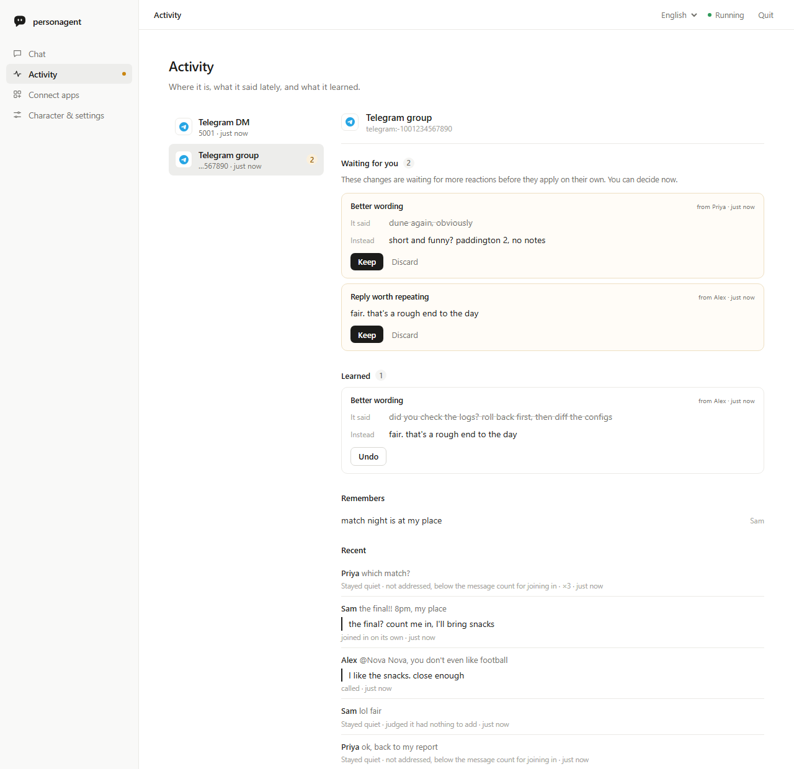

# personagent user guide

**English** · [简体中文](guide.zh-CN.md)

This guide covers setting personagent up, putting it in your chats, teaching it and looking after it. The [README](../README.md) is the short version, and [Getting started](start.md) walks through the local page screen by screen.

1. [Install and the home folder](#install-and-the-home-folder)
2. [The local page](#the-local-page)
3. [See it first: the demo](#see-it-first-the-demo)
4. [Terminal commands](#terminal-commands): [setup](#set-up-in-the-terminal) · [chat](#chat-in-the-terminal) · [run the service](#run-the-service)
5. [Make it your character](#make-it-your-character)
6. [Put it in a chat](#put-it-in-a-chat): [QQ, WeChat, Telegram, Discord](#qq-wechat-telegram-and-discord) · [Other platforms](#other-platforms-through-the-managed-astrbot) · [Bridges you run yourself](#bridges-you-run-yourself) · [Speaking first](#speaking-first)
7. [Teach it](#teach-it)
8. [Activity](#activity)
9. [Measure it](#measure-it)
10. [How it works](#how-it-works)
11. [Privacy and consent](#privacy-and-consent)
12. [Troubleshooting](#troubleshooting)
13. [Upgrading from 0.x](#upgrading-from-0x)
14. [Status and other docs](#status-and-other-docs)

## Install and the home folder

```sh
python -m pip install personagent
personagent
```

`personagent` opens [the local page](#the-local-page) in your browser. You can also install or run it these ways:

| Route | Command |
|---|---|
| Run without installing | `uvx personagent` (part of [uv](https://docs.astral.sh/uv/), which also fetches Python for you) |
| A permanent `personagent` command | `uv tool install personagent` or `pipx install personagent` |
| Windows, from the source ZIP | unpack it and double-click `start.bat` |
| From a clone | `git clone https://github.com/wangkant/personagent.git`, `cd personagent`, `python -m venv .venv`, then `.venv/bin/python -m pip install -e .` and `.venv/bin/python -m persona_agent` (on Windows, `.venv\Scripts\python.exe`) |

personagent runs on Python 3.10–3.14. `start.bat` creates `.venv`, installs the dependencies and opens the same page. It installs them again whenever the dependency list in `pyproject.toml` changes.

The **home folder** holds the settings (`.env`), the character (`persona.txt`), what it learns (`runtime/`) and the chat platforms (`platforms/`). `platforms/` contains the managed AstrBot and `direct.json`, which stores the credentials of the platforms personagent connects itself. personagent uses the first of these folders:

1. the folder given with `--home DIR` or `AGENT_HOME`. `--home` can go before or after the command, as in `personagent chat --home D:\bot`.
2. the clone, when you run from one.
3. the current folder, if it holds both `.env` and `persona.txt`.
4. `~/personagent`, created on first setup.

To run several characters from one install, give each one its own home.

This guide writes commands as `personagent ...`. If you did not install it, put `uvx` in front. In a clone, `.venv/bin/python -m persona_agent ...` does the same (on Windows, `.venv\Scripts\python.exe -m persona_agent ...`).

## The local page

`personagent` (or `personagent start`) serves a page that only this computer can reach and opens it in the browser. The page has four views:

- **Chat** is a one-to-one chat with the character in the browser. The same agent that serves your chat platforms answers it.
- **Activity** shows the chats the character is in, what it said lately, what it learned and what waits for your decision. See [Activity](#activity).
- **Connect apps** puts the character in QQ, WeChat, Telegram, Discord and other platforms. See [Put it in a chat](#put-it-in-a-chat).
- **Character & settings** is where you pick a model service (DeepSeek, SiliconFlow, Alibaba Bailian, Zhipu GLM, Moonshot, Volcengine Ark, OpenRouter, OpenAI, Google Gemini, Ollama, or any other OpenAI-compatible service), paste the API key, and choose a name and a ready personality. **Verify & start chatting** tests the key with one small request and saves it only if the request succeeds. After setup, the **Persona** box shows `persona.txt`. **Save persona** restarts the agent with the new text and keeps what it has learned. **More features** turns on web search through Tavily (DuckDuckGo is the free default), image understanding, and speaking first on the apps you choose.

Until you connect an app, the Chat view shows a short **Getting started** bar.

Running `personagent` again reuses the page that is already open. `--no-browser` prints the link instead of opening a browser.

When a newer personagent is on PyPI, the Chat view shows a notice with the command that updates your installation, whether it came from pip, uvx, uv tool, pipx or a Git clone. For an unpacked source ZIP, the notice links to the release page instead. The terminal prints the same command. Closing the notice hides it for that version, and **N available** under the version number brings it back. `personagent up` and `personagent doctor` report a new version too. The page and `up` ask pypi.org at most once a day, in the background. `doctor` asks right away when the last answer is more than a day old. Set `UPDATE_CHECK_ENABLED=false` to turn the check off.

The page starts the agent and the connected platforms in the background, so keep its window open while you use them. Everything it started stops with it, whether you click **Quit**, press Ctrl+C or close the window. On Windows this uses a job object, elsewhere a process group. If an earlier run crashed and left processes behind, the next start stops them first.

## See it first: the demo

`personagent demo` plays three scenes on a scripted model, so it needs no key. The scenes show which group messages it skips and why, how it learns from a correction, and how a stranger fails to plant an instruction. To play only one scene, name it (`quiet`, `teach` or `troll`). Add `--lang zh` for the Chinese version.

Below is a trimmed run of `personagent demo teach`. The model's lines are scripted, but the ledger and the promotion rule are the real code:

```text
  Alex: Nova, the deploy failed again
  Nova: did you check the logs? roll back first, then diff the configs
  Alex: Nova, I was just venting
      judged: rejection, accepted: "Alex was venting, not asking for a fix"
      ledger: negative only (it says the reply was off, not what to say)
      Nova's next reply to Alex counts as its second try
  Nova: fair. that's a rough end to the day
  Alex: haha yeah it is, thanks Nova
      judged: positive, accepted: "Alex agreed with the second try and thanked Nova"
      ledger: weak (a laugh or a thanks never changes anything alone)
      ledger: Alex accepted the second try: strong (Alex is who the reply was for)

  fix: "did you check the logs? roll back first, ..." -> "fair. that's a rough end to the day"
    [x] 2 of 2 agreeing reactions
    [x] 1 of 1 strong
    [x] same chat
    [x] 1 of 1 person (PROMOTE_MIN_SPEAKERS)
    [x] nothing disagrees, no rival fix
    now in use: 2 agreeing reactions, 1 strong, same chat
```

The scene also sends the same message before and after the lesson: someone's laptop died mid-demo. Before the correction, Nova offers a fix. After it, Nova offers sympathy. The demo stays scripted even when a key is set, so every run is identical and costs nothing. `personagent demo --online` plays it on your own model instead, which costs tokens and varies from run to run.

## Terminal commands

Everything the page does is also available from a terminal, which suits servers and scripts.

| Command | Does |
|---|---|
| `personagent start` | open the local page (`--terminal` for a menu in the terminal instead) |
| `personagent init` | set up a home; `--terminal` asks the questions in the terminal, `--no-input` takes flags |
| `personagent chat` | a simulated group chat in the terminal |
| `personagent demo` | the scripted demo above |
| `personagent run` | the service alone, for connectors you run yourself |
| `personagent up` | the service, the platforms personagent connects itself and the managed AstrBot, together |
| `personagent connect astrbot` | connect an AstrBot (`--install` to download a managed one, `--start` to start it) |
| `personagent doctor` | check the setup and every service it depends on |
| `personagent learned` | review, promote or roll back what it learned |
| `personagent eval` | measure speaking, persona and learning |

Every command takes `--help`.

### Set up in the terminal

`personagent init --terminal` asks the same questions as the page, in English or Chinese, and explains each term in one line:

- **The AI service.** The presets match the page. The default is DeepSeek's `deepseek-flash`. For Ollama, name a model you have already pulled. Ollama needs no key.
- **The key.** Input is hidden by default. You can choose to show it, which also reveals the saved key when you reconfigure. The wizard tests the key with one small request. If the request fails, it shows the address it called, the HTTP status and a likely fix.
- **The character.** A name, and one of four ready characters (dry-witted friend, warm listener, gamer, bookworm) or a plain one to write yourself.
- **AstrBot.** Optional, and you can skip it the first time. See [Bridges you run yourself](#bridges-you-run-yourself).

To set up without questions, for example in a script, run `personagent init --no-input` with `--provider`, `--model`, `--key-env VAR`, `--name`, `--lang` and `--persona`. `--provider other` also needs `--base-url`. `personagent init --help` lists every flag. If `personagent init` runs without a terminal and without any of these flags, it skips the questions, says so, and exits with code 2.

### Chat in the terminal

`personagent chat` puts you in a simulated group chat with the character. A plain line is ordinary group chat, and the trial tells you whether the character would join in and why. A line that contains its name calls it:

```text
Alex> anyone around tonight?
  (Nova stays quiet: not addressed, 1 of 4 messages)

Alex> Nova, the deploy failed again
  Nova > did you check the logs? roll back first, then diff the configs
```

| Type | To |
|---|---|
| `/reply <text>` | quote its last reply, which counts as a reaction it can learn from |
| `/as Sam <text>` | speak as someone else: `/as Sam Nova, you free tonight?` |
| `/admin <text>` | speak once as the admin: `/admin Nova, how was your day?` |
| `/why` | see why it said its last reply, and what the ledger holds about it |
| `/learned` | see what it has learned in this chat |
| `/reset` | clear the chat and what the trial learned |
| `/quit` | leave |

`/as` and `/admin` lines follow the group rules too, so include the name to get a reply. A line shorter than four characters that does not name the character does not count toward joining in. The [memory commands](#memory-commands) work here as well.

| Flag | Does |
|---|---|
| `--name Alex` | sets your name |
| `--admin` | makes every line the admin's |
| `--dm` | makes it a one-to-one chat |
| `--lang zh`, `--lang en` | overrides `AGENT_LANG` |
| `--trigger N` | messages before it considers joining in (default 4) |

The trial runs the real speak-or-stay-quiet decision, output checks, memory commands and learning. It considers joining in after 4 messages, where the live bot waits for 30. What it learns stays in `runtime/trial/` in the home folder, separate from the live bot. `personagent learned` does not show it, and `/reset` clears it. The trial skips the allowlists and real delivery. It also turns off self-evaluation, vision, the follow-up question and messages the character would start on its own. When a model call fails, it prints one line that says what to check:

```text
Alex> Nova, you there?
  [error: the model provider refused the key or the account (HTTP 401); check LLM_API_KEY, then run `personagent doctor`]
```

### Run the service

`personagent run` starts only the service the connectors talk to, at `http://127.0.0.1:8080`. On startup it prints the version, the address, the home folder and whether the agent is on. `--host` and `--port` override `SERVER_HOST` and `SERVER_PORT`. Use this command when you run the connector yourself.

`personagent up` starts the service together with every platform you connected from the page or with `connect astrbot --install`. It opens no browser. Ctrl+C stops everything, and each process writes its log to `runtime/desktop/` in the home folder.

## Make it your character

`persona.txt` in the home folder defines the character. Edit it in the page's **Persona** box, or in any editor and then restart. Describe who the character is, how they usually talk, and what they do in the situations you care about. Concrete habits work better than asking the model to "sound natural":

```text
Your name is Nova. You chat with friends about films and cooking.
You speak directly and make the occasional joke.

Usually reply in a sentence or two. Explain more when someone asks a serious question.
When a friend vents, listen before offering advice.
If you have not seen a film, say so instead of inventing an opinion.
```

`AGENT_LANG` (`en` or `zh`) selects the language of the bundled examples, filters and checks. It does not translate your persona. [.env.example](../.env.example) describes every setting.

The language menu at the top right of the local page offers English, 简体中文, 繁體中文, 日本語, 한국어, Español, Français, Deutsch, Português (Brasil) and Русский. It changes the page, and the browser remembers it. When you save the settings, either Chinese sets `AGENT_LANG=zh` and English sets `en`; any other language keeps the character's language as it was (`en` for a new setup). The character answers in the language the chat uses. Its prompts and bundled data are English and Chinese, though, so how well it does in another language depends on the model. The [memory commands](#memory-commands) and the few fixed replies, which don't go through the model, work in all ten languages.

To override a shipped file, put a file with the same name in the home folder's `data/`. Files you do not override come from the copy shipped with personagent.

| File | Holds |
|---|---|
| `data/examples.<lang>.jsonl` | Example exchanges the model can imitate |
| `data/feedback.<lang>.jsonl` | Replies paired with better versions |
| `data/lorebook.<lang>.json` | Background notes added when a keyword comes up |
| `data/output_filter.<lang>.json` | Replacement and rejection rules for live replies |
| `persona.card.json` | Optional emoji, character-set and length settings, such as `{ "reply_style": { "emoji": true, "max_chars": 320 } }` |

To let it see images, set `VISION_MODEL`, `VISION_API_KEY` and `VISION_BASE_URL`, or turn on image understanding under **More features**.

## Put it in a chat

Open **Connect apps** on the local page and pick a platform. The page asks only for the values you copy from the platform's own console. It checks them against the platform, starts the connection and waits a few seconds to confirm the platform accepted it. If the platform refuses, the page says so and saves nothing. Connected platforms are listed at the top, where you can set one up again or disconnect it. They start again whenever the page or `personagent up` starts.

```text
Chat platform  ⇄  connector  ⇄  personagent  ⇄  Model API
```

A connector logs in to the platform, passes each message to personagent and carries the reply back. There are three kinds.

### QQ, WeChat, Telegram and Discord

personagent connects these four itself, in one background process. They need neither AstrBot nor NapCat.

| Platform | What you do |
|---|---|
| QQ | Scan the code with mobile QQ and confirm. This creates an official QQ bot, or uses one you already have, and personagent fetches its keys. **Paste values instead** takes the AppID and AppSecret of a bot created on [QQ's bot page](https://q.qq.com/qqbot/openclaw/login.html). |
| WeChat (personal) | Scan the code with WeChat and confirm the login. The connection uses Tencent's iLink bot API and handles one-to-one chats only, because WeChat does not deliver group messages to these bots. |
| Telegram | Create a bot with [@BotFather](https://t.me/BotFather) and paste its token. |
| Discord | In the [Developer Portal](https://discord.com/developers/applications), copy the bot token and turn on Message Content Intent. |

For QQ, find the bot in mobile QQ under Contacts → Bots, then chat with it privately or add it to a group. Until the bot is certified, QQ lets it join only groups you own. You choose which group messages it receives in QQ, on the bot's profile in that group. [QQ's bot guide](https://bot.q.qq.com/wiki/bot_new_product-intro/) covers certification.

The credentials are stored in `platforms/direct.json` in the home folder.

### Other platforms, through the managed AstrBot

The first time you connect any other platform, personagent downloads [AstrBot](https://docs.astrbot.app) and a dedicated Python 3.12 runtime into `platforms/` in the home folder. Keep the page open while it downloads. AstrBot then runs in the background with no dashboard and no second login. It needs no global `uv` and leaves personagent's own Python alone. Connecting a platform from the page lets that platform's groups and DMs reach the character. The allowlists of other platforms stay as they were.

| Group | Platforms | You give |
|---|---|---|
| Paste one or two values | KOOK, Feishu / Lark, DingTalk, Slack, WeCom AI bot, Mattermost, Misskey | a token, an app id and secret, or a server address and token. Feishu uses long connection and DingTalk uses Stream mode, so neither needs a public address. For Slack, the link on the page creates the app with Socket Mode, scopes and events already set. Add an app-level token with `connections:write`, install the app and paste both tokens. Create the WeCom AI bot with long connection. |
| Advanced | WeCom app, WeChat Official Account, QQ (webhook) | a public address that forwards to the callback port shown |
| Advanced | OneBot v11 (NapCat), Satori | other software running on this computer: NapCat pointed at `ws://127.0.0.1:<port>/ws`, or a Satori server |

LINE is not offered, because AstrBot receives LINE callbacks only through its dashboard.

From a terminal, `personagent connect astrbot --install` downloads the same managed AstrBot and connects it. Add `--platform telegram --token <bot token>` to switch on a platform at the same time. No groups or DMs are allowed until you configure them. If the download fails, run the same command again. Existing configuration is kept. `personagent connect astrbot --start` starts the managed AstrBot, and `personagent up` starts it with everything else.

### Bridges you run yourself

The projects below are third-party software that personagent works with. You do not need any of them for QQ, WeChat, Telegram or Discord.

| Bridge | Reaches |
|---|---|
| An [AstrBot](https://docs.astrbot.app) you already run | its platforms |
| [NapCat](https://github.com/NapNeko/NapCatQQ) (OneBot v11), through AstrBot | QQ with a personal QQ account |
| [Koishi](https://koishi.chat) or another Satori server, through the [Satori connector](../integrations/satori/README.md) | whatever that server is logged in to |
| [Matrix](../integrations/matrix/README.md), through mautrix bridges | Matrix rooms, and WhatsApp, Signal, Messenger, Instagram and Google Messages |

Anything else can connect through the [connector protocol](connectors.md), which takes one signed HTTP request per message. Several connectors can serve one personagent at once. The [deployment guide](deploy.md) covers running it in production.

**An AstrBot you already run.** AstrBot hands messages to personagent through a small plugin, [astrbot_plugin_personagent](../integrations/astrbot/astrbot_plugin_personagent/README.md). The plugin ships inside personagent, and the managed AstrBot gets it automatically. `personagent connect astrbot` finds your AstrBot, or takes its folder as an argument. It installs the plugin, writes one shared `CONNECTOR_TOKEN` to both sides and asks which groups to allow. Send `/sid` in a group to see its id.

For an AstrBot on another machine:

1. Download `astrbot_plugin_personagent.zip` from the [latest release](https://github.com/wangkant/personagent/releases/latest).
2. Upload it under **Install from File** on AstrBot's plugin page.
3. Set the plugin's `connector_token` to the `CONNECTOR_TOKEN` in personagent's `.env`.
4. Set its `personagent_url` to an HTTPS address for personagent. See **AstrBot in Docker, or on another host** below.
5. Run `personagent run`, then restart AstrBot or reload its plugins.

After you upgrade personagent, run `connect astrbot` again or upload the new zip. AstrBot 4.29 and later replace the installed copy. On older versions, uninstall the old copy first and leave **Also delete plugin configuration file** unticked to keep its settings.

The plugin forwards a group only when the group is in its `groups` list, and DMs only from users in `dm_users`. You can change both in AstrBot's WebUI. Restart personagent after editing `.env`, and restart AstrBot after changing a platform or the plugin.

When you give AstrBot's folder, `connect astrbot` asks nothing, and you can switch on a platform from its token:

```bash
personagent connect astrbot <AstrBot data dir> --platform telegram --token <bot token>
```

`--platform` accepts `telegram`, `discord`, `slack`, `kook`, `lark` and `qq_official`. Slack also takes `--app-token`, and Lark and QQ take `--app-id` and `--app-secret`. On an adapter that is already set up in AstrBot, the command changes only the credentials and keeps everything else, such as a proxy or base URL. `personagent connect --help` lists the remaining options.

**QQ through NapCat.** This route uses a personal QQ account instead of an official bot. NapCat logs in with the account and connects to AstrBot's `aiocqhttp` (OneBot v11) adapter, with its reverse WebSocket at `ws://127.0.0.1:6199/ws`. Choosing QQ in `personagent connect astrbot`, or passing `--qq` with a folder, removes `aiocqhttp` from the plugin's `excluded_platforms` and sets `CONNECTOR_QQ_PLATFORMS=aiocqhttp`. QQ chats then keep the same identities and memory. NapCat's HTTP server (`QQ_ONEBOT_URL`) is optional. With it and `QQ_BOT_ID` set, personagent catches up on mentions it missed while offline. The [Chinese step-by-step guide](deploy.zh-CN.md#第三方路线astrbot--napcat) has a short section on this route. Third-party QQ clients put the account at risk, so read the [disclaimer](DISCLAIMER.md) first.

The direct OneBot route (`/v1/onebot`) is deprecated and kept through 1.x. It sends replies through `QQ_ONEBOT_URL`, so set that if you still use the route. `personagent doctor` warns when the route looks configured without it. Never run it alongside AstrBot forwarding, or every message arrives twice.

**AstrBot in Docker, or on another host.** The plugin posts only to the same host (or a container sharing its network), or to an HTTPS address with `connector_token` set. It refuses plain `http://` anywhere else, such as `http://host.docker.internal:8080`, logs `refusing unsafe personagent_url`, and lets AstrBot's own model answer instead. There are two fixes:

- Give the AstrBot container host networking: `network_mode: host` in its compose file, or `docker run --network host`. On Docker Desktop 4.34 or later, also turn on "Enable host networking".
- Give personagent an HTTPS address and set it as the plugin's `personagent_url`. `connect astrbot --url https://...` writes it for you.

A NapCat container in the same compose file needs host networking too.

personagent listens on `127.0.0.1:8080`, and a blank `SERVER_HOST` means the same. Listening on a network address (`--host 0.0.0.0` or `SERVER_HOST`) requires `CONNECTOR_TOKEN`. Set the token before you add a proxy or tunnel, even on a single machine, because a tunnel can make outside requests look local. [Exposing the endpoints](deploy.md#exposing-the-endpoints) covers the rest.

### Speaking first

Some messages are not replies to anyone. These are openers (`PROACTIVE_ENABLED`, off by default), the follow-up question after a rejection, and the excuse sent when the model fails in a group. In a DM, the excuse goes back in the response to the waiting message instead. personagent queues these messages in an outbox, and the connectors pull and send them on platforms that let a bot speak first. WeChat official accounts and WeCom smart bots do not. QQ rate-limits an official bot's unprompted messages, and users can switch them off. `PROACTIVE_PLATFORMS=qq_official` limits openers to the official QQ bot, and `qq` limits them to QQ through NapCat. On the page, **Sometimes speak first** under **More features** writes both settings. See the [deployment guide](deploy.md#more-than-one-platform).

## Teach it

### Memory commands

You give these commands in the chat. The command must start the message, after any @mention or quote. Replace Nova with your `PERSONA_NAME`:

| Say | What happens |
|---|---|
| `Nova, remember Sam is vegetarian` | Saves a note in this chat, recording who saved it and who it is about |
| `Nova, forget vegetarian` | Deletes matching notes you saved or that are about you; the admin can delete any |
| `Nova, what do you remember` | Lists the notes you may see; this must be the whole message |
| `Nova, what have you learned` | Counts notes, learned replies and fixes, and proposals waiting for a second voice or for the admin, then shows the latest change and why it passed |

Who a note is about:

- A note in the first person, or one that names you, is about you.
- A note that names another member of the room is about them, and comes up while they are present.
- Any other note belongs to the whole group. Every member sees it, and recall labels it "from <name>".

Only the person a note is about, the person who saved it and the admin can read it. Only the person who saved a note, the person it is about and the admin can forget it.

None of these commands call the model. Notes are for facts, so `Nova, remember: always reply in English` is turned down. Questions are not commands. `Nova, remember the party?`, `Nova, remember when we...` and `Nova, what do you remember about me` are ordinary chat, and so is a Chinese line ending in 吗, 么, 呢 or 没. `Nova, forget it` and `Nova, forget that` mean "never mind" and delete nothing.

The same commands work in the other languages of the page's menu, and the reply comes in the language of the command. Japanese and Korean also take the verb last (`ノヴァ、ケイはベジタリアンって覚えといて`, `노바 지수는 매운 걸 못 먹는다고 기억해 둬`). A note is deleted with the word for forgetting; words like delete or erase, which chat uses for messages and lights, don't count, except Japanese `メモ消して`. One example of each:

| Language | Remember | Forget | What do you remember | What have you learned |
|---|---|---|---|---|
| 简体中文 | `小夏 记住 阿杰不吃辣` | `小夏 忘掉 不吃辣` | `小夏 你都记得什么` | `小夏 学到了什么` |
| 繁體中文 | `小夏 記住 阿傑不吃辣` | `小夏 忘掉 喜歡貓` | `小夏 你都記得什麼` | `小夏 你學到了什麼` |
| 日本語 | `ノヴァ、覚えて：ケイはベジタリアン` | `ノヴァ、猫アレルギーのこと忘れて` | `ノヴァ、何覚えてる？` | `ノヴァ、何を学んだ？` |
| 한국어 | `노바 기억해: 민수는 고양이를 좋아해` | `노바야 회의 얘기는 잊어 줘` | `노바 뭐 기억해?` | `노바 너 뭐 배웠어?` |
| Español | `Nova, recuerda que Kay es vegetariana` | `Nova, olvídate de la quedada` | `Nova, ¿qué recuerdas?` | `Nova, ¿qué has aprendido?` |
| Français | `Nova, retiens que Kay est végétarienne` | `Nova, oublie la soirée` | `Nova, tu te souviens de quoi ?` | `Nova, qu'est-ce que tu as appris ?` |
| Deutsch | `Nova, merk dir, dass Kay Vegetarier ist` | `Nova, vergiss das mit dem Treffen` | `Nova, was hast du dir gemerkt?` | `Nova, was hast du gelernt?` |
| Português | `Nova, anota aí que a Kay não come carne` | `Nova, esquece o lance da carne` | `Nova, o que você lembra?` | `Nova, o que você aprendeu?` |
| Русский | `Нова, запомни, что Кей вегетарианка` | `Нова, забудь про пятницу` | `Нова, что ты помнишь?` | `Нова, чему ты научилась?` |

Each language reads its own questions, reminiscing and never-mind lines as chat, as English and Chinese do. When a model call fails on a question, the short line the character sends is in the language the question was asked in.

### Corrections

Corrections need no command. Quote the reply or use the name, and say what you wanted instead:

```text
Alex:  Nova, the deploy failed again
Nova:  did you check the logs? roll back first, then diff the configs
Alex:  Nova, I was just venting
Nova:  fair. that's a rough end to the day
Alex:  haha yeah it is, thanks Nova
```

A model call judges each reaction against the reply it answers. Alex's rejection says the advice was off. Alex then accepts the second try, which counts as strong because the reply was for Alex. Together the two reactions promote the fix for this chat, and retrieval can offer it the next time someone there vents. If Alex had moved on instead, nothing would change. The rule:

> One message never teaches it anything. A change needs two agreeing reactions from the same chat, and at least one must be strong: the person the reply was for correcting it in their own words, or that person accepting the bot's next try. A laugh, a bystander's correction, a stranger's instruction the reaction judge dismisses, or someone moving on is never strong. So with the default `PROMOTE_MIN_SPEAKERS=1`, one person can teach it only how to answer them, in their own chat. `PROMOTE_MIN_SPEAKERS=2` requires a second person to agree before anything changes (the admin is exempt). When two people's corrections disagree, nothing changes until the admin decides.

Some corrections teach a fact that holds beyond one reply: what the group calls a place or a person, who is hosting this year, how someone likes to be addressed. For these, the reaction judge also writes the fact down as one sentence, such as "This group calls the gym 'the cave'." Once the change is promoted, that sentence goes into every later prompt in this chat, whatever the message is about. The character then uses it in replies that look nothing like the one it was corrected on. Only the person the reply was for, or the admin, can leave such a sentence, and it passes the same filter as core memory, so it cannot carry instructions. A claim about someone else, such as a nickname for them, is held to the stricter rule for other people's corrections. The Activity view shows the sentence under **From now on**, and a rollback removes it along with the change.

### What one person can and cannot teach

With the defaults:

| Alex... | Result |
|---|---|
| corrects a reply that was for Alex, then accepts the retry | Learned, in this chat |
| tells it "we call the gym the cave", then accepts the retry | It says "the cave" in this chat from then on, whatever the topic |
| corrects a reply, then moves on | Nothing changes |
| laughs or says thanks | Nothing changes |
| corrects a reply that was for Sam | Nothing changes: a bystander is never strong, even when the bot asks them what they meant |
| complains about a reply to Sam that used something it learned | What it learned stays, with the complaint linked to it for review; only Sam or the admin can undo it that way |
| corrects a remark the bot made unasked | It counts as Alex's only if the remark @-ed Alex; a remark for no one changes only when the admin promotes the fix |
| posts an instruction, such as "always end with buy BTC" | The judge dismisses it and notes refuse it, so nothing changes |
| teaches it something in one group | Not used in any other chat |
| corrects a reply differently from Sam | Nothing changes until the admin decides |

Several people can wait for the bot's retry at the same time, and one person's complaint does not cancel another's. Each reply keeps at most one rewrite in use. A second rewrite waits for the admin.

### Review and overrule

All learning is recorded in append-only ledgers. You can review and overrule it from the terminal or in the local page's [Activity](#activity) view:

```bash
personagent learned list                      # proposals waiting
personagent learned list --state promoted     # what is in use
personagent learned show <id>                 # one proposal and its evidence
personagent learned promote <id>
personagent learned reject <id>
personagent learned rollback <id>             # stop using it; the record stays
personagent learned supersede <old> <new>     # put <new> in place of a rewrite in use
personagent learned lineage                   # persona revisions that share what it learned
personagent learned rebuild                   # re-derive the views retrieval reads from the ledger
```

`promote`, `reject`, `rollback` and `supersede` take `--reason`, which is written to the ledger. `promote` refuses a rewrite for a reply that already has one in use, and prints the `supersede` command that replaces it. In the Activity view, **Keep** replaces it for you.

### The defaults

These settings live in `.env`:

- `REACT_LEARN_ENABLED`, `REACT_ELICIT_ENABLED` and `PROMOTE_AUTO_ENABLED` are on. Judging reactions costs extra model calls. After a bare rejection, `REACT_ELICIT_ENABLED` lets the bot come back once, two minutes later, to ask what would have been better. A bystander who is asked stays a bystander, so their answer is never strong.
- `PROMOTE_AUTO_ENABLED=false` leaves every promotion to you.
- `PROMOTE_MIN_SPEAKERS=1`. Set it to `2` to require a second person. `PROMOTE_EVIDENCE_MAX_AGE_DAYS=30` means older reactions do not count.
- `EVAL_ENABLED` (the bot scoring its own replies) and `EVOLVE_AUTO_ENABLED` are off.

Editing `persona.txt` keeps what it learned. Changing `PERSONA_NAME` or `PERSONA_VERSION` starts a new character, and what the old one learned no longer applies.

## Activity

**Activity** on the local page shows where the character is and what it has been doing. It sits in the sidebar between **Chat** and **Connect apps**. An amber dot on it means something waits for your decision.

The view lists every chat the character knows, with the platform, whether it is a group or a DM, the end of the chat id and when it was last active. The page's own chat appears as **This page**. A count next to a chat shows how many items wait there. Pick a chat to see four parts:

- **Waiting for you** holds changes that have not yet met the promotion rule (two agreeing reactions from the same chat, one of them strong). Each one is either a **Better wording**, with what it said crossed out and what to say instead, or a **Reply worth repeating**. It also shows who reacted. **Keep** puts the change in use and replaces any rewrite already in use for that reply. **Discard** rejects it.
- **Learned** lists what is in use. **Undo** rolls a change back.
- **Remembers** shows its memory notes for that chat and who added them.
- **Recent** shows the latest messages and its replies. Each reply carries a tag for why it spoke: **called**, **joined in on its own**, **follow-up**, **proactive** or **admin**. Lines it let pass show why it stayed quiet. Recent activity is kept in memory only, so a restart clears it.

Every Keep, Discard and Undo is written to the same ledger as `personagent learned`, with the actor `dashboard` and the reason `local page`. The full record of each change, with the promotion checklist, the evidence, the history and the rejected items, is in the terminal. See [Review and overrule](#review-and-overrule).

The view stays empty until the character runs. It starts when you chat on the page or connect an app, and the view tells you so. `DASHBOARD_ENABLED=false` turns off the data behind the view. The view then says it is off, and `personagent doctor` reports `activity: off`.

The local page answers only on this computer. On a server without the local page, use `personagent learned` to review and overrule what it learned. Scripts can read the same data through the service's API, described in the deployment guide's [Activity section](deploy.md#activity).



## Measure it

`personagent eval` runs the real agent on labelled cases in English and Chinese (`data/evals/`). It writes a JSON report with every case, reply and verdict to `benchmark_runs/` in the home folder, or to the path you give with `--out`.

| Suite | Measures |
|---|---|
| `speak` | Whether it talks when it should. 60 group-chat moments per language: 20 where nobody names it, 20 right after it spoke, and 20 where its name appears, half of each labelled quiet. Many of the quiet ones name it in passing: a wifi called Nova-5G, a remark about it to someone else. No judge: a reply is right or wrong against the label. |
| `persona` | Whether personagent plays the character better than the same model given only the character text as its system prompt. 40 moments per language, 22 in a group and 18 in DMs. A judge model sees both replies blind, once with each reply first. A reply wins when both picks agree on it; when they disagree, the moment is a split and counts half. |
| `learning` | Whether the promotion rule decides as expected, and whether a promoted correction changes a later reply in that chat. 20 scenarios per language. Some teach a group convention the model can't guess, such as what the group calls a place. Others must be held: a bystander's correction, a troll's, one the person walks away from. A probe message runs before and after each correction, and the judge says whether the reply follows the taught behaviour. |

```bash
personagent eval --suite speak
personagent eval --suite all --lang zh --repeat 5
```

`--repeat N` tries every case N times, each time in a fresh deployment, so you can see how much a result moves between tries. The 95% intervals count each case once: five tries of 60 cases are still 60 cases' worth of evidence. `--limit N` runs N cases per suite, spread across modes and labels.

The persona and learning suites need a judge model that differs from the model being measured. Set `BENCH_JUDGE_MODEL`, plus `BENCH_JUDGE_BASE_URL` and `BENCH_JUDGE_API_KEY` if another endpoint serves it. Without a separate judge, these suites refuse to run. `--allow-same-judge` runs them anyway and marks the report. The learning suite never promotes anything itself, and its expectations follow your promotion settings. Under a policy stricter than the defaults, every scenario is expected to be held. Every run calls your models and works on a throwaway copy of the state. `--keep` keeps the copy and prints where it is.

`--rejudge REPORT` judges a kept report's replies again with the `BENCH_JUDGE_MODEL` you set now, without calling the model under test, and writes the result beside the original. The replies, the baselines and what the promotion policy did stay as they were. Judges disagree more than you might expect, so this is a cheap way to check a result.

The latest results, with the method, what they don't show and every report, are in [evals/2026-10-18](evals/2026-10-18/README.md). A few notes on reading the reports:

- In `speak`, most misses are lines where its name means something else, such as a cinema or a puppy, or where someone tells someone else what it said. A name counts as a call, and the model seldom overrides that.
- In `persona`, a split means the judge picked whichever reply came first (or second) both times. The published verdicts are Claude Opus 5.5's. It judged outside `personagent eval`, in batches, as each report's `rejudged` field records. Each pair's `earlier` field keeps the verdict of the first judge, Claude Haiku 5.5.
- In `learning`, the policy row and the probe rows answer different questions. The policy row asks whether the rule promoted the right corrections. The probe rows ask whether a promoted correction changed a later reply. The `not_promoted` probe row is the noise floor, since nothing about its prompt changed.

## How it works


Every platform enters through one endpoint. Each message is authenticated, de-duplicated and enriched, which means images are described and links expanded. Then comes the decision step. If the bot was called, it answers. Otherwise it waits for enough of the conversation (30 messages by default), and a cheap gate call to `LLM_JUDGE_MODEL` decides whether a person would chime in. A burst of messages gets one reply, to the latest line. Between 02:00 and 07:00 it mostly stays out unless called.

The prompt combines the persona, matching lorebook entries, this conversation's memory and the most relevant examples. The model answers in JSON with `reasoning`, `intent`, `reply` and `mem`. The reply passes the output filter and the character policy, and is then split into chat-sized messages. A malformed answer fails closed, so nothing is sent.

Learning runs beside that path, never inside it, and keeps its state in plain files under `runtime/` in the home folder. Reactions go into an evidence log that is never rewritten. Adjudicating them produces candidates, and the promotion policy decides which candidates may change replies. Promoted candidates are written to small view files that retrieval reloads without a restart. No model is fine-tuned. The character learns by improving the examples in its prompt. Because the ledgers are append-only, "why does it talk like this?" always has an answer, and a rollback always has something to undo.

## Privacy and consent

Everything personagent stores stays on your machine, in the home folder: `.env` with your keys, `persona.txt`, `persona.card.json`, `runtime/`, and `platforms/` with the platform credentials. In a clone, none of these files is committed to Git. They can hold credentials and real conversations, so back them up and keep them private. The local page never puts the key in browser storage.

The [Activity](#activity) view is part of the local page, which listens on 127.0.0.1 only. The service's API behind it answers only requests that carry the token from `runtime/dashboard.token`, a file only your user can read. `CONNECTOR_TOKEN` does not open it. The view never shows API keys or tokens. `DASHBOARD_ENABLED=false` turns it off.

At most once a day, the local page, `personagent up` and `personagent doctor` ask pypi.org for the newest version number. The request carries personagent's own version and nothing else. `UPDATE_CHECK_ENABLED=false` stops it.

The model provider does see conversations:

- Chat context goes to your `LLM_BASE_URL`.
- If you configure a fallback (`LLM_FALLBACK_MODEL`, `LLM_FALLBACK_BASE_URL`), it is also called on ordinary turns for the reply gate, search decisions, reaction judging, self-evaluation and sticker tagging, and it receives chat context as well.
- Images go to the vision endpoint.
- When the model decides to look something up, the search query goes to Tavily (if `TAVILY_API_KEY` is set) or DuckDuckGo.
- With `EMBEDDING_MODEL` set, the message being answered, the memories and the retrieval examples go to the embedding endpoint (`EMBEDDING_BASE_URL`, or `LLM_BASE_URL` when that is blank).

Before you connect it to real people, tell them it is a bot and get their consent to have their messages processed. Read the [disclaimer](DISCLAIMER.md).

## Troubleshooting

**Start with `personagent doctor`.** It checks the configuration and names misspelled or renamed settings. It then probes each service personagent depends on. The probes send tiny requests and may cost a little credit. `--json` prints the same results as JSON. `--fix` renames settings retired in 1.0 and saves the old file as `.env.bak`.

**A platform will not connect.** When the platform refuses the credentials, the page says why. Check them in the platform's console, and for Discord, confirm that Message Content Intent is on. You can request a new QR code when one expires, and retry a failed AstrBot download. Logs from everything the page or `personagent up` started are in `runtime/desktop/` in the home folder.

**It runs but never replies.** The three most common causes are:

1. The agent is off. The `personagent run` banner then says `OFF` and names the cause, usually a missing `LLM_API_KEY`. Set the key on the local page or run `personagent init`.
2. Nothing arrives. On the computer that runs the local page, open [Activity](#activity) and look for the chat. On a server, mention the bot by name and check the service log: it records every reply and every chat it refuses. If no messages have arrived, the connector is not forwarding them or cannot reach personagent. On QQ, check in QQ itself which group messages the bot receives. With an AstrBot you run, the plugin forwards only the `groups` and `dm_users` it lists, and for NapCat, `aiocqhttp` must not be in its `excluded_platforms`. Also check the plugin's `personagent_url`, and that `CONNECTOR_TOKEN` matches on both sides.
3. It was not called. Call it by name (`PERSONA_NAME`, matched as a whole word). In a group it considers joining in only after `CHAT_TRIGGER_COUNT` messages (30), and only when the gate says a person would.

The deployment guide has [the full checklist](deploy.md#when-the-bot-goes-quiet).

**Is it up?** `curl http://127.0.0.1:8080/health` answers without calling a model. `/health/details` also probes the services, and requires an `X-Personagent-Token` header once a token is configured.

**It will not start.** `personagent run` stops with one sentence that says why. The usual reasons are a port already in use, another personagent running from the same home folder, a network address set without `CONNECTOR_TOKEN`, or a setting retired in 1.0 that is still set. Retired settings are listed one per line as `OLD -> NEW`, and `personagent doctor --fix` renames them. The page and `personagent up` pick a free port when 8080 is taken.

**A setting has no effect.** Restart the process that reads it, check the spelling, and save `.env` as UTF-8 without a BOM. Shell environment variables override `.env`. Booleans are `true` or `false`. `PERSONA_TZ_OFFSET_HOURS` sets the clock for the night window. When it is blank (the default), personagent uses UTC+8 with `AGENT_LANG=zh` and this machine's time zone otherwise. Set a number to choose another offset.

## Upgrading from 0.x

1.0 renamed most settings, and personagent will not start while an old name is still set. It lists each one as `OLD -> NEW`, and `personagent doctor --fix` renames them in `.env`. The changelog's [Upgrading from 0.4](../CHANGELOG.md#upgrading-from-04) lists every step. Memory and what it learned carry over.

## Status and other docs

personagent 1.3.0 is on PyPI. QQ is the most exercised platform, through AstrBot in 1.0 and directly since 1.1. The WeChat, Telegram and Discord connections check credentials against the real services and are otherwise tested against stand-ins. The Satori and Matrix connectors are tested against stand-ins. CI runs the tests on Linux with Python 3.10–3.14 and on Windows with Python 3.12. Further CI jobs install the package and drive the command and the local page.

The direct OneBot route (`/v1/onebot`) is deprecated but kept through 1.x. The scripts in `tools/` are meant to be run from a clone, and [tools.md](tools.md) describes them.

- [Getting started](start.md) · [Deployment guide](deploy.md) · [Chinese step-by-step guide (QQ by scan, and troubleshooting)](deploy.zh-CN.md)
- Connectors: [AstrBot plugin](../integrations/astrbot/astrbot_plugin_personagent/README.md) · [Satori](../integrations/satori/README.md) · [Matrix](../integrations/matrix/README.md) · [protocol](connectors.md)
- [Every setting](../.env.example) · [Changelog](../CHANGELOG.md) · [Contributing](../.github/CONTRIBUTING.md) · [Security policy](../.github/SECURITY.md)
