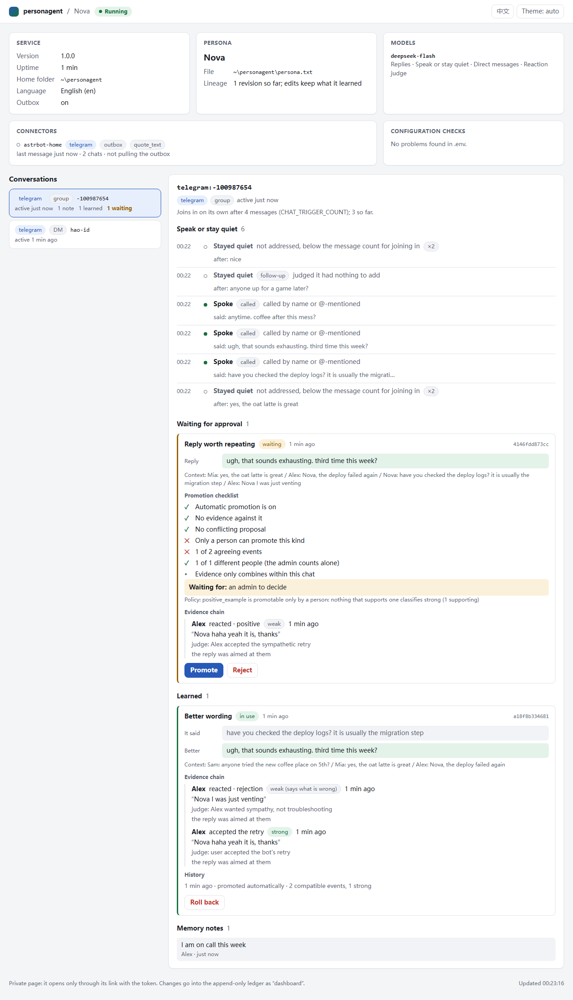

# personagent user guide

**English** · [简体中文](guide.zh-CN.md)

Everything you need to set personagent up, put it in your chats, teach it and look after it. The [README](../README.md) is the short version, and the [getting-started guide](start.md) is the page-by-page walkthrough.

1. [Install and the home folder](#install-and-the-home-folder)
2. [The local page](#the-local-page)
3. [See it first: the demo](#see-it-first-the-demo)
4. [Terminal commands](#terminal-commands): [setup](#set-up-in-the-terminal) · [chat](#chat-in-the-terminal) · [run the service](#run-the-service)
5. [Make it your character](#make-it-your-character)
6. [Put it in a chat](#put-it-in-a-chat): [QQ, WeChat, Telegram, Discord](#qq-wechat-telegram-and-discord) · [Other platforms](#other-platforms-through-the-managed-astrbot) · [Bridges you run yourself](#bridges-you-run-yourself) · [Speaking first](#speaking-first)
7. [Teach it](#teach-it)
8. [The dashboard](#the-dashboard)
9. [Measure it](#measure-it)
10. [How it works](#how-it-works)
11. [Privacy and consent](#privacy-and-consent)
12. [Troubleshooting](#troubleshooting)
13. [Upgrading from 0.x](#upgrading-from-0x)
14. [Status and other docs](#status-and-other-docs)

## Install and the home folder

```sh
python -m pip install personagent
personagent
```

`personagent` opens [the local page](#the-local-page) in your browser. Other routes:

| Route | Command |
|---|---|
| Run without installing | `uvx personagent` (comes with [uv](https://docs.astral.sh/uv/), which fetches Python for you) |
| A permanent `personagent` command | `uv tool install personagent` or `pipx install personagent` |
| Windows, from the source ZIP | unpack it and double-click `start.bat` |
| From a clone | `git clone https://github.com/wangkant/personagent.git`, `cd personagent`, `python -m venv .venv`, then `.venv/bin/python -m pip install -e .` and `.venv/bin/python -m persona_agent` (on Windows, `.venv\Scripts\python.exe`) |

personagent runs on Python 3.10–3.14. `start.bat` creates `.venv`, installs the dependencies (again whenever `pyproject.toml` changes) and opens the same page.

The **home folder** holds the settings (`.env`), the character (`persona.txt`), what it learns (`runtime/`) and the chat platforms (`platforms/`: the managed AstrBot and `direct.json`, the credentials of the platforms personagent connects itself). It is the first of:

1. the folder you give with `--home DIR` (before or after the command: `personagent chat --home D:\bot`) or `AGENT_HOME`;
2. the clone, when you run from one;
3. the current folder, if it holds both `.env` and `persona.txt`;
4. `~/personagent`, created on first setup.

To run several characters from one install, give each its own home.

This guide writes commands as `personagent ...`. Put `uvx` in front if you did not install it. In a clone, `.venv/bin/python -m persona_agent ...` (Windows: `.venv\Scripts\python.exe -m persona_agent ...`) does the same.

## The local page

`personagent` (or `personagent start`) serves a page on this computer only and opens it in the browser. It has three views:

- **Chat**: a one-to-one chat with the real character in the browser, answered by the same agent that serves your chat platforms.
- **Connect apps**: put it in QQ, WeChat, Telegram, Discord and the other platforms; see [Put it in a chat](#put-it-in-a-chat).
- **Character & settings**: pick a model service (DeepSeek, SiliconFlow, Alibaba Bailian, Zhipu GLM, Moonshot, Volcengine Ark, OpenRouter, OpenAI, Google Gemini, Ollama, or any other OpenAI-compatible service), paste the API key, and choose a name and a ready personality. **Verify & start chatting** tests the key with one small request before saving it. Once set up, the **Persona** box holds `persona.txt`; **Save persona** restarts the agent with the new text and keeps what it learned. **More features** turns on Tavily search (DuckDuckGo is the free default), image understanding and speaking first on the apps you pick. Until an app is connected, the Chat view shows a short getting-started bar.

Running `personagent` again reuses the page that is already open. `--no-browser` prints the link instead of opening it.

When a newer personagent is on PyPI, the Chat view shows a notice with the command that updates your installation (pip, uvx, uv tool, pipx or a Git clone), and the terminal prints the same line; closing the notice hides it until the next start, and **N available** under the version number brings it back. `personagent up` and `personagent doctor` say so too. The page and `up` ask pypi.org at most once a day, in the background; `doctor` asks then and there when the last answer is a day old. `UPDATE_CHECK_ENABLED=false` turns it off.

The page starts the agent, and the connected platforms with it, in the background. Keep its window open while you use it. Whatever it started ends with it, however it ends: **Quit**, Ctrl+C or a closed window (a job object on Windows, a process group elsewhere). If an earlier run crashed and left something running, the next start stops it first.

## See it first: the demo

`personagent demo` plays three scenes on a scripted model, with no key needed: which group messages it skips and why, learning from a correction, and a stranger failing to plant an instruction. Name one scene to play only that one (`quiet`, `teach` or `troll`), and add `--lang zh` for the Chinese version.

This is `personagent demo teach`, trimmed. The model's lines are scripted; the ledger and the promotion rule are the real code:

```text
  Alex: Nova, the deploy failed again
  Nova: did you check the logs? roll back first, then diff the configs
  Alex: Nova, I was just venting
      judged: rejection, accepted: "Alex was venting, not asking for a fix"
      ledger: negative only (it says the reply was off, not what to say)
      Nova's next reply to Alex counts as its second try
  Nova: fair. that's a rough end to the day
  Alex: haha yeah it is, thanks Nova
      judged: positive, accepted: "Alex agreed with the second try and thanked Nova"
      ledger: weak (a laugh or a thanks never changes anything alone)
      ledger: Alex accepted the second try: strong (Alex is who the reply was for)

  fix: "did you check the logs? roll back first, ..." -> "fair. that's a rough end to the day"
    [x] 2 of 2 agreeing reactions
    [x] 1 of 1 strong
    [x] same chat
    [x] 1 of 1 person (PROMOTE_MIN_SPEAKERS)
    [x] nothing disagrees, no rival fix
    now in use: 2 agreeing reactions, 1 strong, same chat
```

Asked about a laptop that died mid-demo, Nova offered a fix before this exchange and sympathy after it. The demo is scripted even when a key is set, so every run is the same and costs nothing. `personagent demo --online` plays it on your own model, which costs tokens and varies from run to run.

## Terminal commands

Everything the page does can also be done from a terminal, which suits servers and scripts.

| Command | Does |
|---|---|
| `personagent start` | open the local page (`--terminal` for a menu in the terminal instead) |
| `personagent init` | set up a home; `--terminal` asks the questions in the terminal, `--no-input` takes flags |
| `personagent chat` | a simulated group chat in the terminal |
| `personagent demo` | the scripted demo above |
| `personagent run` | the service alone, for connectors you run yourself |
| `personagent up` | the service, the platforms personagent connects itself and the managed AstrBot, together |
| `personagent connect astrbot` | connect an AstrBot (`--install` to download a managed one, `--start` to start it) |
| `personagent doctor` | check the setup and every service it depends on |
| `personagent learned` | review, promote or roll back what it learned |
| `personagent eval` | measure speaking, persona and learning |

Each takes `--help`.

### Set up in the terminal

`personagent init --terminal` asks the same things as the page, in English or Chinese, and explains each term in a line:

- **The AI service.** The same presets as the page. The default is DeepSeek's `deepseek-flash`. For Ollama, name a model you have already pulled; no key is needed.
- **The key.** Hidden by default; you can choose to show it, which also reveals the saved key when reconfiguring. It is tested with one small request; if that fails, it shows the address it called, the HTTP status and a likely fix.
- **The character.** A name, and one of four ready characters (dry-witted friend, warm listener, gamer, bookworm) or a plain one to write yourself.
- **AstrBot.** Optional; skip it the first time. See [Bridges you run yourself](#bridges-you-run-yourself).

To set up without questions, for example in a script, run `personagent init --no-input` with `--provider`, `--model`, `--key-env VAR`, `--name`, `--lang` and `--persona` (and `--base-url` for `--provider other`); `personagent init --help` lists them. Run without a terminal and without any of these flags, `personagent init` skips the questions, says so, and exits with code 2.

### Chat in the terminal

`personagent chat` puts you in a simulated group chat with the character. A plain line is group chat, and it tells you whether it would join in and why. A line with its name is a call:

```text
Alex> anyone around tonight?
  (Nova stays quiet: not addressed, 1 of 4 messages)

Alex> Nova, the deploy failed again
  Nova > did you check the logs? roll back first, then diff the configs
```

| Type | To |
|---|---|
| `/reply <text>` | quote its last reply, which counts as a reaction it can learn from |
| `/as Sam <text>` | speak as someone else: `/as Sam Nova, you free tonight?` |
| `/admin <text>` | speak once as the admin: `/admin Nova, how was your day?` |
| `/why` | see why it said its last reply, and what the ledger holds about it |
| `/learned` | see what it has learned in this chat |
| `/reset` | clear the chat and what the trial learned |
| `/quit` | leave |

`/as` and `/admin` lines follow the group rules too, so put the name in them to get a reply. A line under four characters that does not name it is too short to count toward joining in. The [memory commands](#memory-commands) work here too.

| Flag | Does |
|---|---|
| `--name Alex` | sets your name |
| `--admin` | makes every line the admin's |
| `--dm` | makes it a one-to-one chat |
| `--lang zh`, `--lang en` | overrides `AGENT_LANG` |
| `--trigger N` | messages before it considers joining in (default 4) |

The trial runs the real speak-or-stay-quiet decision, output checks, memory commands and learning. It considers joining in after 4 messages, where the live bot waits for 30. What it learns stays in `runtime/trial/` in the home folder, apart from the live bot: `personagent learned` does not show it, and `/reset` clears it. It skips the allowlists and real delivery, and turns off self-evaluation, vision, the follow-up question and messages it would start by itself. When a model call fails, it prints one line saying what to check:

```text
Alex> Nova, you there?
  [error: the model provider refused the key or the account (HTTP 401); check LLM_API_KEY, then run `personagent doctor`]
```

### Run the service

`personagent run` starts only the service the connectors talk to, at `http://127.0.0.1:8080`, with [the dashboard](#the-dashboard) at the same address. It prints the version, the address, the home folder, the dashboard's private link and whether the agent is on. `--host` and `--port` override `SERVER_HOST` and `SERVER_PORT`. Use it when you run the connector yourself.

`personagent up` starts the service together with every platform connected from the page or by `connect astrbot --install`, without a browser. Ctrl+C stops them all. Each one's log is in `runtime/desktop/` in the home folder.

## Make it your character

`persona.txt` in the home folder is the character. Edit it in the page's **Persona** box, or in any editor and restart. Say who they are, how they usually talk, and what they do in the situations you care about; concrete habits work better than asking the model to "sound natural":

```text
Your name is Nova. You chat with friends about films and cooking.
You speak directly and make the occasional joke.

Usually reply in a sentence or two. Explain more when someone asks a serious question.
When a friend vents, listen before offering advice.
If you have not seen a film, say so instead of inventing an opinion.
```

`AGENT_LANG` (`en` or `zh`) picks the language of the bundled examples, filters and checks; it does not translate your persona. Every setting is described in [.env.example](../.env.example).

To override a shipped file, put one with the same name in the home folder's `data/`. Anything you do not override comes from the copy shipped with personagent.

| File | Holds |
|---|---|
| `data/examples.<lang>.jsonl` | Example exchanges the model can imitate |
| `data/feedback.<lang>.jsonl` | Replies paired with better versions |
| `data/lorebook.<lang>.json` | Background notes added when a keyword comes up |
| `data/output_filter.<lang>.json` | Replacement and rejection rules for live replies |
| `persona.card.json` | Optional emoji, character-set and length settings, such as `{ "reply_style": { "emoji": true, "max_chars": 320 } }` |

To let it see images, set `VISION_MODEL`, `VISION_API_KEY` and `VISION_BASE_URL`.

## Put it in a chat

Open **Connect apps** on the local page and pick a platform. The page asks only for what you copy from the platform's own console, checks it against the platform before saving it, starts the connection and waits a few seconds to see that the platform accepted it. If the platform refuses, the page says so and nothing is saved. Connected platforms are listed at the top, where you can set one up again or disconnect it, and they start again whenever the page or `personagent up` starts.

```text
Chat platform  ⇄  connector  ⇄  personagent  ⇄  Model API
```

A connector logs in to the platform, passes each message to personagent and carries the reply back. There are three kinds.

### QQ, WeChat, Telegram and Discord

personagent connects these itself, in one background process, with no AstrBot and no NapCat:

| Platform | What you do |
|---|---|
| QQ | Scan the code with mobile QQ and confirm: it creates an official QQ bot, or uses one you already made, and personagent fetches its keys. **Paste values instead** takes the AppID and AppSecret of a bot made on [QQ's bot page](https://q.qq.com/qqbot/openclaw/login.html). |
| WeChat (personal) | Scan the code with WeChat and confirm the login. It uses Tencent's iLink bot API and chats one to one only: WeChat gives these bots no group messages. |
| Telegram | Create a bot with [@BotFather](https://t.me/BotFather) and paste its token. |
| Discord | In the [Developer Portal](https://discord.com/developers/applications), copy the bot token and turn on Message Content Intent. |

For QQ, find the bot in mobile QQ under Contacts → Bots, then chat privately or add it to a group. Until the bot is certified, QQ lets it join only groups you own. Which group messages it receives is set in QQ, on the bot's profile in that group. [QQ's bot guide](https://bot.q.qq.com/wiki/bot_new_product-intro/) covers certification.

The credentials are kept in `platforms/direct.json` in the home folder.

### Other platforms, through the managed AstrBot

For everything else, the first connection downloads [AstrBot](https://docs.astrbot.app) and its own Python 3.12 runtime into `platforms/` in the home folder (keep the page open meanwhile), then runs it in the background. It has no dashboard and no second login; it does not need a global `uv` or change personagent's Python. Connecting a platform from the page lets that platform's groups and DMs reach the character; the allowlists of other platforms are left as they were.

| Group | Platforms | You give |
|---|---|---|
| Paste one or two values | KOOK, Feishu / Lark, DingTalk, Slack, WeCom AI bot, Mattermost, Misskey | a token, an app id and secret, or a server address and token. Feishu uses long connection and DingTalk Stream mode, so no public address is needed. For Slack, the link on the page creates the app with Socket Mode, scopes and events set; add an app-level token with `connections:write`, install it and paste both tokens. Create the WeCom AI bot with long connection. |
| Advanced | WeCom app, WeChat Official Account, QQ (webhook) | a public address that forwards to the callback port shown |
| Advanced | OneBot v11 (NapCat), Satori | other software running on this computer: NapCat pointed at `ws://127.0.0.1:<port>/ws`, or a Satori server |

LINE is not offered: AstrBot receives LINE callbacks only through its dashboard.

From a terminal, `personagent connect astrbot --install` downloads the same managed AstrBot and connects it; add `--platform telegram --token <bot token>` to switch on a platform at the same time. No groups or DMs are allowed until configured. A failed download can be retried with the same command, and existing configuration is kept. `personagent connect astrbot --start` starts it, or `personagent up` starts it with everything else.

### Bridges you run yourself

These are third-party projects personagent works with. None of them is needed for QQ, WeChat, Telegram or Discord.

| Bridge | Reaches |
|---|---|
| An [AstrBot](https://docs.astrbot.app) you already run | its platforms |
| [NapCat](https://github.com/NapNeko/NapCatQQ) (OneBot v11), through AstrBot | QQ with a personal QQ account |
| [Koishi](https://koishi.chat) or another Satori server, through the [Satori connector](../integrations/satori/README.md) | whatever that server is logged in to |
| [Matrix](../integrations/matrix/README.md), through mautrix bridges | Matrix rooms, and WhatsApp, Signal, Messenger, Instagram and Google Messages |

Anything else can connect through the [connector protocol](connectors.md): one signed HTTP request per message. Several connectors can serve one personagent at once. The [deployment guide](deploy.md) covers running it for real.

**An AstrBot you already run.** AstrBot hands messages to personagent through a small plugin, [astrbot_plugin_personagent](../integrations/astrbot/astrbot_plugin_personagent/README.md), which ships inside personagent (the managed AstrBot gets it automatically). `personagent connect astrbot` finds your AstrBot, or takes its folder as an argument, installs the plugin, writes one shared `CONNECTOR_TOKEN` to both sides and asks which groups to allow (send `/sid` in a group to see its id). For an AstrBot on another machine, download `astrbot_plugin_personagent.zip` from the [latest release](https://github.com/wangkant/personagent/releases/latest), upload it under **Install from File** on AstrBot's plugin page, set its `connector_token` to the `CONNECTOR_TOKEN` in personagent's `.env`, and set its `personagent_url` to an HTTPS address for personagent (see **AstrBot in Docker, or on another host** below). Then run `personagent run`, and restart AstrBot or reload its plugins. After upgrading personagent, run `connect astrbot` again or upload the new zip: AstrBot 4.29 and later replace the installed copy, and on older versions you uninstall the old one first, leaving **Also delete plugin configuration file** unticked to keep its settings.

The plugin forwards a group only when it is in its `groups`, and DMs only from `dm_users`; both can be changed in AstrBot's WebUI. Restart personagent after editing `.env`, and AstrBot after changing a platform or the plugin.

With AstrBot's folder given, nothing is asked, and a platform can be switched on from its token:

```bash
personagent connect astrbot <AstrBot data dir> --platform telegram --token <bot token>
```

`--platform` accepts `telegram`, `discord`, `slack`, `kook`, `lark` and `qq_official` (Slack also takes `--app-token`; Lark and QQ take `--app-id` and `--app-secret`). On an adapter already set up in AstrBot it changes only the credentials and keeps the rest, such as a proxy or base URL. `personagent connect --help` lists the rest.

**QQ through NapCat.** For a personal QQ account instead of an official bot: NapCat logs in with the account and connects to AstrBot's `aiocqhttp` (OneBot v11) adapter, with its reverse WebSocket at `ws://127.0.0.1:6199/ws`. Choosing QQ in `personagent connect astrbot` (or passing `--qq` with a folder) removes `aiocqhttp` from the plugin's `excluded_platforms` and sets `CONNECTOR_QQ_PLATFORMS=aiocqhttp`, so QQ chats keep the same identities and memory. NapCat's HTTP server (`QQ_ONEBOT_URL`) is optional; with it and `QQ_BOT_ID`, personagent catches up on mentions it missed while offline. The [Chinese step-by-step guide](deploy.zh-CN.md#第三方路线astrbot--napcat) has a short section on this route. Third-party QQ clients put the account at risk; read the [disclaimer](DISCLAIMER.md).

The direct OneBot route (`/v1/onebot`) is deprecated and kept through 1.x. It replies through `QQ_ONEBOT_URL`, so set that if you still use it; `personagent doctor` warns when the route looks configured without it. Never run it alongside AstrBot forwarding, or every message arrives twice.

**AstrBot in Docker, or on another host.** The plugin posts only to the same host (or a container sharing its network), or to an HTTPS address with `connector_token` set. Plain `http://` anywhere else, such as `http://host.docker.internal:8080`, is refused and logged as `refusing unsafe personagent_url`, and AstrBot's own model answers instead. Give the AstrBot container host networking (`network_mode: host` in its compose file, or `docker run --network host`; on Docker Desktop 4.34 or later, also turn on "Enable host networking"), or give personagent an HTTPS address and set it as the plugin's `personagent_url` (`connect astrbot --url https://...` writes it for you). A NapCat container in the same compose file needs host networking too.

personagent listens on `127.0.0.1:8080` (a blank `SERVER_HOST` means the same). Listening on a network address (`--host 0.0.0.0` or `SERVER_HOST`) requires `CONNECTOR_TOKEN`. Set it before you add a proxy or tunnel, even on one machine: a tunnel can make outside requests look local. [Exposing the endpoints](deploy.md#exposing-the-endpoints) has the rest.

### Speaking first

Some messages answer nobody: openers (`PROACTIVE_ENABLED`, off by default), the follow-up question after a rejection, and the excuse when the model fails in a group (in a DM it goes back in the response to the message that was waiting). personagent queues them in an outbox, and the connectors pull and send them on platforms that let a bot speak first (not WeChat official accounts or WeCom smart bots; QQ rate-limits an official bot's unprompted messages, and a person can switch them off). `PROACTIVE_PLATFORMS=qq_official` keeps openers on the official QQ bot, and `qq` on QQ through NapCat. See the [deployment guide](deploy.md#more-than-one-platform).

## Teach it

### Memory commands

Talk to it in the chat. The command opens the message, after any @mention or quote (replace Nova with your `PERSONA_NAME`):

| Say | What happens |
|---|---|
| `Nova, remember Sam is vegetarian` | Saves a note in this chat, recording who saved it and who it is about |
| `Nova, forget vegetarian` | Deletes matching notes you saved or that are about you; the admin can delete any |
| `Nova, what do you remember` | Lists the notes you may see; this must be the whole message |
| `Nova, what have you learned` | Counts notes, learned replies and fixes, and proposals waiting for a second voice or for the admin, then shows the latest change and why it passed |

Who a note is about:

- A note in the first person, or one naming you, is about you.
- A note naming another member of the room is about them, and comes up while they are there.
- Anything else is a note for the whole group: every member sees it, and recall labels it "from <name>".

A note about someone can be read only by them, its saver and the admin; any note can be forgotten only by its saver, the person it is about, or the admin.

None of these call the model. Notes are for facts: `Nova, remember: always reply in English` is turned down. A question is not a command: `Nova, remember the party?`, `Nova, remember when we...` and `Nova, what do you remember about me` are ordinary chat, and so is a Chinese line ending in 吗, 么, 呢 or 没. `Nova, forget it` and `Nova, forget that` mean never mind and delete nothing.

### Corrections

Corrections need no command. Quote the reply or use the name, and say what you wanted instead:

```text
Alex:  Nova, the deploy failed again
Nova:  did you check the logs? roll back first, then diff the configs
Alex:  Nova, I was just venting
Nova:  fair. that's a rough end to the day
Alex:  haha yeah it is, thanks Nova
```

A model call judges each reaction against the reply it answers. Alex's rejection says the advice was off; Alex accepting the second try is strong, because the reply was for Alex. Together they promote the fix for this chat, and retrieval can offer it the next time someone there vents. Had Alex moved on instead, nothing would change. The rule:

> One message never teaches it anything. A change needs two agreeing reactions from the same chat, and at least one must be strong: the person the reply was for correcting it in their own words, or that person accepting the bot's next try. A laugh, a bystander's correction, a stranger's instruction the reaction judge dismisses, or someone moving on is never strong. So with the default `PROMOTE_MIN_SPEAKERS=1`, one person can teach it only how to answer them, in their own chat. `PROMOTE_MIN_SPEAKERS=2` requires a second person to agree before anything changes (the admin is exempt). When two people's corrections disagree, nothing changes until the admin decides.

### What one person can and cannot teach

With the defaults:

| Alex... | Result |
|---|---|
| corrects a reply that was for Alex, then accepts the retry | Learned, in this chat |
| corrects a reply, then moves on | Nothing changes |
| laughs or says thanks | Nothing changes |
| corrects a reply that was for Sam | Nothing changes: a bystander is never strong, even when the bot asks them what they meant |
| complains about a reply to Sam that used something it learned | What it learned stays, with the complaint linked to it for review; only Sam or the admin can undo it that way |
| corrects a remark the bot made unasked | It counts as Alex's only if the remark @-ed Alex; a remark for no one changes only when the admin promotes the fix |
| posts an instruction, such as "always end with buy BTC" | The judge dismisses it, notes refuse it: nothing changes |
| teaches it something in one group | Not used in any other chat |
| corrects a reply differently from Sam | Nothing changes until the admin decides |

Several people can each be waiting for the bot's retry at once; one person's complaint does not cancel another's. One reply keeps at most one rewrite in use: a second one waits for the admin.

### Review and overrule

Everything is in append-only ledgers. Review and overrule them from the terminal, or in [the dashboard](#the-dashboard):

```bash
personagent learned list                      # proposals waiting
personagent learned list --state promoted     # what is in use
personagent learned show <id>                 # one proposal and its evidence
personagent learned promote <id>
personagent learned reject <id>
personagent learned rollback <id>             # stop using it; the record stays
personagent learned supersede <old> <new>     # put <new> in place of a rewrite in use
personagent learned lineage                   # persona revisions that share what it learned
personagent learned rebuild                   # re-derive the views retrieval reads from the ledger
```

`promote`, `reject`, `rollback` and `supersede` take `--reason`, which goes into the ledger. `promote` refuses a rewrite of a reply that already has one in use, and prints the `supersede` command that replaces it; the dashboard offers Replace instead.

### The defaults

All in `.env`:

- `REACT_LEARN_ENABLED`, `REACT_ELICIT_ENABLED` and `PROMOTE_AUTO_ENABLED` are on. Judging reactions costs extra model calls. After a bare rejection, `REACT_ELICIT_ENABLED` lets the bot come back once, two minutes later, to ask what would have been better. A bystander who is asked back is still a bystander, so their answer is never strong.
- `PROMOTE_AUTO_ENABLED=false` leaves every promotion to you.
- `PROMOTE_MIN_SPEAKERS=1`; set it to `2` to need a second person. `PROMOTE_EVIDENCE_MAX_AGE_DAYS=30`: older reactions do not count.
- `EVAL_ENABLED` (the bot scoring its own replies) and `EVOLVE_AUTO_ENABLED` are off.

Editing `persona.txt` keeps what it learned. Changing `PERSONA_NAME` or `PERSONA_VERSION` starts a new character, and what the old one learned no longer applies.

## The dashboard

The service also serves a local page at `http://127.0.0.1:8080/` that shows whether it is running and receiving messages, why it spoke or stayed quiet, and what it learned with the evidence behind each change, with buttons to promote, reject, roll back or replace. Each conversation reads like the chat itself: who said what, the bot's replies, a note wherever it chose to stay quiet and why, a struck-through reply where it was corrected, and what it learned from that, right under it.

It opens only through its private link, which `personagent run` prints when it starts and `personagent doctor` prints on its last line:

```text
  dashboard:  http://127.0.0.1:8080/?token=...
```

Opening the link signs this browser in for a year. The deployment guide's [dashboard section](deploy.md#the-dashboard) covers opening it from another computer, issuing a new link and turning it off.



## Measure it

`personagent eval` runs the real agent on labelled cases in English and Chinese (`data/evals/`) and writes a JSON report with every case and its verdict (by default to `benchmark_runs/` in the home folder; `--out` picks another path):

| Suite | Measures |
|---|---|
| `speak` | Whether it talks when it should: accuracy, speaking when it should stay quiet, and staying quiet when it should speak (24 cases per language) |
| `persona` | Whether it sounds like the character: a judge model scores each reply, flags assistant phrasing, and picks blind between its reply and a plain assistant's from the same model (18 cases) |
| `learning` | Whether the promotion rule decides as expected, and whether a promoted correction changes the next reply in that chat (10 scenarios per language, including a troll, a bystander, a bystander the bot asks back, and a correction the person walks away from) |

```bash
personagent eval --suite speak
personagent eval --suite all --lang zh --limit 6
```

The persona and learning suites need a judge that is a different model from the one being measured (`BENCH_JUDGE_MODEL`, plus `BENCH_JUDGE_BASE_URL` and `BENCH_JUDGE_API_KEY` if another endpoint serves it), and refuse to run otherwise; `--allow-same-judge` runs anyway and marks the report. The learning suite never promotes anything itself, and its expectations follow your promotion settings: under a policy stricter than the defaults, every scenario is expected to be held. Every run calls your models and works on a throwaway copy of the state (`--keep` keeps it and prints where it is).

The latest published results are in the [README](../README.md#measured), and the reports behind them, with every case, reply and verdict, in [evals/2026-10-03](evals/2026-10-03). How to read them:

- Most misses in `speak` are lines that name the bot in passing ("the wifi is called Nova-5G now"): a name counts as a call, so it answers.
- The judge's 1–5 rubric scores were all at the ceiling with this judge, so they are left out.
- The learning probes show little because the model already answered most of them in character before any correction. The corrections row is the one that matters: it promoted every correction that held up and none of the troll, bystander or walk-away cases.
- One run on one model is a sample, so expect some noise between runs; the persona report gives its 95% interval.

## How it works


Every platform enters through one endpoint. A message is authenticated, de-duplicated and enriched (images described, links expanded). Then the decision step: if the bot was called it answers; otherwise it waits for enough of the conversation (30 messages by default), and a cheap gate call to `LLM_JUDGE_MODEL` decides whether a person would chime in. A burst gets one reply, to the latest line, and between 02:00 and 07:00 it mostly stays out unless called. The prompt combines the persona, matching lorebook entries, this conversation's memory and the most relevant examples. The model answers in JSON with `reasoning`, `intent`, `reply` and `mem`, and the reply passes the output filter and the character policy before it is split into chat-sized messages. A malformed answer fails closed: nothing is sent.

Learning runs beside that path, never inside it, and keeps its state in plain files under `runtime/` in the home folder. Reactions go into an evidence log that is never rewritten. Adjudicating them proposes candidates, the promotion policy decides which may change replies, and promoted ones are written to small view files that retrieval reloads without a restart. No model is fine-tuned: it learns by improving the examples in its prompt. Because the ledgers are append-only, "why does it talk like this?" always has an answer, and a rollback always has something to undo.

## Privacy and consent

Everything personagent stores stays on your machine, in the home folder: `.env` with your keys, `persona.txt`, `persona.card.json`, `runtime/` and `platforms/` with the platform credentials. In a clone none of it is committed to Git. It can hold credentials and real conversations, so back it up and keep it private. The local page never puts the key in browser storage.

The dashboard opens only through its private link with the token (see [the dashboard](#the-dashboard)); anyone who has the link and can reach the service can use it, so keep the link as private as `.env`. It never shows API keys or tokens. `DASHBOARD_ENABLED=false` turns it off.

Once a day the local page, `personagent up` and `personagent doctor` ask pypi.org for the newest version number; the request carries personagent's own version and nothing else. `UPDATE_CHECK_ENABLED=false` stops it.

The model provider does see conversations:

- Chat context goes to your `LLM_BASE_URL`.
- If you configure a fallback (`LLM_FALLBACK_MODEL`, `LLM_FALLBACK_BASE_URL`), it is called on ordinary turns too, for the reply gate, search decisions, reaction judging, self-evaluation and sticker tagging, and receives chat context as well.
- Images go to the vision endpoint.
- When the model decides to look something up, the search query goes to Tavily (if `TAVILY_API_KEY` is set) or DuckDuckGo.
- With `EMBEDDING_MODEL` set, the message being answered, the memories and the retrieval examples are sent to the embedding endpoint (`EMBEDDING_BASE_URL`, or `LLM_BASE_URL` when that is blank).

Before you connect it to real people, tell them it is a bot and get their consent to have their messages processed. Read the [disclaimer](DISCLAIMER.md).

## Troubleshooting

**Start with `personagent doctor`.** It checks the configuration, naming misspelled and renamed settings, and probes each service personagent depends on, then prints the dashboard's link. The probes send tiny requests and may cost a little credit. `--json` prints the same as JSON, and `--fix` renames settings retired in 1.0.

**A platform will not connect.** The page says why when the platform refuses the credentials; check them in the platform's console, and for Discord that Message Content Intent is on. An expired QR code can be requested again, and a failed AstrBot download retried. The logs of what the page or `personagent up` started are in `runtime/desktop/` in the home folder.

**It runs but never replies.** The three most common causes:

1. The agent is off. The `personagent run` banner then says `OFF` and names the cause, usually a missing `LLM_API_KEY`: set the key on the local page or run `personagent init`.
2. Nothing arrives. Open [the dashboard](#the-dashboard) through the link `personagent doctor` prints; if nothing has arrived, the connector is not forwarding or not reaching personagent. On QQ, check which group messages the bot receives in QQ itself. With an AstrBot you run, the plugin forwards only the `groups` and `dm_users` it lists (and for NapCat, `aiocqhttp` must not be in its `excluded_platforms`); check also its `personagent_url`, and that `CONNECTOR_TOKEN` is the same on both sides.
3. It was not called. Call it by name (`PERSONA_NAME`, matched as a whole word). In a group it considers joining in only after `CHAT_TRIGGER_COUNT` messages (30), and only when the gate says a person would.

The deployment guide has [the full checklist](deploy.md#when-the-bot-goes-quiet).

**Is it up?** `curl http://127.0.0.1:8080/health` answers without calling a model. `/health/details` probes the services too, and requires an `X-Personagent-Token` header once a token is configured.

**It will not start.** `personagent run` stops with one sentence saying why: the port is taken, another personagent runs from the same home folder, a network address is set without `CONNECTOR_TOKEN`, or a setting retired in 1.0 is still set (one `OLD -> NEW` line each; `personagent doctor --fix` renames them). The page and `personagent up` pick a free port when 8080 is taken.

**A setting has no effect.** Restart the process that reads it, check the spelling, and save `.env` as UTF-8 without a BOM. Shell environment variables override `.env`; booleans are `true` / `false`. `PERSONA_TZ_OFFSET_HOURS` sets the clock for the night window. Blank (the default) means UTC+8 with `AGENT_LANG=zh` and this machine's time zone otherwise; set a number to choose another.

## Upgrading from 0.x

1.0 renamed most settings, and personagent will not start while an old name is still set: it lists each one as `OLD -> NEW`, and `personagent doctor --fix` renames them in `.env`. The changelog's [Upgrading from 0.4](../CHANGELOG.md#upgrading-from-04) has every step. Memory and what it learned carry over.

## Status and other docs

personagent 1.2.1 is on PyPI. QQ is the most exercised platform, through AstrBot in 1.0 and directly since 1.1. The WeChat, Telegram and Discord connections check credentials against the real services and are otherwise tested against stand-ins; the Satori and Matrix connectors are tested against stand-ins. CI runs the tests on Linux with Python 3.10–3.14 and on Windows with Python 3.12, plus jobs that install the package and drive the command and the local page.

Through 1.x, the direct OneBot route (`/v1/onebot`) is deprecated but kept. The scripts in `tools/` are for running from a clone; [tools.md](tools.md) describes them.

- [Getting started](start.md) · [Deployment guide](deploy.md) · [Chinese step-by-step guide (QQ by scan, and troubleshooting)](deploy.zh-CN.md)
- Connectors: [AstrBot plugin](../integrations/astrbot/astrbot_plugin_personagent/README.md) · [Satori](../integrations/satori/README.md) · [Matrix](../integrations/matrix/README.md) · [protocol](connectors.md)
- [Every setting](../.env.example) · [Changelog](../CHANGELOG.md) · [Contributing](../.github/CONTRIBUTING.md) · [Security policy](../.github/SECURITY.md)
