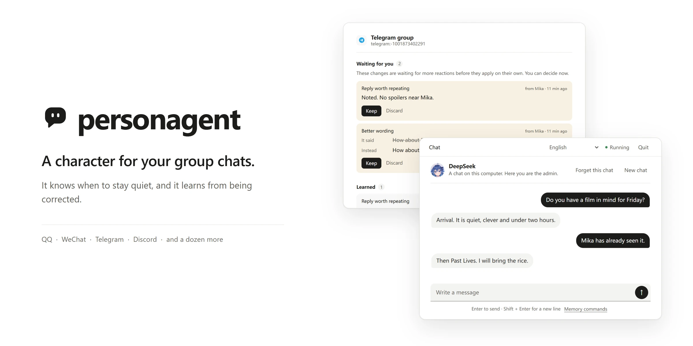
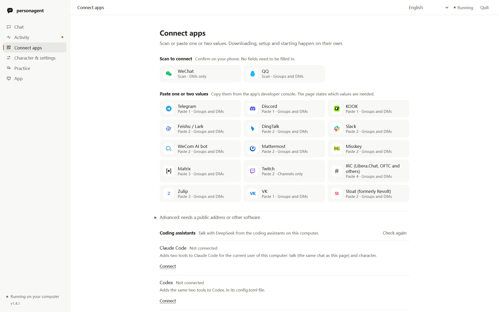

<p align="center">
  
</p>

<h3 align="center">Ein Agent, der sich wie ein Mensch verhält, auf allen Plattformen, die Sie nutzen.<br>Er hat eine eigene Persönlichkeit, merkt sich Dinge, lernt von den Menschen, mit denen er spricht, und entscheidet selbst, wann er sich äußert.</h3>

<p align="center">
  <a href="https://pypi.org/project/personagent/"></a>
  <a href="https://github.com/wangkant/personagent/actions/workflows/ci.yml"></a>
  <a href="https://www.python.org/downloads/"></a>
  <a href="https://github.com/wangkant/personagent/blob/main/LICENSE"></a>
</p>

<p align="center"><a href="https://github.com/wangkant/personagent/blob/main/README.md">English</a> · <a href="https://github.com/wangkant/personagent/blob/main/README.zh-CN.md">简体中文</a> · <a href="https://github.com/wangkant/personagent/blob/main/docs/readme/README.zh-TW.md">繁體中文</a> · <a href="https://github.com/wangkant/personagent/blob/main/docs/readme/README.ja.md">日本語</a> · <a href="https://github.com/wangkant/personagent/blob/main/docs/readme/README.ko.md">한국어</a> · <a href="https://github.com/wangkant/personagent/blob/main/docs/readme/README.es.md">Español</a> · <a href="https://github.com/wangkant/personagent/blob/main/docs/readme/README.fr.md">Français</a> · <strong>Deutsch</strong> · <a href="https://github.com/wangkant/personagent/blob/main/docs/readme/README.pt-BR.md">Português</a> · <a href="https://github.com/wangkant/personagent/blob/main/docs/readme/README.ru.md">Русский</a></p>

*Dies ist eine Übersetzung der englischen README, die maßgeblich ist und aktueller sein kann.*

personagent läuft auf Ihrem eigenen Computer und bewahrt alles, was es speichert, dort auf. Er läuft überall dort, wo Sie ihn brauchen: in Gruppenchats und Einzelchats auf QQ, WeChat, Telegram, Discord und achtzehn weiteren Plattformen, in einem Fenster auf Ihrem Rechner und in Programmierassistenten wie Claude Code und Codex. Seine Persönlichkeit wählen Sie aus oder schreiben sie selbst, und er läuft mit einem beliebigen OpenAI-kompatiblen Modell.

<p align="center">
  
</p>

<p align="center"><em>Plattformen verbinden, auf derselben lokalen Seite wie Einrichtung und Chat mit der Figur.</em></p>

## Warum personagent

<table>
<tr>
<td width="220" valign="top"><strong>Er hat eine eigene Persönlichkeit.</strong></td>
<td valign="top">
Sieben fertige Persönlichkeiten. Drei davon sind Figuren, die die Community längst zeichnet: DeepSeek-chan, GPT-chan und Claude-chan, mit Porträts, die blinzeln, nachdenken und sprechen.<br>
Sie können die Persona jederzeit umschreiben. Was die Figur gelernt hat, bleibt erhalten.<br>
Übernehmen Sie eine Tavern-Charakterkarte als einzelne Datei, oder beschreiben Sie eine Figur in einem Satz und lassen Sie die Persona entwerfen. Ihre eigene Figur lässt sich zum Teilen als Karte speichern.
</td>
</tr>
<tr>
<td width="220" valign="top"><strong>Er schreibt wie ein Mensch.</strong></td>
<td valign="top">
Er schreibt so, wie Menschen in einem Chat schreiben: kurze, einfache Sätze in der Sprache des Gesprächs, ohne Listen, Überschriften oder Assistentenfloskeln, und er sagt es, wenn er etwas nicht weiß.<br>
Auf den meisten Plattformen kommt eine Antwort als einige kurze Nachrichten mit einer Tipp-Pause dazwischen; Telegram, Discord und Matrix zeigen währenddessen zusätzlich die Tippanzeige.<br>
Er sammelt die Sticker, die andere senden, und verwendet sie, wo sie passen. Nachts beteiligt er sich kaum, solange er nicht angesprochen wird.<br>
Wenn Sie es aktivieren, beginnt er nach längerer Stille selbst ein Gespräch und kommt auf Pläne zurück, die erwähnt wurden.
</td>
</tr>
<tr>
<td width="220" valign="top"><strong>Er merkt sich Dinge.</strong></td>
<td valign="top">
Jeder Chat hat sein eigenes Gedächtnis: letzte Nachrichten, die einen Neustart überstehen, eine Zusammenfassung des bisherigen Gesprächs, datierte Ereignisse und Fakten über Personen, die er selbst aktuell hält.<br>
Alles, was er sich merkt, steht in der Ansicht <strong>Aktivität</strong>; jeder Eintrag dort lässt sich vergessen oder zurückholen.
</td>
</tr>
<tr>
<td width="220" valign="top"><strong>Die Figur lernt aus Korrekturen, die Bestand haben.</strong></td>
<td valign="top">
Was eine Korrektur lehrt, etwa wie die Gruppe das Fitnessstudio nennt, fließt in jede spätere Antwort in diesem Chat ein.<br>
Ein Störer oder ein Unbeteiligter kann sie nicht umerziehen.<br>
Wo Reaktionen eine Änderung nicht klären können, entscheidet die Figur selbst und hält fest, warum; niemand muss etwas genehmigen.<br>
Jede Änderung wird festgehalten, und jede lässt sich zurücknehmen.
</td>
</tr>
<tr>
<td width="220" valign="top"><strong>Die Figur weiß, wann sie besser schweigt.</strong></td>
<td valign="top">
In einer Gruppe antwortet die Figur, wenn sie angesprochen wird. Andernfalls beurteilt ein Modell, ob sich ein Mensch an dieser Stelle beteiligen würde.<br>
Auf eine Flut von Nachrichten kommt eine einzige Antwort.
</td>
</tr>
<tr>
<td width="220" valign="top"><strong>Er verbindet sich mit all Ihren Plattformen.</strong></td>
<td valign="top">
Zweiundzwanzig Chat-Plattformen werden von einer einzigen Seite aus verbunden, per Scan mit dem Smartphone oder mit einigen eingefügten Werten. Die meisten unterstützen Gruppenchats ebenso wie Einzelchats.<br>
Eine verbundene Plattform antwortet nur in Chats, die Sie freigeben: Wer Ihnen unbekannt ist, erhält einen kurzen Code, und Sie geben ihn auf der Seite frei, wo **Das bin ich** Sie zudem zum Administrator macht.<br>
Derselbe Agent antwortet in einem Fenster auf Ihrem Rechner sowie in Claude Code, Codex und DeepSeek Harness.<br>
Jede Software, die eine OpenAI-kompatible Adresse annimmt, etwa Open WebUI oder SillyTavern, kann mit derselben Figur sprechen.<br>
Jede weitere Plattform lässt sich über eine AstrBot-, Koishi- oder Matrix-Brücke oder einen selbst geschriebenen Konnektor anbinden.
</td>
</tr>
<tr>
<td width="220" valign="top"><strong>Er funktioniert mit dem, was Sie haben.</strong></td>
<td valign="top">
Jedes OpenAI-kompatible Modell: die kostenlosen Modelle von OpenRouter, ein kostenpflichtiger Dienst oder ein Modell, das mit Ollama auf Ihrem eigenen Rechner läuft.<br>
Eine Zeile installiert ihn mitsamt eigenem Python, auch auf einem Computer, auf dem nichts installiert ist. Die Seite gibt es auf Englisch, Chinesisch oder in acht weiteren Sprachen, und die Anmeldung mit OpenRouter im Browser oder ein eingefügter Modellschlüssel startet den Chat; läuft bereits Ollama oder LM Studio, genügt ein Klick.
</td>
</tr>
<tr>
<td width="220" valign="top"><strong>Er nutzt die Werkzeuge, die Sie ihm geben.</strong></td>
<td valign="top">
Fügen Sie den Block aus dem README eines MCP-Servers ein, und die Figur kann über die Werkzeuge dieses Servers Dinge nachschlagen oder handeln, ein Werkzeug pro Antwort, und antwortet dabei mit ihrer eigenen Stimme.<br>
Jedes Werkzeug hat einen Schalter und eine Auswahl, wer seine Verwendung auslösen darf: nur Sie oder jeder, dem die Figur antwortet.
</td>
</tr>
<tr>
<td width="220" valign="top"><strong>Er läuft dort, wo Sie ihn brauchen.</strong></td>
<td valign="top">
Auf Ihrem eigenen Computer in einem Fenster oder auf einem Server, einem NAS oder in Docker, dauerhaft in Betrieb gehalten durch `personagent service install`.<br>
Ist ein Seitenpasswort festgelegt, öffnet sich dieselbe Seite auch auf einem Smartphone oder einem anderen Computer, geschützt durch eine Anmeldung.
</td>
</tr>
</table>

Auf Wunsch im Chat merkt er sich Dinge oder vergisst sie wieder (Nova ist der Name der Standardfigur): `Nova, remember Sam is vegetarian`, `Nova, forget vegetarian` ([Gedächtnis-Befehle](https://github.com/wangkant/personagent/blob/main/docs/guide.de.md#gedächtnis-befehle)). Was er speichert und wie lange, steht im Abschnitt [Gedächtnis](https://github.com/wangkant/personagent/blob/main/docs/guide.de.md#gedächtnis) des Handbuchs.

## Erste Schritte

Vorab muss nichts installiert werden. Fügen Sie eine Zeile in ein Terminal ein.

Windows (PowerShell):

```powershell
irm https://raw.githubusercontent.com/wangkant/personagent/main/install.ps1 | iex
```

macOS und Linux:

```sh
curl -LsSf https://raw.githubusercontent.com/wangkant/personagent/main/install.sh | sh
```

Das Installationsprogramm bringt ein eigenes Python mit, installiert personagent und öffnet es; unter Windows legt es außerdem ein Symbol auf dem Desktop an. Sind PyPI oder GitHub nur langsam erreichbar, wechselt es selbstständig zu Spiegelservern in Festlandchina. Ein erneuter Aufruf aktualisiert personagent.

Ist bereits Python 3.10 oder neuer installiert, erreichen Sie dasselbe mit `python -m pip install personagent` und anschließend `personagent`; mit [uv](https://docs.astral.sh/uv/) startet `uvx personagent` das Programm ohne gesonderten Installationsschritt. Unter Windows können Sie auch das Quellcode-ZIP herunterladen und `start.bat` doppelklicken; ist auf dem Computer kein Python vorhanden, lädt es dieses ebenfalls herunter.

Unter Windows öffnet es sich in einem eigenen Fenster, unter macOS und Linux im Browser. Klicken Sie auf **Mit OpenRouter anmelden** und geben Sie den Zugriff im Browser frei, oder fügen Sie einen API-Schlüssel für das Modell ein und klicken Sie auf **Prüfen & Chat starten**. Die kostenlosen Modelle von OpenRouter sind vorausgewählt, brauchen aber ebenfalls ein Konto oder einen Schlüssel; beides ist kostenlos. `personagent demo` spielt drei vorgefertigte Szenen ganz ohne Schlüssel ab. Die [Einstiegsanleitung](https://github.com/wangkant/personagent/blob/main/docs/start.de.md) erläutert die Seite Ansicht für Ansicht.

personagent ist kostenlos. Sie bezahlen den gewählten Modelldienst zu dessen eigenen Preisen. Eine Nachricht kann mehr als eine Modellanfrage auslösen: Neben der Antwort entscheidet die Figur bisweilen, ob sie sich in einer Gruppe äußert, beurteilt, wie eine Antwort aufgenommen wurde, oder ordnet ihr Gedächtnis. Die kostenlosen Modelle von OpenRouter erlauben 50 Anfragen pro Tag, und manche kostenlosen Anbieter speichern, was sie erhalten; Ollama führt ein Modell ganz ohne Schlüssel auf Ihrem eigenen Computer aus.

## Ihre Plattformen verbinden

Öffnen Sie **Plattformen verbinden** auf der lokalen Seite:

| Auf der Seite | Plattformen | Voraussetzung |
|---|---|---|
| Per Scan verbinden | QQ, persönliches WeChat | Ihr Smartphone. WeChat-Bots erhalten nur Einzelchats |
| Einige Werte einfügen | Telegram, Discord, Matrix, Twitch, IRC, Zulip, VK, Stoat, KOOK, Feishu/Lark, DingTalk, Slack, WeCom-KI-Bot, Mattermost, Misskey | Werte aus der Konsole der Plattform; die Seite gibt an, welche |
| Erweitert | WeCom-App, Offizielles WeChat-Konto, QQ-Webhook, OneBot v11 (NapCat), Satori | Eine öffentliche Adresse oder zusätzliche Software auf diesem Computer |

Verbundene Plattformen werden bei jedem Start von personagent automatisch mitgestartet. Die Plattformen mit Scan-Verbindung sowie Telegram, Discord, Matrix, Twitch, IRC, Zulip, VK und Stoat verbindet personagent selbst; die übrigen laufen über ein [AstrBot](https://github.com/AstrBotDevs/AstrBot), das personagent herunterlädt und im Hintergrund betreibt. Auf einem Server ohne Bildschirm verbindet `personagent connect <platform>` jede dieser zehn Plattformen im Terminal, mit denselben Schritten und Prüfungen wie die Seite, und `personagent up` startet alles ohne Browser. Die Einrichtung für jede Plattform steht im [Benutzerhandbuch](https://github.com/wangkant/personagent/blob/main/docs/guide.de.md#in-einen-chat-bringen), und die vollständige Einrichtung von QQ in der [chinesischen Deployment-Anleitung](https://github.com/wangkant/personagent/blob/main/docs/deploy.zh-CN.md).

Für alles andere gibt es auf derselben Seite **Andere Software**: Schalten Sie sie ein, kopieren Sie Adresse, Schlüssel und Modellnamen in eine beliebige Anwendung, die eine OpenAI-kompatible Adresse annimmt, und diese Anwendung spricht mit Ihrer Figur, mit demselben Gedächtnis wie überall sonst. Einzelheiten stehen im [Benutzerhandbuch](https://github.com/wangkant/personagent/blob/main/docs/guide.de.md#andere-software), und `personagent connect api` erledigt dasselbe im Terminal.

Sie betreiben bereits AstrBot, Koishi oder Matrix? personagent kann als Agent dahinter laufen: siehe [Brücken, die Sie selbst betreiben](https://github.com/wangkant/personagent/blob/main/docs/guide.de.md#brücken-die-sie-selbst-betreiben), den [Satori-Konnektor](https://github.com/wangkant/personagent/blob/main/integrations/satori/README.de.md) und den [Matrix-Konnektor](https://github.com/wangkant/personagent/blob/main/integrations/matrix/README.de.md).

## Auf einem Server

```sh
personagent page password --random   # prints a password for the page
PAGE_HOST=0.0.0.0 personagent up      # the service, the platforms and the page on port 8090
personagent service install           # keep it running after a reboot (Linux, macOS)
```

Öffnen Sie `http://<Adresse des Servers>:8090/` auf einem beliebigen Gerät und melden Sie sich mit dem Seitenpasswort an. Ohne Passwort lauscht die Seite nur auf dem Computer selbst. Unverschlüsseltes HTTP legt das Passwort gegenüber jedem Netzwerk offen, das es durchquert; nutzen Sie daher außerhalb eines Heimnetzes einen SSH-Tunnel, Tailscale oder einen Reverse-Proxy mit HTTPS. In Docker baut und startet `docker compose up -d` in einem Klon des Repositorys alles, und `docker compose logs` zeigt das beim ersten Start erzeugte Passwort; Images werden mit jedem Release unter `ghcr.io/wangkant/personagent` veröffentlicht. Die [Deployment-Anleitung](https://github.com/wangkant/personagent/blob/main/docs/deploy.de.md#auf-einem-server-einem-nas-oder-in-docker) beschreibt jeden Schritt.

## Programmierassistenten

**Einrichtung durch einen Programmierassistenten.** Geben Sie die folgende Zeile einem Programmierassistenten, der auf Ihrem Computer Befehle ausführen kann. Ihren Modellschlüssel fügen Sie selbst in die lokale Seite ein, sodass er nie über den Assistenten läuft.

```text
Lies https://raw.githubusercontent.com/wangkant/personagent/main/docs/setup-for-agents.md und richte personagent für mich ein.
```

**Mit Ihrer Figur sprechen, während Sie arbeiten.** Claude Code, Codex und DeepSeek Harness (`dsh`) erreichen die Figur, mit demselben Chat und demselben Gedächtnis wie auf der lokalen Seite:

```bash
personagent connect claude-code
personagent connect codex
personagent connect dsh
```

`--remove` entfernt die Verbindung wieder; **Programmierassistenten** unter **Plattformen verbinden** erledigt beides auch auf der Seite. Das [Benutzerhandbuch](https://github.com/wangkant/personagent/blob/main/docs/guide.de.md#programmierassistenten) erklärt die Berechtigungen und `--react`, mit dem die Figur am Ende eines Durchgangs eine kurze Bemerkung macht.

## Aktualisieren und deinstallieren

Wenn auf PyPI eine neuere Version verfügbar ist, zeigt die Seite einen Hinweis mit dem Update-Befehl. Mit pip ist das `python -m pip install -U personagent`. Bei den meisten Installationen führt **Aktualisieren und neu öffnen** in der Ansicht **App** der Seite diesen Befehl für Sie aus. Einstellungen, Figur, Gelerntes und verbundene Apps bleiben erhalten. Um personagent zu entfernen, folgen Sie [personagent entfernen](https://github.com/wangkant/personagent/blob/main/docs/guide.de.md#personagent-entfernen) im Benutzerhandbuch.

## Datenschutz

Alles, was personagent speichert, bleibt auf Ihrem Rechner, in einem personagent-Ordner. Der von Ihnen gewählte Modellanbieter sieht die Unterhaltungen, auf die er antwortet, und einmal täglich fragt personagent bei pypi.org nach, ob eine neuere Version vorliegt (`UPDATE_CHECK_ENABLED=false` deaktiviert dies). Bevor Sie die Figur mit echten Menschen verbinden, teilen Sie ihnen mit, dass es sich um einen Bot handelt, und holen Sie ihre Einwilligung ein; das [Handbuch](https://github.com/wangkant/personagent/blob/main/docs/guide.de.md#datenschutz-und-einwilligung) listet auf, was wohin geht.

## Dokumentation

- [Benutzerhandbuch](https://github.com/wangkant/personagent/blob/main/docs/guide.de.md): Einrichtung, Konnektoren, Anleitung der Figur, die Ansicht Aktivität, Fehlerbehebung.
- [Deployment-Anleitung](https://github.com/wangkant/personagent/blob/main/docs/deploy.de.md): dauerhafter Betrieb, Kosten und was zu prüfen ist, wenn der Bot verstummt.
- [Konnektor-Protokoll](https://github.com/wangkant/personagent/blob/main/docs/connectors.de.md): zum Schreiben eines eigenen Konnektors.
- [Werkzeuge](https://github.com/wangkant/personagent/blob/main/docs/tools.de.md): die Skripte in `tools/` zur Ausführung aus einem Klon.
- [Changelog](https://github.com/wangkant/personagent/blob/main/CHANGELOG.md) · [Mitwirken](https://github.com/wangkant/personagent/blob/main/.github/CONTRIBUTING.md) · [Sicherheitsrichtlinie](https://github.com/wangkant/personagent/blob/main/.github/SECURITY.md) · [Haftungsausschluss](https://github.com/wangkant/personagent/blob/main/docs/DISCLAIMER.de.md)

## Lizenz

personagent wird unter der [Apache License 2.0](https://github.com/wangkant/personagent/blob/main/LICENSE) veröffentlicht, © 2026 Qiankang (Kant) Wang: Nutzung, Änderung und Weitergabe sind kostenlos, auch für kommerzielle Zwecke. Die Konnektoren unter `integrations/` stehen unter der MIT-Lizenz. Die Versionen bis 1.4.0 wurden unter der MIT-Lizenz veröffentlicht, die Versionen 1.4.1 bis 1.5.0 unter der PolyForm Noncommercial License 1.0.0. Die drei Porträts der Figuren stehen unter CC BY-NC-SA 4.0, die keine kommerzielle Nutzung erlaubt; die Nachweise finden sich in [persona_agent/static/characters/LICENSE.md](https://github.com/wangkant/personagent/blob/main/persona_agent/static/characters/LICENSE.md).

## Danksagungen

- Andere Chatplattformen werden über [AstrBot](https://github.com/AstrBotDevs/AstrBot), [NapCat](https://github.com/NapNeko/NapCatQQ), [Koishi](https://koishi.chat) mit [satori-python](https://github.com/RF-Tar-Railt/satori-python) sowie [matrix-nio](https://github.com/matrix-nio/matrix-nio) mit den [mautrix-Bridges](https://docs.mau.fi/bridges/) erreicht; die WeChat-Verbindung folgt Tencents [Protokollnotizen zu openclaw-weixin](https://github.com/Tencent/openclaw-weixin/blob/main/docs/protocol.md).
- Das Lernen aus Reaktionen stützt sich auf [Self-Feeding Chatbot](https://arxiv.org/abs/1901.05415), [Alexa self-learning](https://arxiv.org/abs/1911.02557) und [BlenderBot 3x](https://arxiv.org/abs/2306.04707); das Lorebook folgt der World Info von [SillyTavern](https://github.com/SillyTavern/SillyTavern).
