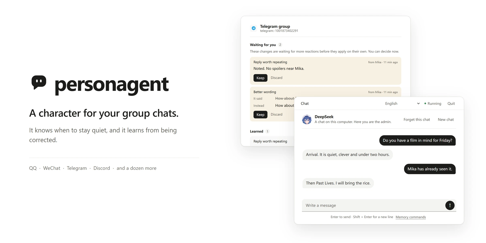
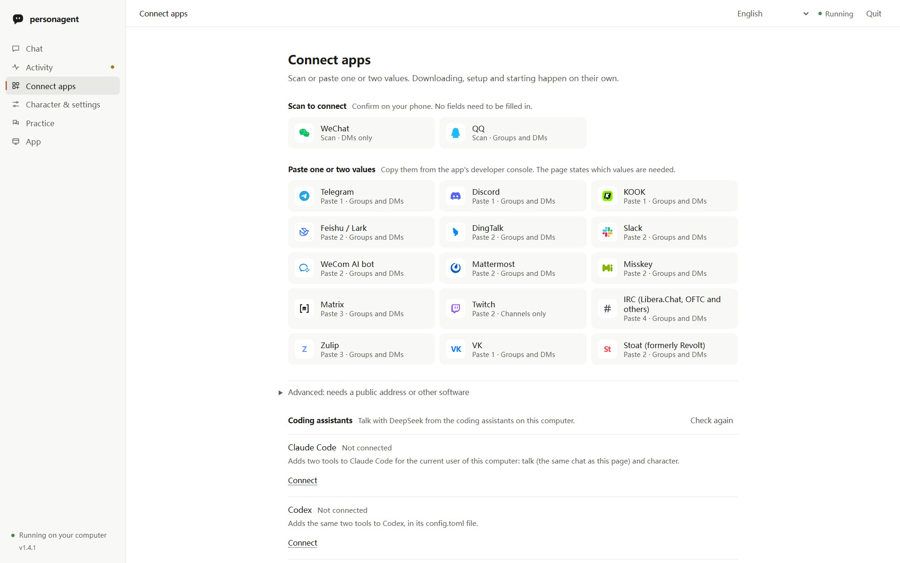

<p align="center">
  
</p>

<h3 align="center">Un agente que se comporta como una persona, en todas las plataformas que usted utiliza.<br>Tiene un carácter propio, recuerda, aprende de las personas con las que habla y decide por sí mismo cuándo intervenir.</h3>

<p align="center">
  <a href="https://pypi.org/project/personagent/"></a>
  <a href="https://github.com/wangkant/personagent/actions/workflows/ci.yml"></a>
  <a href="https://www.python.org/downloads/"></a>
  <a href="https://github.com/wangkant/personagent/blob/main/LICENSE"></a>
</p>

<p align="center"><a href="https://github.com/wangkant/personagent/blob/main/README.md">English</a> · <a href="https://github.com/wangkant/personagent/blob/main/README.zh-CN.md">简体中文</a> · <a href="https://github.com/wangkant/personagent/blob/main/docs/readme/README.zh-TW.md">繁體中文</a> · <a href="https://github.com/wangkant/personagent/blob/main/docs/readme/README.ja.md">日本語</a> · <a href="https://github.com/wangkant/personagent/blob/main/docs/readme/README.ko.md">한국어</a> · <strong>Español</strong> · <a href="https://github.com/wangkant/personagent/blob/main/docs/readme/README.fr.md">Français</a> · <a href="https://github.com/wangkant/personagent/blob/main/docs/readme/README.de.md">Deutsch</a> · <a href="https://github.com/wangkant/personagent/blob/main/docs/readme/README.pt-BR.md">Português</a> · <a href="https://github.com/wangkant/personagent/blob/main/docs/readme/README.ru.md">Русский</a></p>

*Esta es una traducción del README en inglés, que es la versión de referencia y puede estar más actualizada.*

personagent se ejecuta en su propio equipo y guarda allí todo lo que almacena. Funciona allí donde usted lo necesite: en chats de grupo y chats privados de QQ, WeChat, Telegram, Discord y otras dieciocho plataformas, en una ventana de su equipo y dentro de asistentes de programación como Claude Code y Codex. Usted elige o redacta su carácter, y funciona con cualquier modelo compatible con OpenAI.

<p align="center">
  
</p>

<p align="center"><em>Conectar plataformas, en la misma página local que la configuración y el chat con el personaje.</em></p>

## Por qué personagent

<table>
<tr>
<td width="220" valign="top"><strong>Tiene un carácter propio.</strong></td>
<td valign="top">
Siete personalidades predefinidas. Tres son personajes que la comunidad ya dibuja: la chica ballena de DeepSeek, la chica dragón de GPT y la dama Claude, con retratos que parpadean, piensan y hablan.<br>
Puede modificar el perfil del personaje en cualquier momento. Lo que ha aprendido se conserva.<br>
Incorpore una tarjeta de personaje de Tavern como un único archivo, o describa un personaje en una frase y obtenga un borrador del perfil. Su propio personaje se puede guardar como tarjeta para compartirlo.
</td>
</tr>
<tr>
<td width="220" valign="top"><strong>Habla como una persona.</strong></td>
<td valign="top">
Escribe como escriben las personas en un chat: frases cortas y sencillas en el idioma de la conversación, sin listas, títulos ni fórmulas de asistente, y dice que no sabe algo cuando no lo sabe.<br>
En la mayoría de las plataformas, la respuesta llega en varios mensajes cortos, con una pausa entre ellos como la de quien escribe; Telegram, Discord y Matrix muestran además el indicador de escritura.<br>
Recoge los stickers que envían las personas y los usa cuando encajan, y de madrugada apenas interviene si no lo llaman.<br>
Si usted lo activa, inicia una conversación tras un silencio prolongado y retoma los planes que las personas mencionaron.
</td>
</tr>
<tr>
<td width="220" valign="top"><strong>Recuerda.</strong></td>
<td valign="top">
Cada chat tiene su propia memoria: mensajes recientes que se conservan tras un reinicio, un resumen de la conversación anterior, acontecimientos con fecha y hechos sobre las personas, que mantiene actualizados por sí mismo.<br>
Todo lo que recuerda aparece en la vista Actividad, donde cualquier elemento puede olvidarse o recuperarse.
</td>
</tr>
<tr>
<td width="220" valign="top"><strong>Aprende de las correcciones fundadas.</strong></td>
<td valign="top">
Lo que enseña una corrección, como el nombre que el grupo da al gimnasio, se aplica a todas las respuestas posteriores en ese chat.<br>
Un troll o un simple espectador no pueden volver a entrenarlo.<br>
Cuando las reacciones no pueden resolver un cambio, decide por sí mismo y registra el motivo; nadie tiene que aprobar nada.<br>
Cada cambio queda registrado y cualquiera de ellos puede revertirse.
</td>
</tr>
<tr>
<td width="220" valign="top"><strong>Sabe cuándo guardar silencio.</strong></td>
<td valign="top">
En un grupo, responde cuando se dirigen a él. En caso contrario, un modelo determina si una persona intervendría.<br>
Una ráfaga de mensajes recibe una sola respuesta.
</td>
</tr>
<tr>
<td width="220" valign="top"><strong>Se conecta a todas sus plataformas.</strong></td>
<td valign="top">
Veintidós plataformas de chat se conectan desde una sola página, escaneando un código con el teléfono o pegando algunos valores. La mayoría admite tanto chats de grupo como chats privados.<br>
Una plataforma que usted conecta solo responde a los chats que usted aprueba: un desconocido recibe un código corto y usted lo aprueba en la página, donde **Soy yo** además lo convierte a usted en administrador.<br>
El mismo agente responde en una ventana de su equipo y dentro de Claude Code, Codex y DeepSeek Harness.<br>
Cualquier software que admita una dirección compatible con OpenAI, como Open WebUI o SillyTavern, puede hablar con el mismo personaje.<br>
Cualquier otra plataforma puede añadirse mediante un puente de AstrBot, Koishi o Matrix, o con un conector que usted mismo escriba.
</td>
</tr>
<tr>
<td width="220" valign="top"><strong>Funciona con lo que usted ya tiene.</strong></td>
<td valign="top">
Cualquier modelo compatible con OpenAI: los modelos gratuitos de OpenRouter, un servicio de pago o uno que se ejecute en su propio equipo con Ollama.<br>
Una sola línea lo instala, con su propio Python, en un equipo que no tenga nada instalado. La página está en inglés, en chino o en otros ocho idiomas, y basta con iniciar sesión con OpenRouter en el navegador, o con pegar una clave de modelo, para empezar a chatear; si Ollama o LM Studio ya se están ejecutando, basta con un clic.
</td>
</tr>
<tr>
<td width="220" valign="top"><strong>Usa las herramientas que usted le da.</strong></td>
<td valign="top">
Pegue el bloque del README de un servidor MCP, y el personaje podrá consultar información o actuar mediante las herramientas de ese servidor, una por respuesta, respondiendo con su propia voz.<br>
Cada herramienta tiene un interruptor y una opción de quién puede hacer que se use: solo usted o cualquier persona a la que responda el personaje.
</td>
</tr>
<tr>
<td width="220" valign="top"><strong>Se ejecuta donde usted lo necesita.</strong></td>
<td valign="top">
En su propio equipo, en una ventana, o en un servidor, un NAS o en Docker, donde `personagent service install` lo mantiene en ejecución.<br>
Con una contraseña de la página configurada, la misma página se abre desde un teléfono u otro equipo, tras iniciar sesión.
</td>
</tr>
</table>

También recuerda y olvida lo que se le pide en el chat (Nova es el nombre del personaje predeterminado): `Nova, remember Sam is vegetarian`, `Nova, forget vegetarian` ([comandos de memoria](https://github.com/wangkant/personagent/blob/main/docs/guide.es.md#comandos-de-memoria)). Qué conserva y durante cuánto tiempo se explica en la sección [memoria](https://github.com/wangkant/personagent/blob/main/docs/guide.es.md#memoria) de la guía.

## Primeros pasos

No hace falta instalar nada antes. Pegue una línea en un terminal.

Windows (PowerShell):

```powershell
irm https://raw.githubusercontent.com/wangkant/personagent/main/install.ps1 | iex
```

macOS y Linux:

```sh
curl -LsSf https://raw.githubusercontent.com/wangkant/personagent/main/install.sh | sh
```

El instalador trae su propio Python, instala personagent y lo abre; en Windows también coloca un icono en el escritorio. Si PyPI o GitHub responden con lentitud, cambia por sí mismo a servidores espejo de China continental. Ejecutarlo de nuevo actualiza personagent.

Si ya tiene instalado Python 3.10 o posterior, `python -m pip install personagent` y después `personagent` hacen lo mismo, y con [uv](https://docs.astral.sh/uv/), `uvx personagent` lo ejecuta sin un paso de instalación independiente. En Windows también puede descargar el ZIP del código fuente y hacer doble clic en `start.bat`, que también descarga Python si el equipo no lo tiene.

En Windows se abre en una ventana propia, y en macOS y Linux, en el navegador. Pulse **Iniciar sesión con OpenRouter** y apruebe el acceso en el navegador, o pegue la clave de API de su modelo y seleccione **Verificar e iniciar el chat**. Los modelos gratuitos de OpenRouter están preseleccionados, pero también necesitan una cuenta o una clave, que no tienen coste. `personagent demo` reproduce tres escenas guionizadas sin ninguna clave. La [guía de primeros pasos](https://github.com/wangkant/personagent/blob/main/docs/start.es.md) recorre la página pantalla por pantalla.

personagent es gratuito. Usted paga al servicio de modelos que elija, según sus propias tarifas. Un mensaje puede generar más de una solicitud al modelo: además de la respuesta, el personaje a veces decide si intervenir en un grupo, valora cómo se recibió una respuesta u ordena su memoria. Los modelos gratuitos de OpenRouter admiten 50 solicitudes al día, y algunos proveedores gratuitos conservan lo que reciben; Ollama ejecuta un modelo en su propio equipo sin clave.

## Conectar sus plataformas

Abra **Conectar plataformas** en la página local:

| En la página | Plataformas | Requisitos |
|---|---|---|
| Escanear para conectar | QQ, WeChat personal | Su teléfono. Los bots de WeChat solo admiten chats individuales |
| Pegar algunos valores | Telegram, Discord, Matrix, Twitch, IRC, Zulip, VK, Stoat, KOOK, Feishu/Lark, DingTalk, Slack, bot de IA de WeCom, Mattermost, Misskey | Valores de la consola de la plataforma; la página indica cuáles |
| Avanzado | App de WeCom, cuenta oficial de WeChat, webhook de QQ, OneBot v11 (NapCat), Satori | Una dirección pública u otro software en este equipo |

Las plataformas conectadas se vuelven a iniciar cada vez que se inicia personagent. personagent conecta por sí mismo las plataformas que se conectan mediante escaneo, Telegram, Discord, Matrix, Twitch, IRC, Zulip, VK y Stoat; las demás utilizan un [AstrBot](https://github.com/AstrBotDevs/AstrBot) que descarga y ejecuta en segundo plano. En un servidor sin pantalla, `personagent connect <plataforma>` conecta cualquiera de esas diez plataformas desde el terminal, con los mismos pasos y comprobaciones que la página, y `personagent up` lo inicia todo sin navegador. La configuración de cada plataforma se describe en la [guía de usuario](https://github.com/wangkant/personagent/blob/main/docs/guide.es.md#llevar-el-personaje-a-un-chat), y la de QQ desde cero, en la [guía de despliegue en chino](https://github.com/wangkant/personagent/blob/main/docs/deploy.zh-CN.md).

Para todo lo demás está **Otro software** en la misma página: actívelo, copie la dirección, la clave y el nombre del modelo en cualquier aplicación que admita una dirección compatible con OpenAI, y esa aplicación hablará con su personaje, con la misma memoria que en cualquier otro lugar. La [guía de usuario](https://github.com/wangkant/personagent/blob/main/docs/guide.es.md#otro-software) ofrece los detalles, y `personagent connect api` hace lo mismo desde un terminal.

¿Ya utiliza AstrBot, Koishi o Matrix? personagent puede funcionar detrás de cualquiera de ellos como el agente: consulte [puentes que ejecuta usted](https://github.com/wangkant/personagent/blob/main/docs/guide.es.md#puentes-que-ejecuta-usted), el [conector de Satori](https://github.com/wangkant/personagent/blob/main/integrations/satori/README.es.md) y el [conector de Matrix](https://github.com/wangkant/personagent/blob/main/integrations/matrix/README.es.md).

## En un servidor

```sh
personagent page password --random   # prints a password for the page
PAGE_HOST=0.0.0.0 personagent up      # the service, the platforms and the page on port 8090
personagent service install           # keep it running after a reboot (Linux, macOS)
```

Abra `http://<dirección del servidor>:8090/` desde cualquier dispositivo e inicie sesión con la contraseña de la página. Sin contraseña, la página se niega a escuchar más allá del propio equipo. El HTTP sin cifrar expone la contraseña a la red que atraviesa, por lo que, fuera de una red doméstica, use un túnel SSH, Tailscale o un proxy inverso con HTTPS. En Docker, `docker compose up -d` en un clon del repositorio lo compila y lo inicia, y `docker compose logs` muestra la contraseña creada en el primer inicio; con cada versión se publican imágenes en `ghcr.io/wangkant/personagent`. La [guía de despliegue](https://github.com/wangkant/personagent/blob/main/docs/deploy.es.md#en-un-servidor-un-nas-o-en-docker) detalla cada paso.

## Asistentes de programación

**Configuración mediante un asistente.** Proporcione la línea siguiente a un asistente de programación que pueda ejecutar comandos en su equipo. Usted mismo pega la clave del modelo en la página local, por lo que la clave nunca pasa por el asistente.

```text
Lee https://raw.githubusercontent.com/wangkant/personagent/main/docs/setup-for-agents.md y configura personagent por mí.
```

**Conversación con el personaje mientras trabaja.** Claude Code, Codex y DeepSeek Harness (`dsh`) pueden hablar con el personaje, con el mismo chat y la misma memoria que en la página local:

```bash
personagent connect claude-code
personagent connect codex
personagent connect dsh
```

`--remove` lo vuelve a quitar, y **Asistentes de programación**, en **Conectar plataformas**, permite hacer ambas cosas desde la página. La [guía](https://github.com/wangkant/personagent/blob/main/docs/guide.es.md#asistentes-de-programación) explica los permisos y `--react`, que permite que el personaje diga una frase al terminar un turno.

## Actualizar y desinstalar

Cuando hay una versión más reciente en PyPI, la página muestra un aviso con el comando de actualización. Con pip, el comando es `python -m pip install -U personagent`. En la mayoría de las instalaciones, **Actualizar y volver a abrir**, en la vista **Aplicación** de la página, lo ejecuta por usted. Los ajustes, el personaje, lo que ha aprendido y las plataformas conectadas se conservan. Para desinstalarlo, siga [Desinstalar personagent](https://github.com/wangkant/personagent/blob/main/docs/guide.es.md#desinstalar-personagent) en la guía.

## Privacidad

Todo lo que personagent guarda permanece en su equipo, en una única carpeta de personagent. El proveedor de modelos que elija ve las conversaciones a las que responde, y una vez al día personagent consulta a pypi.org si hay una versión más reciente (`UPDATE_CHECK_ENABLED=false` lo desactiva). Antes de conectarlo con personas reales, infórmeles de que es un bot y obtenga su consentimiento; la [guía](https://github.com/wangkant/personagent/blob/main/docs/guide.es.md#privacidad-y-consentimiento) detalla qué información se envía a cada lugar.

## Documentación

- [Guía de usuario](https://github.com/wangkant/personagent/blob/main/docs/guide.es.md): configuración, conectores, cómo enseñar al personaje, la vista Actividad y solución de problemas.
- [Guía de despliegue](https://github.com/wangkant/personagent/blob/main/docs/deploy.es.md): puesta en producción, costes y qué revisar cuando el bot deja de responder.
- [Protocolo de conectores](https://github.com/wangkant/personagent/blob/main/docs/connectors.es.md): para escribir su propio conector.
- [Herramientas](https://github.com/wangkant/personagent/blob/main/docs/tools.es.md): los scripts de `tools/`, para ejecutarlos desde un clon.
- [Registro de cambios](https://github.com/wangkant/personagent/blob/main/CHANGELOG.md) · [Cómo contribuir](https://github.com/wangkant/personagent/blob/main/.github/CONTRIBUTING.md) · [Política de seguridad](https://github.com/wangkant/personagent/blob/main/.github/SECURITY.md) · [Aviso legal](https://github.com/wangkant/personagent/blob/main/docs/DISCLAIMER.es.md)

## Licencia

personagent se publica bajo la [Apache License 2.0](https://github.com/wangkant/personagent/blob/main/LICENSE) © 2026 Qiankang (Kant) Wang: su uso, modificación y distribución son gratuitos, también con fines comerciales. Los conectores de `integrations/` están bajo la licencia MIT. Las versiones hasta la 1.4.0 se publicaron bajo la licencia MIT, y las versiones 1.4.1 a 1.5.0 bajo la PolyForm Noncommercial License 1.0.0. Los tres retratos de personajes tienen licencia CC BY-NC-SA 4.0, que no permite el uso comercial, con los créditos en [persona_agent/static/characters/LICENSE.md](https://github.com/wangkant/personagent/blob/main/persona_agent/static/characters/LICENSE.md).

## Agradecimientos

- Las demás plataformas de chat se integran a través de [AstrBot](https://github.com/AstrBotDevs/AstrBot), [NapCat](https://github.com/NapNeko/NapCatQQ), [Koishi](https://koishi.chat) con [satori-python](https://github.com/RF-Tar-Railt/satori-python), y [matrix-nio](https://github.com/matrix-nio/matrix-nio) con los [puentes de mautrix](https://docs.mau.fi/bridges/); la conexión con WeChat sigue las [notas del protocolo openclaw-weixin](https://github.com/Tencent/openclaw-weixin/blob/main/docs/protocol.md) de Tencent.
- El aprendizaje a partir de reacciones se basa en [Self-Feeding Chatbot](https://arxiv.org/abs/1901.05415), [Alexa self-learning](https://arxiv.org/abs/1911.02557) y [BlenderBot 3x](https://arxiv.org/abs/2306.04707); el lorebook sigue el World Info de [SillyTavern](https://github.com/SillyTavern/SillyTavern).
