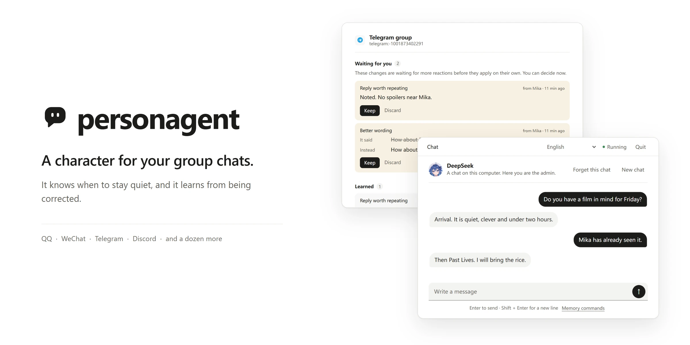
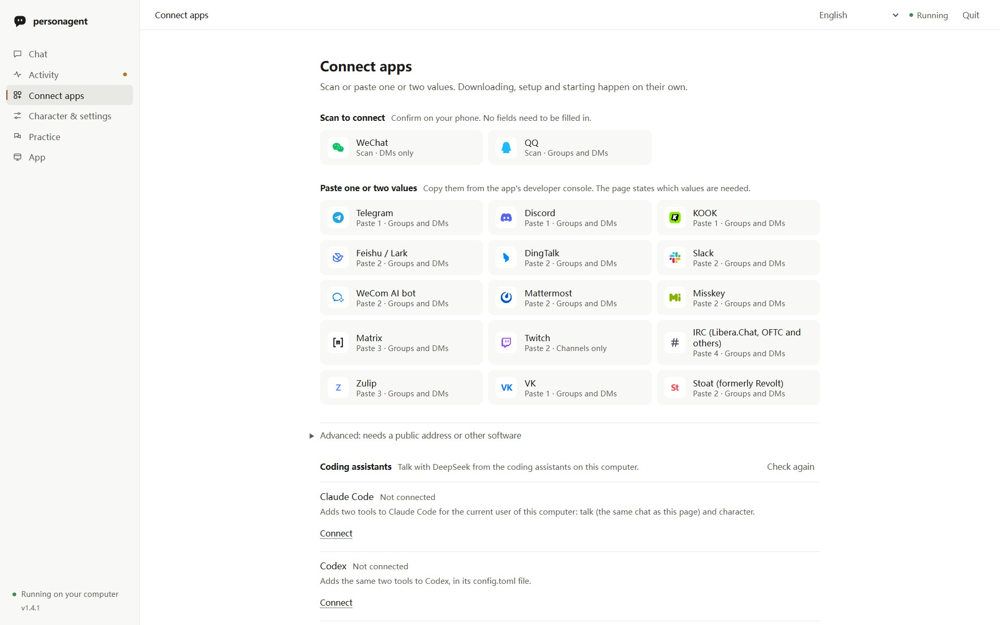

<p align="center">
  
</p>

<h3 align="center">Un agent qui se comporte comme une personne, sur toutes les plateformes que vous utilisez.<br>Il a un caractère qui lui est propre, se souvient, apprend des personnes avec qui il parle et juge par lui-même quand prendre la parole.</h3>

<p align="center">
  <a href="https://pypi.org/project/personagent/"></a>
  <a href="https://github.com/wangkant/personagent/actions/workflows/ci.yml"></a>
  <a href="https://www.python.org/downloads/"></a>
  <a href="https://github.com/wangkant/personagent/blob/main/LICENSE"></a>
</p>

<p align="center"><a href="https://github.com/wangkant/personagent/blob/main/README.md">English</a> · <a href="https://github.com/wangkant/personagent/blob/main/README.zh-CN.md">简体中文</a> · <a href="https://github.com/wangkant/personagent/blob/main/docs/readme/README.zh-TW.md">繁體中文</a> · <a href="https://github.com/wangkant/personagent/blob/main/docs/readme/README.ja.md">日本語</a> · <a href="https://github.com/wangkant/personagent/blob/main/docs/readme/README.ko.md">한국어</a> · <a href="https://github.com/wangkant/personagent/blob/main/docs/readme/README.es.md">Español</a> · <strong>Français</strong> · <a href="https://github.com/wangkant/personagent/blob/main/docs/readme/README.de.md">Deutsch</a> · <a href="https://github.com/wangkant/personagent/blob/main/docs/readme/README.pt-BR.md">Português</a> · <a href="https://github.com/wangkant/personagent/blob/main/docs/readme/README.ru.md">Русский</a></p>

*Ceci est une traduction du README anglais, qui fait référence et peut être plus récent.*

personagent fonctionne sur votre propre ordinateur et y conserve tout ce qu'il enregistre. Il fonctionne partout où vous en avez besoin : dans les discussions de groupe et les discussions privées sur QQ, WeChat, Telegram, Discord et dix-huit autres plateformes, dans une fenêtre sur votre ordinateur et au sein d'assistants de programmation tels que Claude Code et Codex. Vous choisissez ou rédigez son caractère, et il fonctionne avec n'importe quel modèle compatible OpenAI.

<p align="center">
  
</p>

<p align="center"><em>Connecter des plateformes, dans la même page locale que la configuration et la discussion avec le personnage.</em></p>

## Pourquoi personagent

<table>
<tr>
<td width="220" valign="top"><strong>Il a un caractère qui lui est propre.</strong></td>
<td valign="top">
Sept personnalités prédéfinies. Trois sont des personnages que la communauté dessine déjà : DeepSeek-chan, GPT-chan et Claude-chan, avec des portraits qui clignent des yeux, réfléchissent et parlent.<br>
Vous pouvez réécrire la fiche du personnage à tout moment. Ce qu'il a appris est conservé.<br>
Importez une carte de personnage Tavern en un seul fichier, ou décrivez un personnage en une phrase et laissez rédiger sa fiche. Votre propre personnage s'enregistre sous forme de carte à partager.
</td>
</tr>
<tr>
<td width="220" valign="top"><strong>Il parle comme une personne.</strong></td>
<td valign="top">
Il écrit comme on écrit dans une discussion : des phrases courtes et simples dans la langue de la conversation, sans listes, sans titres ni formules d'assistant, et il le dit quand il ne sait pas.<br>
Sur la plupart des plateformes, une réponse arrive en quelques messages courts, séparés par le temps d'une saisie ; Telegram, Discord et Matrix affichent en plus l'indicateur de saisie.<br>
Il récupère les autocollants que les gens envoient et les utilise quand ils conviennent, et la nuit il n'intervient guère à moins d'être appelé.<br>
Si vous l'activez, il lance une conversation après un long silence et revient sur les projets que les gens ont évoqués.
</td>
</tr>
<tr>
<td width="220" valign="top"><strong>Il se souvient.</strong></td>
<td valign="top">
Chaque discussion a sa propre mémoire : des messages récents qui survivent à un redémarrage, un résumé de la conversation antérieure, des événements datés et des faits concernant les personnes, qu'il tient à jour lui-même.<br>
Tout ce dont il se souvient figure dans la vue **Activité**, où chaque élément peut être oublié ou rétabli.
</td>
</tr>
<tr>
<td width="220" valign="top"><strong>Il apprend des corrections confirmées.</strong></td>
<td valign="top">
Ce qu'une correction lui apprend, comme le nom que le groupe donne à la salle de sport, se retrouve dans toutes ses réponses suivantes dans cette discussion.<br>
Un troll ou un simple spectateur ne peut pas le rééduquer.<br>
Lorsque les réactions ne permettent pas de trancher un changement, il décide lui-même et consigne pourquoi ; personne n'a rien à approuver.<br>
Chaque changement est consigné, et chacun peut être annulé.
</td>
</tr>
<tr>
<td width="220" valign="top"><strong>Il sait quand se taire.</strong></td>
<td valign="top">
Dans un groupe, il répond quand on l'appelle. Sinon, un modèle juge si une personne interviendrait.<br>
Une rafale de messages reçoit une seule réponse.
</td>
</tr>
<tr>
<td width="220" valign="top"><strong>Il se connecte à toutes vos plateformes.</strong></td>
<td valign="top">
Vingt-deux plateformes de discussion se connectent depuis une seule page, en scannant un code avec votre téléphone ou en collant quelques valeurs. La plupart acceptent les discussions de groupe comme les discussions privées.<br>
Une plateforme connectée ne répond qu'aux discussions que vous approuvez : un inconnu reçoit un code court, et vous l'approuvez dans la page, où **C'est moi** fait aussi de vous l'administrateur.<br>
Le même agent répond dans une fenêtre sur votre ordinateur ainsi que dans Claude Code, Codex et DeepSeek Harness.<br>
Tout logiciel qui accepte une adresse compatible OpenAI, comme Open WebUI ou SillyTavern, peut parler au même personnage.<br>
Toute autre plateforme peut être ajoutée par un pont AstrBot, Koishi ou Matrix, ou par un connecteur que vous écrivez.
</td>
</tr>
<tr>
<td width="220" valign="top"><strong>Il fonctionne avec ce que vous avez.</strong></td>
<td valign="top">
N'importe quel modèle compatible OpenAI : les modèles gratuits d'OpenRouter, un service payant ou un modèle exécuté sur votre propre ordinateur avec Ollama.<br>
Une seule ligne l'installe, avec son propre Python, sur un ordinateur où rien n'est installé. La page est en anglais, en chinois ou dans huit autres langues, et une connexion avec OpenRouter dans le navigateur, ou une clé de modèle collée, suffit pour commencer la discussion ; si Ollama ou LM Studio tourne déjà, un clic suffit.
</td>
</tr>
<tr>
<td width="220" valign="top"><strong>Il utilise les outils que vous lui donnez.</strong></td>
<td valign="top">
Collez le bloc tiré du README d'un serveur MCP, et le personnage peut chercher des informations ou agir au moyen des outils de ce serveur, un par réponse, en répondant avec sa propre voix.<br>
Chaque outil a un interrupteur et un choix de qui peut en déclencher l'utilisation : vous seul, ou toute personne à qui le personnage répond.
</td>
</tr>
<tr>
<td width="220" valign="top"><strong>Il s'exécute là où vous en avez besoin.</strong></td>
<td valign="top">
Sur votre propre ordinateur dans une fenêtre, ou sur un serveur, un NAS ou dans Docker, maintenu en fonctionnement par `personagent service install`.<br>
Avec un mot de passe de la page défini, la même page s'ouvre depuis un téléphone ou un autre ordinateur, derrière une connexion.
</td>
</tr>
</table>

Il retient et oublie aussi ce qu'on lui demande dans la discussion (Nova est le nom du personnage par défaut) : `Nova, remember Sam is vegetarian`, `Nova, forget vegetarian` ([commandes de mémoire](https://github.com/wangkant/personagent/blob/main/docs/guide.fr.md#commandes-de-mémoire)). Ce qu'il conserve, et pour combien de temps, est décrit dans la section [mémoire](https://github.com/wangkant/personagent/blob/main/docs/guide.fr.md#mémoire) du guide.

## Pour commencer

Rien n'est à installer au préalable. Collez une seule ligne dans un terminal.

Windows (PowerShell) :

```powershell
irm https://raw.githubusercontent.com/wangkant/personagent/main/install.ps1 | iex
```

macOS et Linux :

```sh
curl -LsSf https://raw.githubusercontent.com/wangkant/personagent/main/install.sh | sh
```

Le programme d'installation apporte son propre Python, installe personagent et l'ouvre ; sous Windows, il place aussi une icône sur le bureau. Lorsque PyPI ou GitHub répondent lentement, il passe de lui-même à des miroirs situés en Chine continentale. Le relancer met personagent à jour.

Si Python 3.10 ou une version ultérieure est déjà installé, `python -m pip install personagent` puis `personagent` produisent le même résultat, et avec [uv](https://docs.astral.sh/uv/), `uvx personagent` le lance sans étape d'installation séparée. Sous Windows, vous pouvez aussi télécharger le ZIP des sources et double-cliquer sur `start.bat`, qui télécharge également Python si l'ordinateur n'en dispose pas.

Il s'ouvre dans sa propre fenêtre sous Windows, et dans votre navigateur sous macOS et Linux. Cliquez sur **Se connecter avec OpenRouter** et approuvez dans le navigateur, ou collez une clé API de modèle et cliquez sur **Vérifier et commencer la discussion**. Les modèles gratuits d'OpenRouter sont présélectionnés, mais ils demandent eux aussi un compte ou une clé, qui ne coûte rien. `personagent demo` joue trois scènes écrites d'avance sans aucune clé. Le [guide de démarrage](https://github.com/wangkant/personagent/blob/main/docs/start.fr.md) parcourt la page écran par écran.

personagent est gratuit. Vous payez le service de modèle que vous choisissez, à ses propres tarifs. Un message peut entraîner plusieurs requêtes au modèle : outre la réponse, le personnage décide parfois s'il intervient dans un groupe, évalue l'accueil d'une réponse ou met de l'ordre dans sa mémoire. Les modèles gratuits d'OpenRouter autorisent 50 requêtes par jour, et certains fournisseurs gratuits conservent ce qu'ils reçoivent ; Ollama exécute un modèle sur votre propre ordinateur, sans clé.

## Connectez vos plateformes

Ouvrez **Connecter des plateformes** dans la page locale :

| Sur la page | Plateformes | Ce dont vous avez besoin |
|---|---|---|
| Scanner pour connecter | QQ, WeChat personnel | Votre téléphone. Les bots WeChat ne gèrent que les discussions individuelles |
| Coller quelques valeurs | Telegram, Discord, Matrix, Twitch, IRC, Zulip, VK, Stoat, KOOK, Feishu/Lark, DingTalk, Slack, bot IA WeCom, Mattermost, Misskey | Des valeurs issues de la console de la plateforme ; la page indique lesquelles |
| Avancé | Application WeCom, compte officiel WeChat, webhook QQ, OneBot v11 (NapCat), Satori | Une adresse publique, ou un autre logiciel sur cet ordinateur |

Les plateformes connectées redémarrent à chaque lancement de personagent. personagent connecte lui-même les plateformes à scanner, Telegram, Discord, Matrix, Twitch, IRC, Zulip, VK et Stoat ; les autres passent par un [AstrBot](https://github.com/AstrBotDevs/AstrBot) qu'il télécharge et exécute en arrière-plan. Sur un serveur sans écran, `personagent connect <plateforme>` connecte n'importe laquelle de ces dix plateformes depuis le terminal, avec les mêmes étapes et les mêmes vérifications que la page, et `personagent up` démarre tout sans navigateur. La configuration de chaque plateforme est décrite dans le [guide d'utilisation](https://github.com/wangkant/personagent/blob/main/docs/guide.fr.md#le-placer-dans-une-discussion), et QQ en partant de zéro dans le [guide de déploiement en chinois](https://github.com/wangkant/personagent/blob/main/docs/deploy.zh-CN.md).

Pour tout le reste, la même page propose **Autres logiciels** : activez-le, copiez l'adresse, la clé et le nom du modèle dans toute application qui accepte une adresse compatible OpenAI, et cette application parle à votre personnage, avec la même mémoire que partout ailleurs. Le [guide d'utilisation](https://github.com/wangkant/personagent/blob/main/docs/guide.fr.md#autres-logiciels) donne les détails, et `personagent connect api` fait de même depuis un terminal.

Vous utilisez déjà AstrBot, Koishi ou Matrix ? personagent peut se placer derrière comme agent : voir les [ponts que vous exécutez vous-même](https://github.com/wangkant/personagent/blob/main/docs/guide.fr.md#ponts-que-vous-exécutez-vous-même), le [connecteur Satori](https://github.com/wangkant/personagent/blob/main/integrations/satori/README.fr.md) et le [connecteur Matrix](https://github.com/wangkant/personagent/blob/main/integrations/matrix/README.fr.md).

## Sur un serveur

```sh
personagent page password --random   # prints a password for the page
PAGE_HOST=0.0.0.0 personagent up      # the service, the platforms and the page on port 8090
personagent service install           # keep it running after a reboot (Linux, macOS)
```

Ouvrez `http://<adresse du serveur>:8090/` depuis n'importe quel appareil et connectez-vous avec le mot de passe de la page. Sans mot de passe, la page refuse d'écouter au-delà de l'ordinateur lui-même. Le HTTP simple expose le mot de passe au réseau qu'il traverse : au-delà d'un réseau domestique, utilisez donc un tunnel SSH, Tailscale ou un proxy inverse en HTTPS. Dans Docker, `docker compose up -d` dans un clone du dépôt construit et démarre l'ensemble, et `docker compose logs` affiche le mot de passe généré au premier démarrage ; des images sont publiées sur `ghcr.io/wangkant/personagent` à chaque version. Le [guide de déploiement](https://github.com/wangkant/personagent/blob/main/docs/deploy.fr.md#sur-un-serveur-un-nas-ou-dans-docker) détaille chaque étape.

## Assistants de programmation

**Laissez-en un s'occuper de l'installation.** Donnez la ligne ci-dessous à un assistant de programmation capable d'exécuter des commandes sur votre ordinateur. Vous collez vous-même votre clé de modèle dans la page locale : la clé ne passe donc jamais par l'assistant.

```text
Lis https://raw.githubusercontent.com/wangkant/personagent/main/docs/setup-for-agents.md et installe personagent pour moi.
```

**Parlez à votre personnage pendant que vous travaillez.** Claude Code, Codex et DeepSeek Harness (`dsh`) peuvent parler au personnage, avec la même conversation et la même mémoire que dans la page locale :

```bash
personagent connect claude-code
personagent connect codex
personagent connect dsh
```

`--remove` le retire à nouveau, et **Assistants de programmation**, dans **Connecter des plateformes**, effectue ces deux opérations depuis la page. Le [guide](https://github.com/wangkant/personagent/blob/main/docs/guide.fr.md#assistants-de-programmation) couvre les autorisations et `--react`, qui permet au personnage de formuler une remarque à la fin d'un tour.

## Mise à jour et désinstallation

Quand une version plus récente est sur PyPI, la page affiche un avis avec la commande de mise à jour. Avec pip, c'est `python -m pip install -U personagent`. Sur la plupart des installations, **Mettre à jour et rouvrir**, dans la vue **Application** de la page, l'exécute pour vous. Les réglages, le personnage, ce qu'il a appris et les plateformes connectées sont conservés. Pour le retirer, suivez [Désinstaller personagent](https://github.com/wangkant/personagent/blob/main/docs/guide.fr.md#désinstaller-personagent) dans le guide.

## Confidentialité

Tout ce que personagent stocke reste sur votre machine, dans un seul dossier personagent. Le fournisseur de modèle que vous choisissez voit les conversations auxquelles il répond, et une fois par jour personagent demande à pypi.org si une version plus récente est sortie (`UPDATE_CHECK_ENABLED=false` désactive cette vérification). Avant de le mettre en contact avec de vraies personnes, informez-les qu'il s'agit d'un bot et obtenez leur consentement ; le [guide](https://github.com/wangkant/personagent/blob/main/docs/guide.fr.md#confidentialité-et-consentement) détaille ce qui va où.

## Documentation

- [Guide d'utilisation](https://github.com/wangkant/personagent/blob/main/docs/guide.fr.md) : configuration, connecteurs, apprentissage, la vue Activité, dépannage.
- [Guide de déploiement](https://github.com/wangkant/personagent/blob/main/docs/deploy.fr.md) : l'exécution en production, les coûts et les vérifications à effectuer lorsque le bot se tait.
- [Protocole des connecteurs](https://github.com/wangkant/personagent/blob/main/docs/connectors.fr.md) : pour écrire votre propre connecteur.
- [Outils](https://github.com/wangkant/personagent/blob/main/docs/tools.fr.md) : les scripts de `tools/`, à lancer depuis un clone.
- [Journal des modifications](https://github.com/wangkant/personagent/blob/main/CHANGELOG.md) · [Contribuer](https://github.com/wangkant/personagent/blob/main/.github/CONTRIBUTING.md) · [Politique de sécurité](https://github.com/wangkant/personagent/blob/main/.github/SECURITY.md) · [Avertissement](https://github.com/wangkant/personagent/blob/main/docs/DISCLAIMER.fr.md)

## Licence

personagent est publié sous la [Apache License 2.0](https://github.com/wangkant/personagent/blob/main/LICENSE) © 2026 Qiankang (Kant) Wang : son utilisation, sa modification et son partage sont gratuits, y compris à des fins commerciales. Les connecteurs de `integrations/` sont sous licence MIT. Les versions jusqu'à la 1.4.0 ont été publiées sous licence MIT, et les versions 1.4.1 à 1.5.0 sous la PolyForm Noncommercial License 1.0.0. Les trois portraits de personnages sont sous licence CC BY-NC-SA 4.0, qui n'autorise pas l'usage commercial, avec les crédits dans [persona_agent/static/characters/LICENSE.md](https://github.com/wangkant/personagent/blob/main/persona_agent/static/characters/LICENSE.md).

## Remerciements

- Les autres plateformes de discussion sont atteintes via [AstrBot](https://github.com/AstrBotDevs/AstrBot), [NapCat](https://github.com/NapNeko/NapCatQQ), [Koishi](https://koishi.chat) avec [satori-python](https://github.com/RF-Tar-Railt/satori-python), et [matrix-nio](https://github.com/matrix-nio/matrix-nio) avec les [ponts mautrix](https://docs.mau.fi/bridges/) ; la connexion WeChat suit les [notes de protocole openclaw-weixin](https://github.com/Tencent/openclaw-weixin/blob/main/docs/protocol.md) de Tencent.
- L'apprentissage à partir des réactions s'inspire de [Self-Feeding Chatbot](https://arxiv.org/abs/1901.05415), de [l'auto-apprentissage d'Alexa](https://arxiv.org/abs/1911.02557) et de [BlenderBot 3x](https://arxiv.org/abs/2306.04707) ; les notes de contexte suivent le World Info de [SillyTavern](https://github.com/SillyTavern/SillyTavern).
