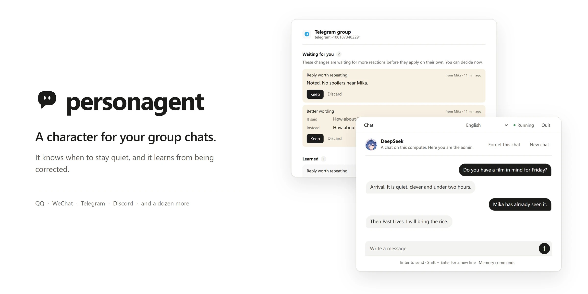
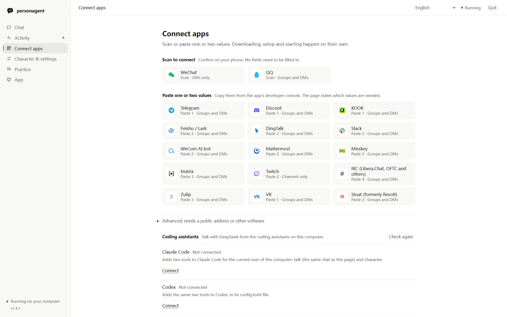

<p align="center">
  
</p>

<h3 align="center">黙るべきときを心得ていて、訂正されると学ぶ、グループチャットのためのキャラクター。</h3>

<p align="center">
  <a href="https://pypi.org/project/personagent/"></a>
  <a href="https://github.com/wangkant/personagent/actions/workflows/ci.yml"></a>
  <a href="https://www.python.org/downloads/"></a>
  <a href="https://github.com/wangkant/personagent/blob/main/LICENSE"></a>
</p>

<p align="center"><a href="https://github.com/wangkant/personagent/blob/main/README.md">English</a> · <a href="https://github.com/wangkant/personagent/blob/main/README.zh-CN.md">简体中文</a> · <a href="https://github.com/wangkant/personagent/blob/main/docs/readme/README.zh-TW.md">繁體中文</a> · <strong>日本語</strong> · <a href="https://github.com/wangkant/personagent/blob/main/docs/readme/README.ko.md">한국어</a> · <a href="https://github.com/wangkant/personagent/blob/main/docs/readme/README.es.md">Español</a> · <a href="https://github.com/wangkant/personagent/blob/main/docs/readme/README.fr.md">Français</a> · <a href="https://github.com/wangkant/personagent/blob/main/docs/readme/README.de.md">Deutsch</a> · <a href="https://github.com/wangkant/personagent/blob/main/docs/readme/README.pt-BR.md">Português</a> · <a href="https://github.com/wangkant/personagent/blob/main/docs/readme/README.ru.md">Русский</a></p>

*これは英語版 README の翻訳です。基準となるのは英語版で、こちらより新しい場合があります。*

personagent はグループチャットのためのキャラクターです。用意されたものから選ぶか自分で書き、OpenAI 互換の任意のモデルで動かせます。まず自分のコンピューターで会話を試し、その後、同じローカルページから QQ、WeChat、Telegram、Discord をはじめ、さらに 18 のプラットフォームに参加させることができます。

<p align="center">
  
</p>

<p align="center"><em>「プラットフォーム連携」は、設定やキャラクターとのチャットと同じローカルページにあります。</em></p>

## personagent を選ぶ理由

<table>
<tr>
<td width="220" valign="top"><strong>黙るべきときを心得ています。</strong></td>
<td valign="top">
呼ばれれば答えます。それ以外のときは、人ならここで口を挟むかをモデルが判断します。<br>
メッセージが立て続けに届いても、返信は 1 回です。
</td>
</tr>
<tr>
<td width="220" valign="top"><strong>確かな訂正から学びます。</strong></td>
<td valign="top">
訂正で教わったこと（たとえば、グループでジムを何と呼んでいるか）は、そのチャットでのその後のすべての返信に反映されます。<br>
荒らしや通りすがりの人が学習し直させることはできません。<br>
リアクションでは決まらない変更はキャラクター自身が判断し、その理由を記録します。誰かが承認する必要はありません。<br>
すべての変更は記録され、どれでも元に戻せます。
</td>
</tr>
<tr>
<td width="220" valign="top"><strong>簡単に始められ、グループが集まる場所で動作します。</strong></td>
<td valign="top">
コマンド 1 つで自分のコンピューター上に開きます。表示は英語、中国語、ほか 8 つの言語から選べます。<br>
モデルのキーを 1 つ貼り付ければチャットでき、スマートフォンでのスキャンか値を 1〜2 個貼り付けるだけでプラットフォームと連携できます。
</td>
</tr>
<tr>
<td width="220" valign="top"><strong>既成のキャラクターにも、自分だけのキャラクターにもできます。</strong></td>
<td valign="top">
既成の性格が 7 つあります。そのうち 3 つは、コミュニティですでに描かれてきたキャラクター、DeepSeek クジラ娘、GPT ドラゴン娘、Claude お嬢様です。立ち絵はまばたきし、考え、話します。<br>
ペルソナはいつでも書き直せます。キャラクターが学んだことは残ります。
</td>
</tr>
</table>

チャットごとに独立した記憶を持ちます。再起動しても失われない最近のメッセージ、これまでの会話の要約、日付付きの出来事、人についての事実で、キャラクターがこれらを自ら最新の状態に保ちます。頼めば忘れます：`ノヴァ、覚えて：ケイはベジタリアン`、`ノヴァ、忘れて、ベジタリアンのこと`（[記憶コマンド](https://github.com/wangkant/personagent/blob/main/docs/guide.ja.md#記憶コマンド)）。アクティビティビューには記憶しているすべての内容が表示され、どの項目も削除または復元できます（[記憶](https://github.com/wangkant/personagent/blob/main/docs/guide.ja.md#記憶)）。

## はじめに

```sh
python -m pip install personagent
personagent
```

[uv](https://docs.astral.sh/uv/) があれば、`uvx personagent` で個別のインストールなしに実行できます。Windows では、ソースの ZIP をダウンロードして `start.bat` をダブルクリックする方法もあります。

Windows では専用のウィンドウで開き、macOS と Linux ではブラウザーで開きます。モデルの API キーを貼り付けて **確認してチャットを開始** をクリックします。まだキーがない場合も、最初から OpenRouter の無料モデルが選ばれていて、そのキーは無料で取得できます。`personagent demo` はキーなしで、台本のある 3 つの場面を再生します。[はじめに](https://github.com/wangkant/personagent/blob/main/docs/start.ja.md)では、ページを画面ごとに説明しています。

personagent 自体は無料です。料金は、選んだモデルサービスに、そのサービスの料金で支払います。OpenRouter の無料モデルは 1 日 50 リクエストまで使え、無料のプロバイダーの中には受け取った内容を保持するところもあります。Ollama ならキーなしで自分のコンピューター上でモデルを動かせます。

## グループに参加させる

ローカルページで **プラットフォーム連携** を開きます。

| ページ上の表示 | プラットフォーム | 必要なもの |
|---|---|---|
| スキャンで連携 | QQ、個人 WeChat | スマートフォン。WeChat のボットは 1 対 1 のチャットのみ |
| 1〜2 個の値を貼り付け | Telegram、Discord、Matrix、Twitch、IRC、Zulip、VK、Stoat、KOOK、Feishu/Lark、DingTalk、Slack、WeCom AI ボット、Mattermost、Misskey | プラットフォームのコンソールで取得する値。どの値かはページに表示されます |
| 上級 | WeCom アプリ、WeChat 公式アカウント、QQ Webhook、OneBot v11 (NapCat)、Satori | 公開アドレス、またはこのコンピューター上の他のソフトウェア |

連携中のプラットフォームは personagent を起動するたびに再び起動します。スキャンで連携するプラットフォームと Telegram、Discord、Matrix、Twitch、IRC、Zulip、VK、Stoat には personagent が自分で接続し、それ以外は personagent がダウンロードしてバックグラウンドで動かす [AstrBot](https://github.com/AstrBotDevs/AstrBot) を経由します。ディスプレイのないサーバーでは、personagent が自分で接続するこれらのプラットフォームを、ターミナルから `personagent connect <platform>` を使ってページと同じ手順と確認で接続でき、`personagent up` でブラウザーなしですべてを起動できます。プラットフォームごとの設定方法は[ユーザーガイド](https://github.com/wangkant/personagent/blob/main/docs/guide.ja.md#チャットに入れる)に、QQ をゼロからつなぐ手順は[中国語のデプロイガイド](https://github.com/wangkant/personagent/blob/main/docs/deploy.zh-CN.md)にあります。

すでに AstrBot、Koishi、Matrix を運用している場合は、personagent をその背後でキャラクターとして動かすことができます。[自分で動かすブリッジ](https://github.com/wangkant/personagent/blob/main/docs/guide.ja.md#自分で動かすブリッジ)、[Satori コネクター](https://github.com/wangkant/personagent/blob/main/integrations/satori/README.ja.md)、[Matrix コネクター](https://github.com/wangkant/personagent/blob/main/integrations/matrix/README.ja.md)を参照してください。

## コーディングアシスタント

**セットアップを任せる。** あなたのコンピューターでコマンドを実行できるコーディングアシスタントに、下の 1 行を渡してください。モデルのキーはローカルページにあなた自身が貼り付けるので、キーがコーディングアシスタントを経由することはありません。

```text
https://raw.githubusercontent.com/wangkant/personagent/main/docs/setup-for-agents.md を読んで、personagent をセットアップしてください。
```

**作業しながらキャラクターと話す。** Claude Code、Codex、DeepSeek Harness（`dsh`）から、ローカルページと同じチャットと記憶でキャラクターに話しかけられます。

```bash
personagent connect claude-code
personagent connect codex
personagent connect dsh
```

`--remove` で元に戻せます。**プラットフォーム連携** の **コーディングアシスタント** を使えば、どちらの操作もページから行えます。権限と、ターンの終わりにキャラクターがコメントできるようにする `--react` については、[ガイド](https://github.com/wangkant/personagent/blob/main/docs/guide.ja.md#コーディングアシスタント)で説明しています。

## アップデートとアンインストール

PyPI に新しいバージョンが出ると、ページに通知とアップデートコマンドが表示されます。pip の場合は `python -m pip install -U personagent` です。ほとんどのインストールでは、ページのアプリビューにある **更新して再起動** がこのコマンドを代わりに実行します。設定、キャラクター、学習内容、連携中のプラットフォームはそのまま引き継がれます。削除するには、[アンインストール手順](https://github.com/wangkant/personagent/blob/main/docs/setup-for-agents.md#undoing-it)（英語）に従ってください。

## プライバシー

personagent が保存するものはすべて、あなたのマシン上の 1 つのホームフォルダーに置かれます。選んだモデルプロバイダーは、自分が応答する会話を見ることになります。また personagent は 1 日に 1 回、新しいバージョンが出ていないか pypi.org に問い合わせます（`UPDATE_CHECK_ENABLED=false` で止められます）。実在の人々とつなぐ前に、ボットであることを伝えて同意を得てください。何がどこに送られるかは[ガイド](https://github.com/wangkant/personagent/blob/main/docs/guide.ja.md#プライバシーと同意)に記載しています。

## ドキュメント

- [ユーザーガイド](https://github.com/wangkant/personagent/blob/main/docs/guide.ja.md)：設定、コネクター、教え方、アクティビティビュー、トラブルシューティング。
- [デプロイガイド](https://github.com/wangkant/personagent/blob/main/docs/deploy.ja.md)：本番運用、コスト、ボットが黙ってしまったときの確認事項。
- [コネクタープロトコル](https://github.com/wangkant/personagent/blob/main/docs/connectors.ja.md)：独自のコネクターを書くためのものです。
- [ツール](https://github.com/wangkant/personagent/blob/main/docs/tools.ja.md)：`tools/` 内のスクリプト。クローンから実行するためのものです。
- [変更履歴](https://github.com/wangkant/personagent/blob/main/CHANGELOG.md) · [コントリビューション](https://github.com/wangkant/personagent/blob/main/.github/CONTRIBUTING.md) · [セキュリティポリシー](https://github.com/wangkant/personagent/blob/main/.github/SECURITY.md) · [免責事項](https://github.com/wangkant/personagent/blob/main/docs/DISCLAIMER.ja.md)

## ライセンス

personagent は [PolyForm Noncommercial License 1.0.0](https://github.com/wangkant/personagent/blob/main/LICENSE) で公開されています（© 2026 Qiankang (Kant) Wang）。非商用目的であれば無料で利用・改変・共有でき、商用目的では利用できません。`integrations/` 以下のコネクターと 1.4.0 以前のバージョンは、引き続き MIT ライセンスです。3 枚のキャラクターの立ち絵は CC BY-NC-SA 4.0 でライセンスされており、クレジットは [persona_agent/static/characters/LICENSE.md](https://github.com/wangkant/personagent/blob/main/persona_agent/static/characters/LICENSE.md) にあります。

## 謝辞

- ほかのチャットプラットフォームへは、[AstrBot](https://github.com/AstrBotDevs/AstrBot)、[NapCat](https://github.com/NapNeko/NapCatQQ)、[Koishi](https://koishi.chat) と [satori-python](https://github.com/RF-Tar-Railt/satori-python)、そして [matrix-nio](https://github.com/matrix-nio/matrix-nio) と [mautrix ブリッジ](https://docs.mau.fi/bridges/)を通じて接続しています。WeChat との接続は Tencent の [openclaw-weixin プロトコルノート](https://github.com/Tencent/openclaw-weixin/blob/main/docs/protocol.md)に従っています。
- 反応からの学習は [Self-Feeding Chatbot](https://arxiv.org/abs/1901.05415)、[Alexa self-learning](https://arxiv.org/abs/1911.02557)、[BlenderBot 3x](https://arxiv.org/abs/2306.04707) を参考にしています。ロアブックは [SillyTavern](https://github.com/SillyTavern/SillyTavern) の World Info にならっています。
