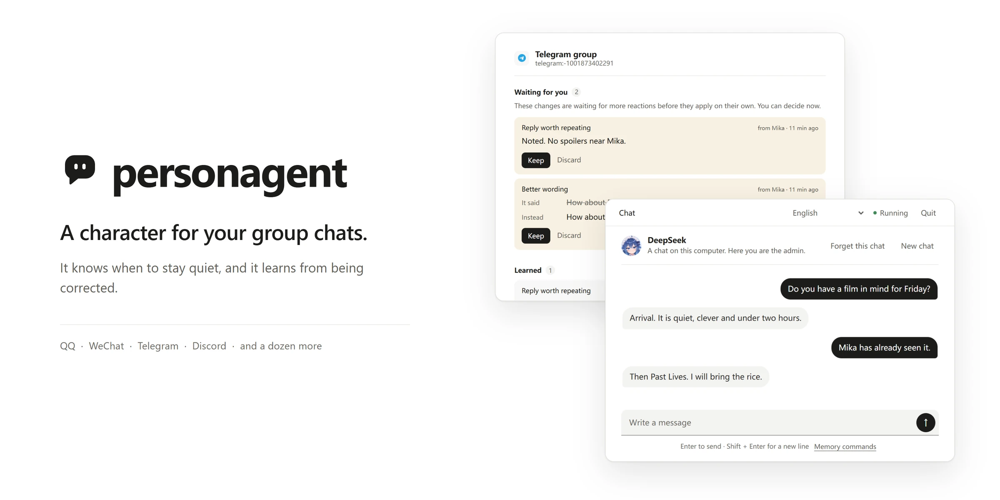
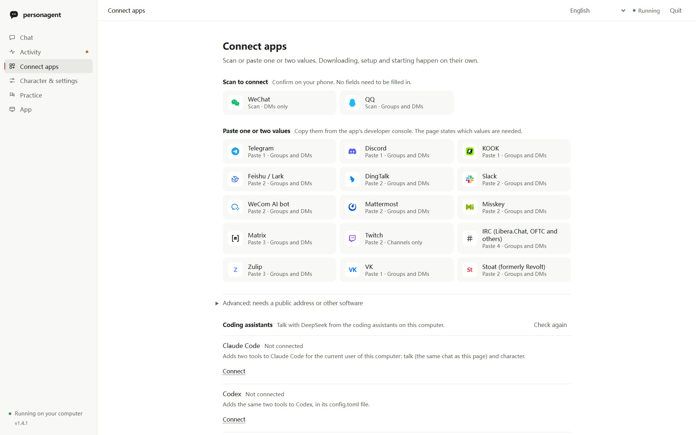

<p align="center">
  
</p>

<h3 align="center">사용하는 모든 플랫폼에서 사람처럼 행동하는 에이전트입니다.<br>고유한 캐릭터를 지니고, 기억하며, 대화 상대에게서 배우고, 언제 말할지 스스로 판단합니다.</h3>

<p align="center">
  <a href="https://pypi.org/project/personagent/"></a>
  <a href="https://github.com/wangkant/personagent/actions/workflows/ci.yml"></a>
  <a href="https://www.python.org/downloads/"></a>
  <a href="https://github.com/wangkant/personagent/blob/main/LICENSE"></a>
</p>

<p align="center"><a href="https://github.com/wangkant/personagent/blob/main/README.md">English</a> · <a href="https://github.com/wangkant/personagent/blob/main/README.zh-CN.md">简体中文</a> · <a href="https://github.com/wangkant/personagent/blob/main/docs/readme/README.zh-TW.md">繁體中文</a> · <a href="https://github.com/wangkant/personagent/blob/main/docs/readme/README.ja.md">日本語</a> · <strong>한국어</strong> · <a href="https://github.com/wangkant/personagent/blob/main/docs/readme/README.es.md">Español</a> · <a href="https://github.com/wangkant/personagent/blob/main/docs/readme/README.fr.md">Français</a> · <a href="https://github.com/wangkant/personagent/blob/main/docs/readme/README.de.md">Deutsch</a> · <a href="https://github.com/wangkant/personagent/blob/main/docs/readme/README.pt-BR.md">Português</a> · <a href="https://github.com/wangkant/personagent/blob/main/docs/readme/README.ru.md">Русский</a></p>

*이 문서는 영어 README를 번역한 것입니다. 기준이 되는 영어 README가 더 최신일 수 있습니다.*

personagent는 사용자의 컴퓨터에서 실행되며, 저장하는 모든 내용을 그 컴퓨터에 둡니다. QQ, WeChat, Telegram, Discord와 그 밖의 18개 플랫폼의 그룹 채팅과 개인 메시지, 사용자의 컴퓨터에 있는 창, Claude Code, Codex 같은 코딩 어시스턴트 등 사용하는 모든 곳에서 작동합니다. 캐릭터는 직접 고르거나 쓸 수 있으며, OpenAI 호환 모델이라면 어떤 모델로든 실행됩니다.

<p align="center">
  
</p>

<p align="center"><em>플랫폼 연결 화면은 설정, 캐릭터 채팅과 같은 로컬 페이지에 있습니다.</em></p>

## 왜 personagent인가

<table>
<tr>
<td width="220" valign="top"><strong>고유한 캐릭터를 지닙니다.</strong></td>
<td valign="top">
준비된 성격은 7가지입니다. 그중 셋은 커뮤니티에서 이미 그려 온 캐릭터인 DeepSeek쨩, GPT쨩, Claude쨩으로, 초상화가 눈을 깜빡이고, 생각하고, 말합니다.<br>
페르소나는 언제든 다시 쓸 수 있습니다. 캐릭터가 배운 것은 그대로 남습니다.<br>
Tavern 캐릭터 카드를 파일 하나로 가져오거나, 캐릭터를 한 문장으로 설명해 페르소나 초안을 받을 수 있습니다. 직접 만든 캐릭터는 공유용 카드로 저장할 수 있습니다.
</td>
</tr>
<tr>
<td width="220" valign="top"><strong>사람처럼 말합니다.</strong></td>
<td valign="top">
사람이 채팅에서 쓰듯이 씁니다. 대화에 쓰이는 언어로 짧고 쉬운 문장을 쓰며, 목록이나 제목, 상담원식 문구는 쓰지 않습니다. 모르는 것은 모른다고 말합니다.<br>
대부분의 플랫폼에서 답장은 짧은 메시지 여러 개로 나뉘어, 입력하는 데 걸릴 만한 간격을 두고 전송됩니다. Telegram, Discord, Matrix에서는 입력 중 표시도 나타납니다.<br>
사람들이 보낸 스티커를 모아 두었다가 어울리는 순간에 사용하며, 심야에는 부르지 않는 한 대화에 거의 끼어들지 않습니다.<br>
기능을 켜 두면 오랫동안 조용한 뒤 먼저 말을 걸고, 사람들이 이야기했던 계획을 나중에 다시 물어봅니다.
</td>
</tr>
<tr>
<td width="220" valign="top"><strong>기억합니다.</strong></td>
<td valign="top">
대화마다 기억이 따로 있습니다. 다시 시작해도 남는 최근 메시지, 이전 대화 요약, 날짜가 붙은 사건, 사람에 관한 사실이며, 스스로 최신 상태로 유지합니다.<br>
기억하는 모든 것은 활동 보기에 표시되며, 그 안의 어떤 항목이든 삭제하거나 복원할 수 있습니다.
</td>
</tr>
<tr>
<td width="220" valign="top"><strong>믿을 만한 지적에서 배웁니다.</strong></td>
<td valign="top">
그룹에서 헬스장을 뭐라고 부르는지처럼 지적에서 배운 내용은 그 대화의 이후 모든 답장에 반영됩니다.<br>
장난꾼이나 구경꾼이 다시 길들일 수는 없습니다.<br>
반응으로 결정할 수 없는 변경은 캐릭터가 스스로 결정하고 그 이유를 기록하므로, 누구도 승인할 필요가 없습니다.<br>
모든 변경은 기록되며, 어느 것이든 되돌릴 수 있습니다.
</td>
</tr>
<tr>
<td width="220" valign="top"><strong>언제 조용히 있어야 할지 압니다.</strong></td>
<td valign="top">
그룹에서는 부르면 답합니다. 그 밖에는 사람이라면 끼어들었을지를 모델이 판단합니다.<br>
메시지가 몰려와도 한 번만 답합니다.
</td>
</tr>
<tr>
<td width="220" valign="top"><strong>모든 플랫폼에 연결됩니다.</strong></td>
<td valign="top">
채팅 플랫폼 22개를 한 페이지에서 휴대폰 스캔 한 번이나 값 몇 개를 붙여 넣어 연결합니다. 대부분은 그룹 채팅과 개인 메시지를 모두 지원합니다.<br>
연결한 플랫폼은 사용자가 승인한 대화에만 답장합니다. 낯선 사람은 짧은 코드를 받고, 사용자가 페이지에서 승인합니다. 그곳에서 **본인입니다**를 고르면 사용자가 관리자도 됩니다.<br>
같은 에이전트가 사용자의 컴퓨터에 있는 창에서도, Claude Code, Codex, DeepSeek Harness 안에서도 답합니다.<br>
Open WebUI나 SillyTavern처럼 OpenAI 호환 주소를 입력할 수 있는 소프트웨어라면 같은 캐릭터와 대화할 수 있습니다.<br>
그 밖의 플랫폼은 AstrBot, Koishi, Matrix 브리지 또는 직접 작성한 커넥터를 통해 추가할 수 있습니다.
</td>
</tr>
<tr>
<td width="220" valign="top"><strong>지금 가진 환경에서 작동합니다.</strong></td>
<td valign="top">
OpenAI 호환 모델이라면 무엇이든 사용할 수 있습니다. OpenRouter의 무료 모델, 유료 서비스, 또는 Ollama로 사용자의 컴퓨터에서 실행하는 모델입니다.<br>
아무것도 설치되지 않은 컴퓨터에서도 한 줄로 자체 Python과 함께 설치됩니다. 페이지는 영어, 중국어 또는 다른 8개 언어로 볼 수 있고, 브라우저에서 OpenRouter로 로그인하거나 모델 키 하나만 붙여 넣으면 채팅을 시작합니다. Ollama나 LM Studio가 이미 실행 중이면 한 번 클릭하면 됩니다.
</td>
</tr>
<tr>
<td width="220" valign="top"><strong>주어진 도구를 씁니다.</strong></td>
<td valign="top">
MCP 서버 README에 있는 블록을 붙여 넣으면, 캐릭터가 그 서버의 도구로 정보를 찾거나 작업을 할 수 있습니다. 답장 하나에 도구 하나를 쓰며, 자기 말투로 답합니다.<br>
각 도구에는 스위치가 있고, 사용을 요청할 수 있는 사람을 고를 수 있습니다. 사용자만, 또는 캐릭터가 답장하는 모든 사람입니다.
</td>
</tr>
<tr>
<td width="220" valign="top"><strong>필요한 곳에서 실행됩니다.</strong></td>
<td valign="top">
내 컴퓨터의 창에서도, 서버, NAS, Docker에서도 실행되며, `personagent service install`로 계속 실행되게 할 수 있습니다.<br>
페이지 비밀번호를 설정하면 같은 페이지를 휴대폰이나 다른 컴퓨터에서 로그인하여 열 수 있습니다.
</td>
</tr>
</table>

채팅에서 부탁하면 기억하거나 잊기도 합니다(노바는 기본 캐릭터의 이름입니다). `노바 기억해: 민수는 채식주의자야`, `노바 잊어: 채식`([기억 명령](https://github.com/wangkant/personagent/blob/main/docs/guide.ko.md#기억-명령)). 무엇을 얼마 동안 보관하는지는 가이드의 [기억](https://github.com/wangkant/personagent/blob/main/docs/guide.ko.md#기억) 절에 나와 있습니다.

## 시작하기

미리 설치할 것은 없습니다. 터미널에 한 줄을 붙여 넣으십시오.

Windows(PowerShell):

```powershell
irm https://raw.githubusercontent.com/wangkant/personagent/main/install.ps1 | iex
```

macOS 및 Linux:

```sh
curl -LsSf https://raw.githubusercontent.com/wangkant/personagent/main/install.sh | sh
```

설치 프로그램은 자체 Python을 함께 가져와 personagent를 설치하고 엽니다. Windows에서는 바탕 화면에 아이콘도 만듭니다. PyPI나 GitHub 접속이 느리면 자동으로 중국 본토의 미러로 전환합니다. 다시 실행하면 personagent가 업데이트됩니다.

Python 3.10 이상이 이미 설치되어 있다면 `python -m pip install personagent`를 실행한 후 `personagent`를 실행해도 되고, [uv](https://docs.astral.sh/uv/)가 있다면 `uvx personagent`로 별도 설치 없이 실행할 수 있습니다. Windows에서는 소스 ZIP을 내려받아 `start.bat`을 더블클릭해도 되며, 컴퓨터에 Python이 없으면 이 스크립트가 Python도 가져옵니다.

Windows에서는 전용 창에서 열리고, macOS와 Linux에서는 브라우저에서 열립니다. **OpenRouter로 로그인**을 누르고 브라우저에서 승인하거나, 모델 API 키를 붙여 넣고 **확인 후 채팅 시작**을 누르십시오. 미리 선택된 OpenRouter의 무료 모델도 계정이나 키가 필요하지만, 둘 다 무료입니다. `personagent demo`는 키 없이 대본이 있는 장면 세 개를 보여 줍니다. [시작 가이드](https://github.com/wangkant/personagent/blob/main/docs/start.ko.md)가 페이지를 화면별로 안내합니다.

personagent는 무료입니다. 비용은 선택한 모델 서비스에, 그 서비스의 요금대로 냅니다. 메시지 하나가 모델 요청 여러 번으로 이어질 수 있습니다. 답장 외에도 캐릭터는 때때로 그룹에서 말할지 판단하거나, 답장이 어떻게 받아들여졌는지 판단하거나, 기억을 정리합니다. OpenRouter의 무료 모델은 하루 50회까지 요청할 수 있고, 일부 무료 제공자는 받은 내용을 보관합니다. Ollama는 키 없이 사용자의 컴퓨터에서 모델을 실행합니다.

## 플랫폼 연결하기

로컬 페이지에서 **플랫폼 연결**을 여십시오.

| 페이지 표시 | 플랫폼 | 필요한 것 |
|---|---|---|
| 스캔하여 연결 | QQ, 개인 WeChat | 휴대폰. WeChat 봇은 1:1 대화만 가능 |
| 값 몇 개 붙여넣기 | Telegram, Discord, Matrix, Twitch, IRC, Zulip, VK, Stoat, KOOK, Feishu/Lark, DingTalk, Slack, WeCom AI 봇, Mattermost, Misskey | 앱 콘솔에서 얻는 값. 어떤 값인지 페이지에 표시 |
| 고급 | WeCom 앱, WeChat 공식 계정, QQ 웹훅, OneBot v11 (NapCat), Satori | 공개 주소, 또는 이 컴퓨터의 다른 소프트웨어 |

연결된 플랫폼은 personagent가 시작될 때마다 함께 다시 시작됩니다. 스캔하여 연결하는 플랫폼과 Telegram, Discord, Matrix, Twitch, IRC, Zulip, VK, Stoat는 personagent가 직접 연결하고, 나머지는 personagent가 내려받아 백그라운드에서 실행하는 [AstrBot](https://github.com/AstrBotDevs/AstrBot)을 거칩니다. 디스플레이가 없는 서버에서는 personagent가 직접 연결하는 이 플랫폼들을 터미널에서 `personagent connect <platform>`으로 페이지와 같은 단계와 확인을 거쳐 연결할 수 있고, `personagent up`으로 브라우저 없이 모든 것을 시작합니다. 플랫폼별 설정 방법은 [사용자 가이드](https://github.com/wangkant/personagent/blob/main/docs/guide.ko.md#채팅에-넣기)에, QQ를 처음부터 연결하는 방법은 [중국어 배포 가이드](https://github.com/wangkant/personagent/blob/main/docs/deploy.zh-CN.md)에 있습니다.

그 밖의 모든 것에는 같은 페이지의 **기타 소프트웨어**가 있습니다. 켜고 주소, 키, 모델 이름을 OpenAI 호환 주소를 입력할 수 있는 앱에 복사하면, 그 앱에서 캐릭터와 대화할 수 있으며 기억도 다른 곳과 같습니다. 자세한 내용은 [가이드](https://github.com/wangkant/personagent/blob/main/docs/guide.ko.md#기타-소프트웨어)에 있으며, 터미널에서는 `personagent connect api`로 같은 작업을 할 수 있습니다.

이미 AstrBot, Koishi, Matrix를 운영 중입니까? personagent를 그 뒤에서 에이전트로 실행할 수 있습니다. [직접 실행하는 브리지](https://github.com/wangkant/personagent/blob/main/docs/guide.ko.md#직접-실행하는-브리지), [Satori 커넥터](https://github.com/wangkant/personagent/blob/main/integrations/satori/README.ko.md), [Matrix 커넥터](https://github.com/wangkant/personagent/blob/main/integrations/matrix/README.ko.md)를 참고하십시오.

## 서버에서

```sh
personagent page password --random   # 페이지 비밀번호 출력
PAGE_HOST=0.0.0.0 personagent up      # 서비스, 플랫폼, 페이지(포트 8090) 시작
personagent service install           # 재부팅 후에도 계속 실행(Linux, macOS)
```

아무 기기에서나 `http://<서버 주소>:8090/`을 열고 페이지 비밀번호로 로그인하십시오. 비밀번호가 없으면 페이지는 이 컴퓨터 밖으로 수신하지 않습니다. 암호화되지 않은 HTTP는 거쳐 가는 네트워크에 비밀번호를 드러내므로, 집 네트워크 밖에서는 SSH 터널, Tailscale 또는 HTTPS 리버스 프록시를 쓰십시오. Docker에서는 저장소 클론에서 `docker compose up -d`를 실행하면 빌드하고 시작하며, `docker compose logs`에 첫 시작 때 만든 비밀번호가 표시됩니다. 이미지는 릴리스마다 `ghcr.io/wangkant/personagent`에 게시됩니다. 각 단계는 [배포 가이드](https://github.com/wangkant/personagent/blob/main/docs/deploy.ko.md#서버-nas-또는-docker에서-실행하기)에 있습니다.

## 코딩 어시스턴트

**설정을 맡기기.** 컴퓨터에서 명령을 실행할 수 있는 코딩 어시스턴트에게 아래 한 줄을 전달하십시오. 모델 키는 직접 로컬 페이지에 붙여 넣으므로, 키가 에이전트를 거치지 않습니다.

```text
https://raw.githubusercontent.com/wangkant/personagent/main/docs/setup-for-agents.md 를 읽고 personagent를 설정해 줘.
```

**작업하면서 캐릭터와 이야기하기.** Claude Code, Codex, DeepSeek Harness(`dsh`)에서 로컬 페이지와 같은 대화와 기억으로 캐릭터를 부를 수 있습니다.

```bash
personagent connect claude-code
personagent connect codex
personagent connect dsh
```

`--remove`는 연결을 다시 해제하며, **플랫폼 연결** 아래의 **코딩 어시스턴트**에서 페이지로 연결과 해제를 모두 할 수 있습니다. 권한, 그리고 턴이 끝날 때 캐릭터가 한마디 하게 하는 `--react`는 [가이드](https://github.com/wangkant/personagent/blob/main/docs/guide.ko.md#코딩-어시스턴트)에서 다룹니다.

## 업데이트와 제거

PyPI에 새 버전이 올라오면 페이지에 알림과 업데이트 명령이 표시됩니다. pip라면 `python -m pip install -U personagent`입니다. 대부분의 설치 방식에서는 페이지의 앱 보기에 있는 **업데이트 후 다시 열기**가 이 명령을 대신 실행합니다. 설정, 캐릭터, 배운 것, 연결된 플랫폼이 모두 남습니다. 제거하려면 가이드의 [personagent 제거하기](https://github.com/wangkant/personagent/blob/main/docs/guide.ko.md#personagent-제거하기)를 따르십시오.

## 개인정보

personagent가 저장하는 모든 것은 사용자 컴퓨터의 personagent 폴더 하나에 남습니다. 선택한 모델 제공자는 자신이 답하는 대화를 보게 되며, personagent는 하루에 한 번 pypi.org에 새 버전이 나왔는지 묻습니다(`UPDATE_CHECK_ENABLED=false`로 끌 수 있습니다). 실제 사람들과 연결하기 전에 봇이라는 사실을 알리고 동의를 받으십시오. 무엇이 어디로 가는지는 [가이드](https://github.com/wangkant/personagent/blob/main/docs/guide.ko.md#개인정보와-동의)에 나와 있습니다.

## 문서

- [사용자 가이드](https://github.com/wangkant/personagent/blob/main/docs/guide.ko.md): 설정, 커넥터, 가르치기, 활동 화면, 문제 해결.
- [배포 가이드](https://github.com/wangkant/personagent/blob/main/docs/deploy.ko.md): 실제 운영하기, 비용, 봇이 조용해졌을 때 확인할 것.
- [커넥터 프로토콜](https://github.com/wangkant/personagent/blob/main/docs/connectors.ko.md): 직접 커넥터를 만들 때 참고하십시오.
- [도구](https://github.com/wangkant/personagent/blob/main/docs/tools.ko.md): 클론한 저장소에서 실행하는 `tools/`의 스크립트.
- [변경 기록](https://github.com/wangkant/personagent/blob/main/CHANGELOG.md) · [기여하기](https://github.com/wangkant/personagent/blob/main/.github/CONTRIBUTING.md) · [보안 정책](https://github.com/wangkant/personagent/blob/main/.github/SECURITY.md) · [면책 조항](https://github.com/wangkant/personagent/blob/main/docs/DISCLAIMER.ko.md)

## 라이선스

personagent는 [Apache License 2.0](https://github.com/wangkant/personagent/blob/main/LICENSE)으로 배포됩니다(© 2026 Qiankang (Kant) Wang). 상업적 목적을 포함하여 무료로 사용, 수정, 공유할 수 있습니다. `integrations/` 아래의 커넥터는 MIT 라이선스를 따릅니다. 1.4.0 이하 버전은 MIT 라이선스로, 1.4.1부터 1.5.0까지는 PolyForm Noncommercial License 1.0.0으로 배포되었습니다. 캐릭터 초상화 세 장은 CC BY-NC-SA 4.0으로 라이선스되어 상업적 목적으로는 사용할 수 없으며, 크레딧은 [persona_agent/static/characters/LICENSE.md](https://github.com/wangkant/personagent/blob/main/persona_agent/static/characters/LICENSE.md)에 있습니다.

## 감사의 말

- 다른 채팅 플랫폼에는 [AstrBot](https://github.com/AstrBotDevs/AstrBot), [NapCat](https://github.com/NapNeko/NapCatQQ), [satori-python](https://github.com/RF-Tar-Railt/satori-python)을 사용하는 [Koishi](https://koishi.chat), 그리고 [mautrix 브리지](https://docs.mau.fi/bridges/)를 사용하는 [matrix-nio](https://github.com/matrix-nio/matrix-nio)를 통해 연결합니다. WeChat 연결은 Tencent의 [openclaw-weixin 프로토콜 노트](https://github.com/Tencent/openclaw-weixin/blob/main/docs/protocol.md)를 따릅니다.
- 반응에서 배우는 방식은 [Self-Feeding Chatbot](https://arxiv.org/abs/1901.05415), [Alexa self-learning](https://arxiv.org/abs/1911.02557), [BlenderBot 3x](https://arxiv.org/abs/2306.04707)를 참고했으며, 로어북은 [SillyTavern](https://github.com/SillyTavern/SillyTavern)의 World Info를 따릅니다.
