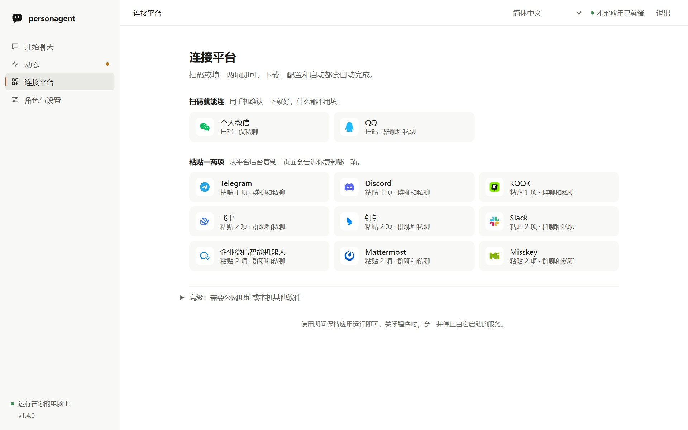

<p align="center">
  
</p>

<h3 align="center">一個知道什麼時候該安靜、能從別人的糾正中學習的群組聊天角色。</h3>

<p align="center">
  <a href="https://pypi.org/project/personagent/"></a>
  <a href="https://github.com/wangkant/personagent/actions/workflows/ci.yml"></a>
  <a href="https://www.python.org/downloads/"></a>
  <a href="https://github.com/wangkant/personagent/blob/main/LICENSE"></a>
</p>

<p align="center"><a href="https://github.com/wangkant/personagent/blob/main/README.md">English</a> · <a href="https://github.com/wangkant/personagent/blob/main/README.zh-CN.md">简体中文</a> · <strong>繁體中文</strong> · <a href="https://github.com/wangkant/personagent/blob/main/docs/readme/README.ja.md">日本語</a> · <a href="https://github.com/wangkant/personagent/blob/main/docs/readme/README.ko.md">한국어</a> · <a href="https://github.com/wangkant/personagent/blob/main/docs/readme/README.es.md">Español</a> · <a href="https://github.com/wangkant/personagent/blob/main/docs/readme/README.fr.md">Français</a> · <a href="https://github.com/wangkant/personagent/blob/main/docs/readme/README.de.md">Deutsch</a> · <a href="https://github.com/wangkant/personagent/blob/main/docs/readme/README.pt-BR.md">Português</a> · <a href="https://github.com/wangkant/personagent/blob/main/docs/readme/README.ru.md">Русский</a></p>

*本頁譯自英文版與簡體中文版，以英文版為準，英文版可能較新。*

personagent 是放進群組聊天裡的一個角色：選一個現成的或自己寫一個，接上任何相容 OpenAI 的模型就能用。先在自己電腦上和它聊，再從同一個本機頁面把它帶進 QQ、微信、Telegram、Discord 和另外十幾個平台。

<p align="center">
  
</p>

<p align="center"><em>「連接平台」和設定、角色聊天都在同一個本機頁面裡。</em></p>

## 為什麼用它

<table>
<tr>
<td width="220" valign="top"><strong>知道什麼時候該安靜</strong></td>
<td valign="top">
叫它就回。沒人叫它時，由一個模型判斷真人這時會不會接話。<br>
有人連續洗版，它只回一則。
</td>
</tr>
<tr>
<td width="220" valign="top"><strong>只從站得住腳的糾正中學習</strong></td>
<td valign="top">
糾正教會的事（例如群組裡怎麼稱呼健身房）會帶進這個聊天之後的每一則回覆。<br>
搗亂的人、旁觀者都教不壞它。<br>
每一項變更都有紀錄，哪一項都可以撤回。
</td>
</tr>
<tr>
<td width="220" valign="top"><strong>上手快，你的群組在哪它就去哪</strong></td>
<td valign="top">
一行指令就在電腦上開啟它，頁面有中文、英文和另外八種語言。<br>
填一個模型金鑰就能聊，再用手機掃描一次或貼上一兩項，就能接入一個平台。
</td>
</tr>
<tr>
<td width="220" valign="top"><strong>現成角色可以挑，也能自己寫</strong></td>
<td valign="top">
七個現成個性。其中三個是社群裡早就有人畫的角色：DeepSeek 鯨魚娘、GPT 娘（白龍）和 Claude 娘，立繪會眨眼、會思考、會開口說話。<br>
人設隨時可以改寫，角色學到的東西會留著。
</td>
</tr>
</table>

每個聊天有自己的記憶，叫它忘它就忘：`小夏 記住 阿傑喜歡貓`、`小夏 忘掉 喜歡貓`（[記憶指令](https://github.com/wangkant/personagent/blob/main/docs/guide.zh-TW.md#教它)）。

## 從這裡開始

```sh
python -m pip install personagent
personagent
```

如果裝了 [uv](https://docs.astral.sh/uv/)，`uvx personagent` 不必另外安裝就能執行。Windows 也可以下載原始碼 ZIP，雙擊 `start.bat`。

在 Windows 上，它會開一個獨立的視窗；在 macOS 和 Linux 上在瀏覽器裡開啟。貼上模型 API 金鑰，按下「驗證並開始聊天」。還沒有金鑰？預設選中的是 OpenRouter 的免費模型，它的金鑰不用付費。`personagent demo` 不用金鑰，會播放三段寫好的場景。[簡明入門](https://github.com/wangkant/personagent/blob/main/docs/start.zh-TW.md)把頁面一個畫面一個畫面講了一遍。

personagent 本身免費。錢付給你選的模型服務，依它自己的價格計算。OpenRouter 的免費模型每天可以請求 50 次，有些免費服務商會保留收到的內容；Ollama 在你自己的電腦上跑模型，不需要金鑰。

## 接進你的群組

在本機頁面開啟「連接平台」：

| 頁面分組 | 平台 | 需要準備什麼 |
|---|---|---|
| 掃描即可連接 | QQ、個人微信 | 手機。微信機器人只能一對一聊天 |
| 貼上一兩項 | Telegram、Discord、KOOK、飛書、釘釘、Slack、企業微信智慧機器人、Mattermost、Misskey | 從平台後台複製，頁面會說明要複製哪一項 |
| 進階 | 企業微信應用程式、微信公眾號、QQ（Webhook）、OneBot v11（NapCat）、Satori | 公開網址，或本機的其他軟體 |

連好的平台之後每次啟動 personagent 都會自動連上。掃描連接的平台、Telegram 和 Discord 由 personagent 自己連接；其餘平台透過它在背景下載並執行的 [AstrBot](https://github.com/AstrBotDevs/AstrBot) 接入。在伺服器上，`personagent up` 不開瀏覽器就能全部啟動。各平台的設定方法見[使用手冊](https://github.com/wangkant/personagent/blob/main/docs/guide.zh-TW.md#接進聊天平臺)；從零接上 QQ 見[部署教學](https://github.com/wangkant/personagent/blob/main/docs/deploy.zh-TW.md)。

已經在跑 AstrBot、Koishi 或 Matrix？personagent 可以接在它後面，只擔任那個角色：見[你自己執行的橋接](https://github.com/wangkant/personagent/blob/main/docs/guide.zh-TW.md#你自己執行的橋接)、[Satori 連接器](https://github.com/wangkant/personagent/blob/main/integrations/satori/README.zh-TW.md)和 [Matrix 連接器](https://github.com/wangkant/personagent/blob/main/integrations/matrix/README.zh-TW.md)。

## 程式助手

**讓程式助手幫你安裝。** 把下面這句話傳給能在你電腦上執行指令的 AI 程式助手。模型金鑰由你自己填進本機頁面，不經過助手。

```text
讀 https://raw.githubusercontent.com/wangkant/personagent/main/docs/setup-for-agents.md ，然後幫我把 personagent 安裝並設定好
```

**寫程式時和角色說話。** Claude Code、Codex 和 DeepSeek Harness（`dsh`）都能找到你的角色，聊天和記憶與本機頁面是同一份：

```bash
personagent connect claude-code
personagent connect codex
personagent connect dsh
```

`--remove` 會把它移除。權限，以及讓角色在一輪結束時說一句話的 `--react`，見[手冊](https://github.com/wangkant/personagent/blob/main/docs/guide.zh-TW.md#程式設計助手)。

## 更新與解除安裝

PyPI 上有新版本時，頁面會顯示一則提示和對應的更新指令。用 pip 安裝的話是 `python -m pip install -U personagent`。設定、角色、它學到的東西和連好的平台都會保留。要解除安裝，照[解除安裝步驟](https://github.com/wangkant/personagent/blob/main/docs/setup-for-agents.md#undoing-it)（英文）做。

## 隱私

personagent 儲存的一切都在你自己機器上的一個主目錄裡。你選的模型服務商會看到它回覆的對話；personagent 每天會向 pypi.org 查詢一次有沒有新版本（設定 `UPDATE_CHECK_ENABLED=false` 可以關閉）。接入真人之前，請告訴他們這是機器人，並徵得他們同意；哪些內容會傳到哪裡，[手冊](https://github.com/wangkant/personagent/blob/main/docs/guide.zh-TW.md#隱私與知情同意)裡都列著。

## 文件

- [使用手冊](https://github.com/wangkant/personagent/blob/main/docs/guide.zh-TW.md)：設定、連接器、教它、「動態」頁、疑難排解。
- [部署指南](https://github.com/wangkant/personagent/blob/main/docs/deploy.zh-TW.md)：真正上線要知道的事、費用，以及機器人不說話時該查什麼。
- [連接器協定](https://github.com/wangkant/personagent/blob/main/docs/connectors.zh-TW.md)：給想自己寫連接器的人看。
- [工具腳本](https://github.com/wangkant/personagent/blob/main/docs/tools.zh-TW.md)：`tools/` 裡的腳本，從複製下來的原始碼執行時使用。
- [更新日誌](https://github.com/wangkant/personagent/blob/main/CHANGELOG.md)（英文） · [貢獻指南](https://github.com/wangkant/personagent/blob/main/.github/CONTRIBUTING.md)（英文） · [安全性政策](https://github.com/wangkant/personagent/blob/main/.github/SECURITY.md)（英文） · [免責聲明](https://github.com/wangkant/personagent/blob/main/docs/DISCLAIMER.zh-TW.md)

## 授權條款

程式碼以 [MIT](https://github.com/wangkant/personagent/blob/main/LICENSE) 授權釋出，© 2026 Qiankang (Kant) Wang。三張角色立繪採用 CC BY-NC-SA 4.0 授權，姓名標示見 [persona_agent/static/characters/LICENSE.md](https://github.com/wangkant/personagent/blob/main/persona_agent/static/characters/LICENSE.md)。

## 致謝

- 其他聊天平台的接入仰賴 [AstrBot](https://github.com/AstrBotDevs/AstrBot)、[NapCat](https://github.com/NapNeko/NapCatQQ)、[Koishi](https://koishi.chat) 與 [satori-python](https://github.com/RF-Tar-Railt/satori-python)、[matrix-nio](https://github.com/matrix-nio/matrix-nio) 與 [mautrix 橋接](https://docs.mau.fi/bridges/)；微信連接依據騰訊的 [openclaw-weixin 協定說明](https://github.com/Tencent/openclaw-weixin/blob/main/docs/protocol.md)。
- 從反應中學習借鑑了 [Self-Feeding Chatbot](https://arxiv.org/abs/1901.05415)、[Alexa self-learning](https://arxiv.org/abs/1911.02557) 和 [BlenderBot 3x](https://arxiv.org/abs/2306.04707)；世界書參考了 [SillyTavern](https://github.com/SillyTavern/SillyTavern) 的 World Info。
